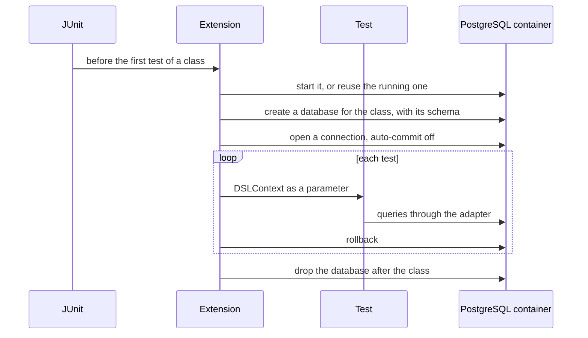

# Testcontainers

Testcontainers starts a real service in Docker for a test, such as PostgreSQL or Meilisearch, and hands the test a
client connected to it. DrinkIt tests each adapter this way, against the technology it runs on, never against an
in-memory substitute. A test asks for its service with an annotation, such as `@JooqIntegrationTest`, that starts
the container, keeps the tests apart and builds the client the test receives. These tests run with the others in
`./gradlew build`, on a laptop as in CI, and fail when Docker is not running. Their containers stay up between runs,
as [shown below](#one-container-for-every-run). Read this page before you test an adapter or bring a new technology
into the tests.

## 🧭 The idea

The bugs of an adapter hide in how it talks to its technology: the SQL, the locks and constraints it relies on, the
ranking of a search engine. A substitute, such as H2 in place of PostgreSQL or a mock of the client, accepts what the real service
refuses, and the bug shows in production. Testcontainers removes the substitute. It is a library that drives Docker
from the test: it pulls the image, starts a container on a free port, waits until the service accepts connections,
and by default removes the container at the end. The test talks to the real service, with nothing installed but
Docker.

Any service that has a Docker image fits: a database, a cache such as Redis, a document store such as MongoDB, a
search engine such as Elasticsearch or Meilisearch, a message broker. The price is Docker on every machine that runs
the tests, and a few seconds to start each container, which DrinkIt pays once per machine.

These tests check one adapter at a time, the integration tests of the test pyramid. The use cases that call the
adapters are tested with
[test doubles](testdouble.md), in memory. Both kinds of test meet in the test contract of a port, one suite of tests
that the adapter and its in-memory double both pass.

## 🏷️ One annotation per technology

A JUnit extension does the work: it starts the container, isolates each test class and passes the client to the
tests, as the diagram of the PostgreSQL section shows. The annotation carries the extension through `@ExtendWith`, so that a test
declares the service it needs and none of the setup:

```kotlin
@JooqIntegrationTest(schemas = [DrinkitApplication::class])
internal class JooqExchangeRatesTest : ExchangeRatesTestContract() {

    private lateinit var dsl: DSLContext

    @BeforeEach
    fun setup(dsl: DSLContext) {
        this.dsl = dsl
    }

    // ...
}
```

The annotation and its extension live in the test fixtures of the [tech starter](../../architecture/tech-starters.md)
that brings the technology, so that every module testing with that technology reuses them.

| Annotation | Service | The test receives | Isolation | Tech starter |
|---|---|---|---|---|
| `@JooqIntegrationTest` | PostgreSQL | a jOOQ `DSLContext`, or a JDBC `Connection` for plain SQL | a database per test class, each test rolled back | `postgresql-starter` |
| `@MeilisearchIntegrationTest` | Meilisearch | the Meilisearch `Client` | every index deleted after the class | `search-engine-starter` |

## 🐘 PostgreSQL, with `@JooqIntegrationTest`

Each test class gets a database of its own. The extension opens the connection with auto-commit off, so that each
test runs in one transaction, rolled back after it, and never sees the rows of another:



A module that applies the `jooq-codegen-convention` plugin of the [build](../../build-and-data/build-tool.md) gets
the annotation in its tests.

The extension builds the schema of the test database from the jOOQ classes named in `schemas`, such as
`DrinkitApplication` for the PostgreSQL schema `drinkit_application`. These classes are generated from the database
and committed with the code, and the extension never reads the Liquibase changelogs. A schema change reaches the
tests once the jOOQ classes are regenerated from its changelog, as the
[database page](../../build-and-data/database.md#integration-tests) explains. No test runs the changelogs themselves
against PostgreSQL yet.

Every test of a jOOQ adapter carries the annotation: the
[architecture test](architecture-tests.md) `tests.jooq-adapter-test-is-integration-test` fails the build otherwise,
so that no adapter is tested against a substitute. The test also extends the test contract of its port, which the
in-memory double passes too, so that the double cannot drift from the adapter, as the [test doubles](testdouble.md)
page explains.

## 🔎 Meilisearch, with `@MeilisearchIntegrationTest`

Meilisearch is the search engine that `search-engine-starter` brings. It has no transaction to roll back, so the tests
of a class share the same indexes, and the extension deletes every index after the class. No adapter of the application
uses Meilisearch yet: only the test of the extension runs it.

## ♻️ One container for every run

Starting PostgreSQL takes seconds, so the extensions start a container once per machine, not once per test class.
Each container is marked reusable, a Testcontainers feature still labelled experimental. Testcontainers reads the
`testcontainers.reuse.enable` switch only from the machine, never from the project, so the extensions write it into
your `~/.testcontainers.properties` the first time they run on a machine. The first test class starts the container, and every later class
and every later run finds it running and reuses it. Isolation comes from the database or the indexes of each class,
not from a container per class.

The container outlives the run: `docker ps` still lists it after the tests. Stop it to get the memory back, and the
next run starts a new one.

Each extension holds a copy of the image tag of `deployment/local/compose.yml`, so that the tests and the local
environment run the same version of the service. Renovate updates both copies.

## ➕ A new technology

A new technology comes with its tech starter, and the starter's test fixtures bring an extension and its annotation of
the same shape, so that no module writes its own setup: a reusable container, an isolated space per test class, the
client passed to the tests.
Testcontainers has a module for most services, such as its [PostgreSQL module][postgres-module], and the community
publishes others, such as the [Meilisearch module][meilisearch-module]. The
[`new-backend-tech-starter` skill][starter-skill] gives the layout of a starter's test fixtures.

## 📚 Sources

- [What is Testcontainers, and why should you use it?](https://testcontainers.com/guides/introducing-testcontainers/), Testcontainers
- [The Practical Test Pyramid](https://martinfowler.com/articles/practical-test-pyramid.html), Ham Vocke
- [Declarative Extension Registration](https://docs.junit.org/current/extensions/registering-extensions.html#registration-declarative), JUnit User Guide
- [Reusable Containers](https://java.testcontainers.org/features/reuse/), Testcontainers for Java
- [PostgreSQL module][postgres-module], Testcontainers for Java
- [Meilisearch module][meilisearch-module], Testcontainers community modules

[postgres-module]: https://java.testcontainers.org/modules/databases/postgres/
[meilisearch-module]: https://testcontainers.com/modules/meilisearch/
[starter-skill]: https://github.com/mboisnard/drinkit/blob/master/.claude/skills/new-backend-tech-starter/SKILL.md
