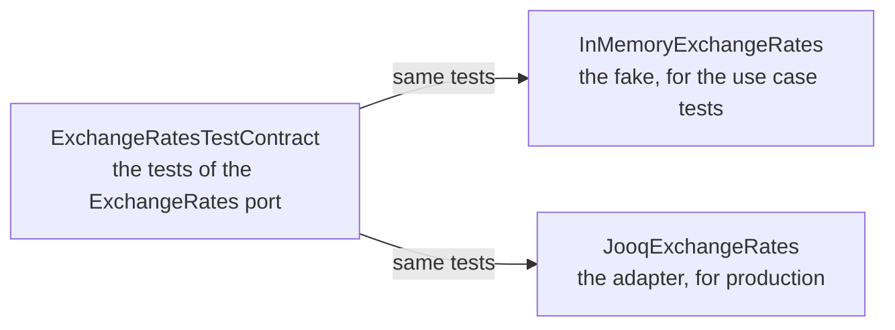

# Test doubles

A test double stands in for a dependency of the code under test. DrinkIt tests its use cases with in-memory fakes of
their ports, the interfaces through which a use case reaches the outside, never with a mocking library. A test
contract, one suite of tests that the fake and the production adapter both pass, keeps them alike, so that a use case
behaves in its test as it does in production. Read this page before you add a port, a double or a use case test.

## 🧭 The pattern

A mock checks the calls the code makes, so a refactoring that keeps the behavior but changes the calls breaks its test.
Its answers are what the test's author believes the dependency returns. A fake is a working implementation with a
shortcut, such as a map in place of a database. A test with a fake checks the result and the state, and fails only
when the behavior changes.

A fake can drift from the real implementation, and the tests then pass on a behavior production does not have. A test
contract prevents it: one suite of tests, written against the interface, runs against the fake and against the real
implementation.

## 🧩 Testing the application piece by piece

A use case test runs the use case with in-memory doubles of its ports: no Spring, no Docker, a few milliseconds. An
adapter test runs the adapter against the real technology, which [Testcontainers](testcontainers.md) starts. The
[hexagonal architecture](../../architecture/hexagonal-architecture.md) makes the split possible: a use case only knows
its ports, so a test plugs a double where production plugs an adapter.

DrinkIt has no end-to-end test that starts the whole application: such tests start slowly and fail for reasons far
from the change, which is why the test pyramid keeps them few. What this leaves untested is the wiring: no test starts
the Spring context or calls a controller yet, so a missing bean shows only when the application starts.

## 🔁 A double kept in line by its test contract

The tests of a port, such as `ExchangeRates`, which stores the currency exchange rates, are written once, in an
abstract `ExchangeRatesTestContract`. The test of the fake and the test of the jOOQ adapter both extend it:



When the adapter gains a behavior, write it into the contract first: the fake fails until it does the same. The
[architecture test](architecture-tests.md) `tests.port-has-test-contract` fails the build when a port has no contract,
or when its fake or its adapter does not run it. The ports written before this rule are tolerated until
[#464](https://github.com/mboisnard/drinkit/issues/464) gives them a contract.

## 🧰 A use case test

The doubles live in `src/testFixtures`, so that the tests of every module reuse them. A fixtures class, such as
`UserFixtures`, builds the use cases of a bounded context with their doubles, and a test takes its doubles from it,
never builds its own. Doubles share instances: `InMemoryUserEvents` saves each user into the `InMemoryUsers` that the
fixtures class gives it, and a second `InMemoryUsers` built by the test would stay empty. The test calls the use case,
then checks its result and the state of the doubles, here a store of tokens and a spy that records the notifications:

```kotlin
private val userFixtures = UserFixtures()
private val sendVerificationToken = userFixtures.sendVerificationToken
private val verificationTokens = userFixtures.verificationTokens
private val spyNotificationSender = userFixtures.spyNotificationSender

@Test
fun `save verification token for a new registered user and send a notification`() {
    val user = userFixtures.givenAnInitializedUser()
    val command = SendVerificationTokenCommand(author = user.id.toConnectedAuthor(), locale = Locale.FRANCE)

    val result = sendVerificationToken.invoke(user.id, command)

    val token = result.shouldBeInstanceOf<Success>().token
    verificationTokens.findBy(user.id, token.value).shouldNotBeNull()
    spyNotificationSender.count() shouldBe 1
}
```

## 📚 Sources

- [Test Double](https://martinfowler.com/bliki/TestDouble.html), Martin Fowler
- [Mocks Aren't Stubs](https://martinfowler.com/articles/mocksArentStubs.html), Martin Fowler
- [Test Doubles](https://abseil.io/resources/swe-book/html/ch13.html), Software Engineering at Google, chapter 13
- [Getting Started with Contract Tests](https://blog.thecodewhisperer.com/permalink/getting-started-with-contract-tests), J. B. Rainsberger
- [The Practical Test Pyramid](https://martinfowler.com/articles/practical-test-pyramid.html), Ham Vocke
