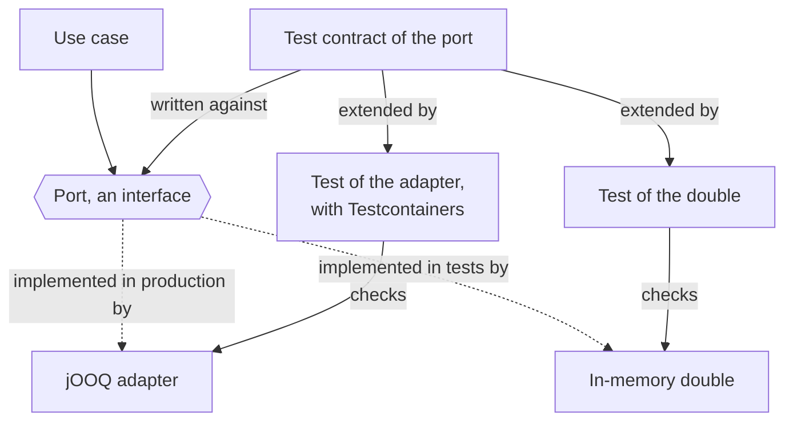

# Test doubles

A test double stands in for a dependency of the code under test. DrinkIt tests its use cases with hand-written
doubles of their ports, the interfaces through which a use case reaches the outside, never with a mocking library: a
test checks what the use case does, such as the state it leaves or the email it sends, not which calls it makes. An
in-memory double and the production adapter of a port pass the same test contract, one suite of tests written against
the port, so that a use case behaves in its test as it does in production. Read this page before you add a port, a double or a use case test.

## 🧭 The pattern

Gerard Meszaros named the kinds of double, and Martin Fowler sums them up: a stub returns canned answers, a spy also
records how it was called, a mock checks that it receives the calls it expects, and a fake is a working
implementation with a shortcut, such as a map in place of a database.

A mock and a fake test different things. A test with a mock lists the calls the code must make, so a refactoring
that keeps the behavior but changes the calls breaks it. The answers a mock returns are what the test's author
believes the dependency returns, and the real dependency may answer otherwise. A test with a fake checks the result and the state, as a
caller would see them: it survives a refactoring and fails when the behavior changes. Software Engineering at Google
ranks the options in that order: the real implementation when it is fast and deterministic, a fake otherwise, a mock
last.

A fake has a risk of its own: it drifts from the real implementation, and the tests pass on a behavior production does
not have. A test contract guards against it. One suite of tests, written against the interface, runs against the fake
and against the real implementation, so that both answer alike on every behavior it covers.

## 🧩 Testing the application piece by piece

DrinkIt tests its application in pieces. A use case test calls the use case with in-memory doubles of its ports: no
Spring, no Docker, a few milliseconds. An adapter test builds the adapter without Spring and runs it against the real
technology, which [Testcontainers](testcontainers.md) starts. No test starts the whole application with its database
and its services: such end-to-end tests start slowly and fail for reasons far from the change, which is why the test
pyramid keeps them to a minimum.

The [hexagonal architecture](../../architecture/hexagonal-architecture.md) makes the split possible. A use case only
knows its port, so a test plugs a double where production plugs an adapter. The test contract, an abstract test class,
holds the tests of the port once, and the test of each implementation extends it:



What the pieces leave out is the wiring. No test starts the Spring context or calls a controller yet, so a missing
bean shows only when the application starts.

## 🔁 A double kept in line by its test contract

The behavior of a port is written once, in an abstract `<Port>TestContract`. It lives in the `src/testFixtures` of
`drinkit-domain`, the module of the ports, a source set that the tests of the other modules can depend on. It holds the
tests and one abstract method that returns the implementation to test:

```kotlin
abstract class ExchangeRatesTestContract {

    abstract fun fetchRepository(): ExchangeRates

    @Test
    fun `save an exchange rate and find it`() {
        // ...
    }
}

internal class InMemoryExchangeRatesTest : ExchangeRatesTestContract() {

    override fun fetchRepository(): ExchangeRates = InMemoryExchangeRates()
}
```

The adapter's test, `JooqExchangeRatesTest`, extends the same contract against PostgreSQL, as the
[Testcontainers](testcontainers.md#one-annotation-per-technology) page shows. When the adapter gains a behavior, write
it into the contract first: the test of the double then fails until the double does the same.

The [architecture test](architecture-tests.md) `tests.port-has-test-contract` fails the build when a port has no
contract, or when no double or no adapter extends it. The ports written before the rule are tolerated until
[#464](https://github.com/mboisnard/drinkit/issues/464) gives them their contract.

## 🏷️ The doubles of DrinkIt

The dependencies of a use case are ports of DrinkIt or plain JDK types such as `Clock`, so a hand-written double can
always replace them. The architecture test `tests.no-mocking-library` refuses Mockito and MockK. A double lives in `src/testFixtures`, so
that the tests of every module reuse it, and its prefix says what a test can check on it. A
[tech starter](../../architecture/tech-starters.md) ships a double of the port it brings, such as the spy of
`messaging-starter` for [platform events](../../architecture/platform-events.md).

| Prefix | Kind | What it does | Example |
|---|---|---|---|
| `InMemory` | Fake | Keeps its data in a map and answers as the adapter does | `InMemoryUsers` |
| `Spy` | Spy | Records what leaves the application, an email or an event, since sending it is the behavior | `SpyPlatformEventPublisher` |
| `Fake` | Stub | Returns what the test sets, or values the test can predict, such as ids numbered in order | `FakeGenerateId` |

A test never reads the system clock or an unseeded random, so that it gives the same result on every run. The
`test-starter` tech starter brings `ControlledClock`, a `java.time.Clock` that a test freezes and moves forward, and
`ControlledRandom`, a seeded random that the [randomization](randomization.md) page covers.

## 🧰 A use case test

A fixtures class of the test fixtures, such as `UserFixtures`, builds the use cases of a bounded context with their
doubles, so that every test gets them wired the same way. Its `given` functions put the doubles in a starting state,
such as an existing user. A test calls the use case, then reads back the same doubles to check the state it left:

```kotlin
internal class SendVerificationTokenTest {

    private val userFixtures = UserFixtures()
    private val sendVerificationToken = userFixtures.sendVerificationToken
    private val verificationTokens = userFixtures.verificationTokens
    private val spyNotificationSender = userFixtures.spyNotificationSender

    @Test
    fun `save verification token for a new registered user and send a notification`() {
        val user = userFixtures.givenAnInitializedUser()
        val command = SendVerificationTokenCommand(author = user.id.toConnectedAuthor(), locale = Locale.FRANCE)

        val result = sendVerificationToken.invoke(user.id, command)

        val token = result.shouldBeInstanceOf<Success>().token
        verificationTokens.findBy(user.id, token.value).shouldNotBeNull()
        spyNotificationSender.count() shouldBe 1
    }
}
```

The [`test-driven-development` skill][tdd-skill], which the [coding agents](../../coding-assistants/skills.md)
follow, gives the order in which a new backend feature is tested: the use case first, with an in-memory double of its
new port, then the port's contract against that double, then the adapter against the same contract.

## 📚 Sources

- [Test Double](https://martinfowler.com/bliki/TestDouble.html), Martin Fowler
- [Mocks Aren't Stubs](https://martinfowler.com/articles/mocksArentStubs.html), Martin Fowler
- [Test Doubles](https://abseil.io/resources/swe-book/html/ch13.html), Software Engineering at Google, chapter 13
- [Getting Started with Contract Tests](https://blog.thecodewhisperer.com/permalink/getting-started-with-contract-tests), J. B. Rainsberger
- [The Practical Test Pyramid](https://martinfowler.com/articles/practical-test-pyramid.html), Ham Vocke

[tdd-skill]: https://github.com/mboisnard/drinkit/blob/master/.claude/skills/test-driven-development/SKILL.md
