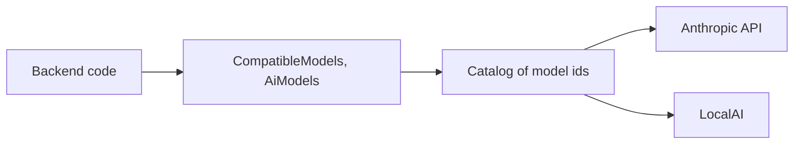
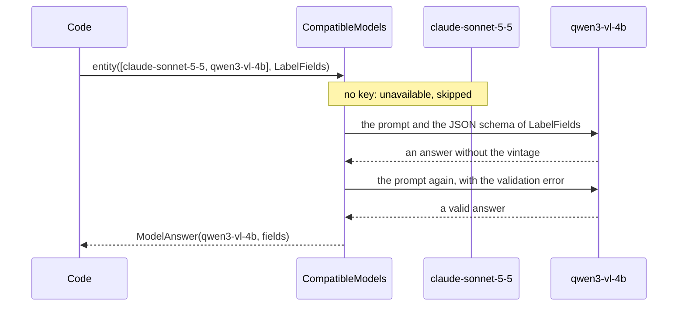

# AI Starter

A [tech starter](https://github.com/mboisnard/drinkit/blob/master/docs/src/engineering/architecture/tech-starters.md)
through which the code asks a language or vision model for an answer, naming the model by its id in a catalog, such
as `qwen3-vl-4b`. Built on [Spring AI](https://docs.spring.io/spring-ai/reference/), it reaches a provider that
speaks the Anthropic or the OpenAI protocol, a frontier API or a [LocalAI](https://localai.io/) server, and moves on
from one model to the next when a call fails.
[ADR 0021](https://github.com/mboisnard/drinkit/blob/master/docs/src/engineering/adr/0021-serve-ai-models-outside-the-application-and-reach-them-through-ai-starter.md)
records why no model runs inside the application.



## How it works

A call lists the models it accepts, in order. The first one that answers wins, and the answer says which one it
was.



## Usage

```kotlin
dependencies {
    implementation(project(":ai-starter"))
}
```

```kotlin
val answer = compatibleModels.entity(listOf("claude-sonnet-5-5", "qwen3-vl-4b"), LabelFields::class) { client ->
    client.prompt()
        .options(ChatOptions.builder().temperature(0.0))
        .user { it.text("Read the fields of this wine label").media(IMAGE_JPEG, ByteArrayResource(photo)) }
}
answer.model // the id of the model that answered
answer.value // a LabelFields

val text = compatibleModels.call(listOf("claude-sonnet-5-5")) { it.prompt().user(question).call().content() }
```

- **A model is available** when the catalog names it and its endpoint has its key, or needs none.
  `aiModels.isAvailable(id)` tells it, and `aiModels.chatClient(id)` gives the Spring AI `ChatClient` of the model for
  any other use.
- **The list is tried in order.** An unavailable model is skipped. A model that fails, whatever the error, hands over
  to the next one, with a warning in the logs: an exception thrown by the code given to `call` counts as a failure of
  the model too. When none answers, `AllModelsFailedException` holds the cause of each model, and its message names
  only the models.
- **A typed answer** is checked against the JSON schema of its type and asked again with the error, three times at
  most. Still invalid, the model fails with `InvalidAnswerException`, which names the field, and the next model is
  asked.
- **A `ChatClientCustomizer` bean** of the application customizes the client of every model, such as to put an
  advisor around each call.
- **Each call is observed** as `gen_ai.client.operation`, with the model, the duration and the tokens, never with the
  text of the prompt or of the answer.
- **Switched off**, the starter makes every model unavailable, so `CompatibleModels` fails at once.

## Configuration

| Property | Default | Environment variable |
|---|---|---|
| `starters.ai.enabled` | `true`, `false` makes every model unavailable | `STARTERS_AI_ENABLED` |
| `starters.ai.endpoints.<endpoint>.provider` | `openai`, the protocol LocalAI speaks too, or `anthropic` | `STARTERS_AI_ENDPOINTS_<ENDPOINT>_PROVIDER` |
| `starters.ai.endpoints.<endpoint>.base-url` | The provider's API. A LocalAI URL ends with `/v1` | `STARTERS_AI_ENDPOINTS_<ENDPOINT>_BASEURL` |
| `starters.ai.endpoints.<endpoint>.api-key` | None: the models of an endpoint without its key are unavailable | `STARTERS_AI_ENDPOINTS_<ENDPOINT>_APIKEY` |
| `starters.ai.endpoints.<endpoint>.api-key-required` | `true`, `false` for a server that asks for none, such as LocalAI | `STARTERS_AI_ENDPOINTS_<ENDPOINT>_APIKEYREQUIRED` |
| `starters.ai.endpoints.<endpoint>.timeout` | `60s`, for each attempt | `STARTERS_AI_ENDPOINTS_<ENDPOINT>_TIMEOUT` |
| `starters.ai.endpoints.<endpoint>.max-retries` | `2`, the attempts the provider's SDK adds before the next model is asked | `STARTERS_AI_ENDPOINTS_<ENDPOINT>_MAXRETRIES` |
| `starters.ai.models.<model>.endpoint` | None, required: an endpoint of `starters.ai.endpoints`, or the application does not start | `STARTERS_AI_MODELS_<MODEL>_ENDPOINT` |
| `starters.ai.models.<model>.name` | The id of the model | `STARTERS_AI_MODELS_<MODEL>_NAME` |

The `application.yml` of `drinkit-backend` declares Claude on the Anthropic API, whose key comes from
`STARTERS_AI_ENDPOINTS_ANTHROPIC_APIKEY`. Its `application-dev.yml` adds the LocalAI of the local compose file and its
vision model.

## Tests

`FakeAiModels`, from `testFixtures(project(":ai-starter"))`, makes available each model a test names, answers what
the test scripts, in order, and records the prompts each model received.

```kotlin
private val aiModels = FakeAiModels()
private val compatibleModels = CompatibleModels(aiModels)

aiModels.model("claude-sonnet-5-5").fails(IllegalStateException("Overloaded"))
aiModels.model("qwen3-vl-4b").answers("""{"producer": "Château Les Trois Chênes", "vintage": 2019}""")
```

## Limits

- An environment variable drops the hyphens of a model id, so the catalog lives in a YAML file, where an id holds
  lowercase letters, digits and hyphens. An id with a dot goes between brackets: `"[qwen3-embedding-0.6b]"`.
- A typed answer is never streamed: its validation needs the whole answer.
- No embedding model yet.
