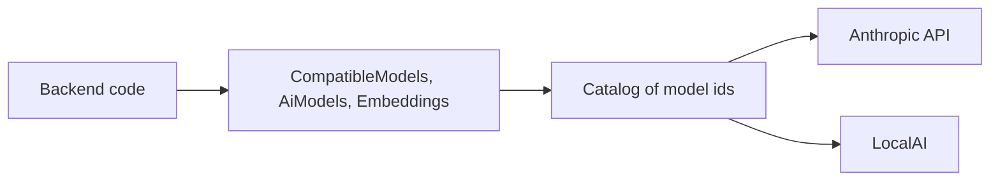
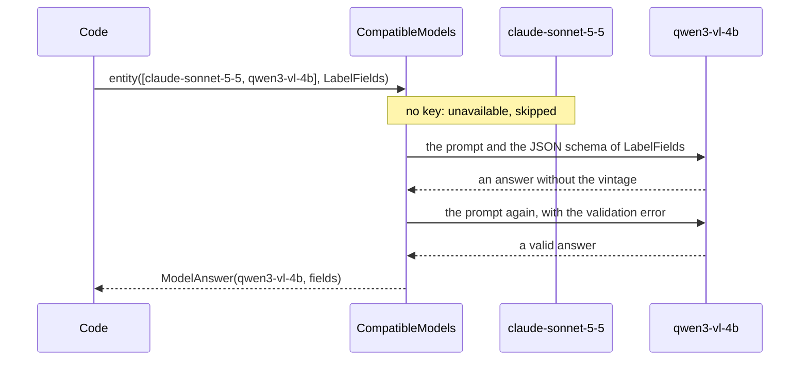

# AI Starter

A [tech starter](https://github.com/mboisnard/drinkit/blob/master/docs/src/engineering/architecture/tech-starters.md)
through which the code asks a language or vision model for an answer, or an embedding model for vectors, naming the
model by its id in a catalog, such as `qwen3-vl-4b`. Built on [Spring AI](https://docs.spring.io/spring-ai/reference/),
it reaches a provider that speaks the Anthropic or the OpenAI protocol, a frontier API or a
[LocalAI](https://localai.io/) server, and moves on from one chat model to the next when a call fails.
[ADR 0021](https://github.com/mboisnard/drinkit/blob/master/docs/src/engineering/adr/0021-serve-ai-models-outside-the-application-and-reach-them-through-ai-starter.md)
records why no model runs inside the application.



## How it works

A call lists the models it accepts, in order. The first one that answers wins, and the answer says which one it
was.



## Usage

```kotlin
dependencies {
    implementation(project(":ai-starter"))
}
```

```kotlin
val answer = compatibleModels.entity(listOf("claude-sonnet-5-5", "qwen3-vl-4b"), LabelFields::class) { client ->
    client.prompt()
        .options(ChatOptions.builder().temperature(0.0))
        .user { it.text("Read the fields of this wine label").media(IMAGE_JPEG, ByteArrayResource(photo)) }
}
answer.model // the id of the model that answered
answer.value // a LabelFields
answer.findings // what the guardrails found without blocking the call

val text = compatibleModels.call(listOf("claude-sonnet-5-5")) { it.prompt().user(question).call().content() }
```

- **A model is available** when the catalog names it and its endpoint has its key, or needs none.
  `aiModels.isAvailable(id)` tells it, and `aiModels.chatClient(id)` gives the Spring AI `ChatClient` of the model for
  any other use.
- **The list is tried in order.** An unavailable model is skipped. A model that fails, whatever the error, hands over
  to the next one, with a warning in the logs: an exception thrown by the code given to `call` counts as a failure of
  the model too. A refusal of the guardrails, an `AiRefusedException`, stops the call at once. When none answers, `AllModelsFailedException` holds the cause of each model, and its message names
  only the models.
- **A typed answer** is checked against the JSON schema of its type and asked again with the error, three times at
  most. Still invalid, the model fails with `InvalidAnswerException`, which names the field, and the next model is
  asked.
- **A `ChatClientBuilderCustomizer` bean** of the application customizes the client of every model, such as to put an
  advisor around each call.
- **Each call is observed** as `gen_ai.client.operation`, with the model, the duration and the tokens, never with the
  text of the prompt or of the answer.
- **Switched off**, the starter makes every model unavailable, so `CompatibleModels` fails at once.

## Embeddings

An embedding model turns a text into a vector, so that a search finds what is close in meaning to a query or to
another document. A model of the catalog that declares its `dimensions` is an embedding model, and the code reaches it
by its id. What text stands for a document, which fields in which order, is the caller's choice.

```kotlin
private const val BOTTLE_SEARCH =
    "Instruct: Given a question about wines, spirits or cocktails, retrieve the matching bottles\nQuery: "

val embeddings = aiModels.embeddings("qwen3-embedding-0.6b")
val vectors = embeddings.embed(bottles.map { it.searchText }) // one request for the whole list
val query = embeddings.embed("un rouge léger pour accompagner un poisson", instruction = BOTTLE_SEARCH)
```

```yaml
starters.ai.models:
  "[qwen3-embedding-0.6b]":
    endpoint: localai
    dimensions: 1024
```

- **No fallback.** The vectors of two models never compare, so a call names one model, and a model change means
  computing every stored vector again.
- **The instruction belongs to the use case**: it goes as is before each text, in the format of the model. Qwen3
  wants `Instruct: <task>\nQuery: ` before a query and nothing before a document.
- **The personal data of each text is masked** before it leaves, as in a prompt, never the instruction. An answer
  whose vectors are not one per text, each of `dimensions` floats, fails.
- **An endpoint of the Anthropic protocol serves no embedding**: an embedding model declared on one stops the
  application at startup.

## Guardrails

An advisor checks each call of every model in the catalog against groups of rules drawn from the
[OWASP Top 10 for LLM applications](https://genai.owasp.org/llm-top-10/). Before the call, it masks the personal data
of the user message, the kinds the `pii` group looks for, then runs the groups that read the prompt. After it, the
groups that read the answer. Each finding is logged, and traced under `gen_ai.ai_starter.guardrails.*`, with its
group, rule and threat level, never with the text. A group that finds a threat at its `block-at` level throws
`GuardrailBlockedException`: the model is not called, or its answer is dropped, and no other model is asked.

| Group | Reads | Finds | By default |
|---|---|---|---|
| `injection` | user message | an order to ignore the instructions, a fake system message, a request for the system prompt, a jailbreak, a role play | blocks at `HIGH` |
| `obfuscation` | user message | base64, hex, unicode escapes, HTML entities, invisible characters, a closing delimiter, rot13, a markdown image | blocks at `HIGH` |
| `secret` | system prompt | an API key, a bearer token, a password | blocks at `HIGH` |
| `output` | answer | a script, SQL, a shell command, a markdown image, a URL that carries a secret | observes |
| `pii` | answer | an IBAN, a card number that passes its checksum, a French social security number, an email, a phone number | observes |
| `leak` | answer | an answer close to the system prompt | blocks at `HIGH` |
| `finish` | answer | a content filter or a refusal of the provider, an answer cut short | observes |

Text from a user, a label or a web page enters a prompt through `UntrustedText.of(text)`, in three steps:

1. **Normalize** to NFKC, so that a fullwidth `＜` or a ligature reads as the rules and the escaping expect.
2. **Remove the invisible characters**, such as a zero-width space that splits an instruction, keeping line breaks
   and tabs.
3. **Escape** `&`, `<` and `>`, so that the text cannot close its tags.

`delimited()` then wraps it in `<untrusted_input>` tags, and the advisor tells the model, in the system prompt, that
this text is data.

```kotlin
client.prompt()
    .system("Read the fields of this wine label.")
    .user("The label reads ${UntrustedText.of(labelText).delimited()}")
```

- **A group of the application** is a `BeforeCallGuardrail` or `AfterCallGuardrail` bean. It runs with the others
  and takes its settings by its `name`. `GuardrailRules` builds one from a table of rules.
- **A bean named after a group**, such as `injectionGuardrail`, replaces the group of the starter.
- **An advisor of the application** goes through a `ChatClientBuilderCustomizer`, and `AiAdvisorOrder` places it
  around those of the starter.
- **A group or a rule** is switched off by configuration. The class of each group lists its rules, and a finding
  names its rule in the logs.
- **A finding that did not block** reaches the code in `ModelAnswer.findings`, so that a feature decides what to do
  with an observed threat. A call made outside `CompatibleModels` collects them by passing a `GuardrailFindings`:
  `prompt().advisors { it.param(GuardrailFindings.KEY, findings) }`.

## Token budget

With `rate-limit-starter` and `security-starter` in the application, each call of a signed-in user counts against
a budget of tokens per hour. The call reserves an estimate first: a quarter of the prompt's characters, plus its
`maxTokens`, or 1 024. Once answered, it pays the tokens it used beyond the estimate. A user over budget gets
`TokenBudgetExceededException`, whose `retryAfter` gives the `Retry-After` of a 429. A call made outside a request,
such as by a job, has no budget.

## Configuration

| Property | Default | Environment variable |
|---|---|---|
| `starters.ai.enabled` | `true`, `false` makes every model unavailable | `STARTERS_AI_ENABLED` |
| `starters.ai.endpoints.<endpoint>.provider` | `openai`, the protocol LocalAI speaks too, or `anthropic` | `STARTERS_AI_ENDPOINTS_<ENDPOINT>_PROVIDER` |
| `starters.ai.endpoints.<endpoint>.base-url` | The provider's API. A LocalAI URL ends with `/v1` | `STARTERS_AI_ENDPOINTS_<ENDPOINT>_BASEURL` |
| `starters.ai.endpoints.<endpoint>.api-key` | None: the models of an endpoint without its key are unavailable | `STARTERS_AI_ENDPOINTS_<ENDPOINT>_APIKEY` |
| `starters.ai.endpoints.<endpoint>.api-key-required` | `true`, `false` for a server that asks for none, such as LocalAI | `STARTERS_AI_ENDPOINTS_<ENDPOINT>_APIKEYREQUIRED` |
| `starters.ai.endpoints.<endpoint>.timeout` | `60s`, for each attempt | `STARTERS_AI_ENDPOINTS_<ENDPOINT>_TIMEOUT` |
| `starters.ai.endpoints.<endpoint>.max-retries` | `2`, the attempts the provider's SDK adds before the next model is asked | `STARTERS_AI_ENDPOINTS_<ENDPOINT>_MAXRETRIES` |
| `starters.ai.models.<model>.endpoint` | None, required: an endpoint of `starters.ai.endpoints`, or the application does not start | `STARTERS_AI_MODELS_<MODEL>_ENDPOINT` |
| `starters.ai.models.<model>.name` | The id of the model | `STARTERS_AI_MODELS_<MODEL>_NAME` |
| `starters.ai.models.<model>.dimensions` | None: a chat model. The size of the vectors of an embedding model | `STARTERS_AI_MODELS_<MODEL>_DIMENSIONS` |
| `starters.ai.guardrails.enabled` | `true`, `false` checks nothing, and leaves the token budget on | `STARTERS_AI_GUARDRAILS_ENABLED` |
| `starters.ai.guardrails.groups.<group>.enabled` | `true` | `STARTERS_AI_GUARDRAILS_GROUPS_<GROUP>_ENABLED` |
| `starters.ai.guardrails.groups.<group>.block-at` | `HIGH` for `injection`, `obfuscation`, `secret` and `leak`, `NONE` for the others, which only observes | `STARTERS_AI_GUARDRAILS_GROUPS_<GROUP>_BLOCKAT` |
| `starters.ai.guardrails.groups.<group>.disabled-rules` | None, the names of the rules to skip | `STARTERS_AI_GUARDRAILS_GROUPS_<GROUP>_DISABLEDRULES` |
| `starters.ai.guardrails.token-budget.enabled` | `true` | `STARTERS_AI_GUARDRAILS_TOKENBUDGET_ENABLED` |
| `starters.ai.guardrails.token-budget.tokens-per-hour` | `100000`, for each user | `STARTERS_AI_GUARDRAILS_TOKENBUDGET_TOKENSPERHOUR` |

The `application.yml` of `drinkit-backend` declares Claude on the Anthropic API, whose key comes from
`STARTERS_AI_ENDPOINTS_ANTHROPIC_APIKEY`. Its `application-dev.yml` adds the LocalAI of the local compose file and its
vision model.

## Tests

`FakeAiModels`, from `testFixtures(project(":ai-starter"))`, makes available each model a test names, answers what
the test scripts, in order, and records the prompts each model received.

```kotlin
private val aiModels = FakeAiModels()
private val compatibleModels = CompatibleModels(aiModels)

aiModels.model("claude-sonnet-5-5").fails(IllegalStateException("Overloaded"))
aiModels.model("qwen3-vl-4b").answers("""{"producer": "Château Les Trois Chênes", "vintage": 2019}""")
```

An embedding model gives the vector a test scripts for each text as the model receives it, after its instruction,
and records those texts in `texts`:

```kotlin
aiModels.embeddingModel("qwen3-embedding-0.6b").embeds("Pommard 2019", floatArrayOf(0.1f, 0.2f, 0.3f))
```

`FakeAiModels` runs no guardrail: a test scripts a refusal with
`fails(GuardrailBlockedException(listOf(Finding("injection", "instruction-override", HIGH))))`, or an answer that
used many tokens with `answers(answer, tokens = 2_000)`. `LocalModelEvaluationTest` sends the attacks of the
evaluation set to a real model, and logs how many leak a canary of the system prompt. It runs when
`AI_EVALUATION_BASE_URL` is set, such as `http://localhost:8083/v1` for the LocalAI of compose, as does
`LocalEmbeddingsEvaluationTest`, which logs how close a query lands to two bottles.

## Limits

- An environment variable drops the hyphens of a model id, so the catalog lives in a YAML file, where an id holds
  lowercase letters, digits and hyphens. An id with a dot goes between brackets: `"[qwen3-embedding-0.6b]"`.
- A typed answer is never streamed: its validation needs the whole answer.
- An embedding goes through no guardrail group and no token budget: only its personal data is masked.
- LocalAI reports no token usage for an embedding, which the OpenAI SDK requires, so the starter adds an empty one
  and its trace counts none. To find out, the starter reads each embedding answer of an OpenAI-protocol endpoint
  whole and writes it again, whatever the provider.
- The guardrails match known patterns: a reworded attack goes through. They lower the risk, and the code still
  treats an answer as untrusted.
- A streamed call, and the result of a tool the model calls, go through no guardrail.
- A group that throws is skipped, with an error in the logs: a broken rule never stops a feature.
- Only the last user message is masked: a system message, or an earlier turn of a conversation, leaves as written.
  The masking runs whatever the settings of the `pii` group.
- The estimate a call reserves is never given back when the answer used less, so short answers spend the budget
  faster than the tokens they used. The tokens an answer used beyond its estimate go uncharged when they exceed what
  the budget has left.
