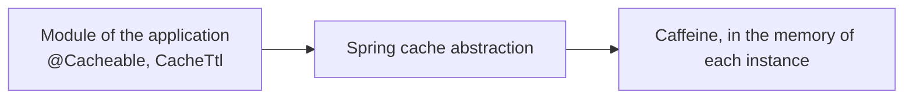

# Cache Starter

A [tech starter](https://github.com/mboisnard/drinkit/blob/master/docs/src/engineering/architecture/tech-starters.md)
that turns on Spring's `@Cacheable` and `@CacheEvict` and keeps the entries in memory with
[Caffeine](https://github.com/ben-manes/caffeine), each cache with a time to live. Spring's default cache never
expires an entry.
[ADR 0007](https://github.com/mboisnard/drinkit/blob/master/docs/src/engineering/adr/0007-cache-through-spring-on-caffeine.md)
says why.



## Usage

A module declares the starter in its build file:

```kotlin
dependencies {
    implementation(project(":cache-starter"))
}
```

```kotlin
@Cacheable("exchange-rates", key = "#currency")
fun findRate(currency: Currency): ExchangeRate? = …

@CacheEvict("exchange-rates", key = "#rate.currency")
fun save(rate: ExchangeRate) { … }

@Bean
fun exchangeRatesCacheTtl() = CacheTtl("exchange-rates", Duration.ofHours(1))
```

- **`CacheTtl`**: the module that owns a cache declares its time to live as a `CacheTtl` bean.
- **The time to live of a cache**: `starters.cache.ttl.<cache>` first, then its `CacheTtl`, then
  `starters.cache.default-ttl`.

## Configuration

| Property | Default | Environment variable |
|---|---|---|
| `starters.cache.default-ttl` | `10m` | `STARTERS_CACHE_DEFAULTTTL` |
| `starters.cache.ttl.<cache>` | the `CacheTtl` of the module | `STARTERS_CACHE_TTL_<CACHE>` |
| `starters.cache.maximum-size` | `10000` | `STARTERS_CACHE_MAXIMUMSIZE` |
| `starters.cache.enabled` | `true`, `false` runs every method on each call | `STARTERS_CACHE_ENABLED` |

## Tests

`ControlledTicker`, from `testFixtures(project(":cache-starter"))`, declared as a bean, moves the time of the
caches forward so that a test never waits for an entry to expire.

## Limits

- Each instance keeps its own entries, and an eviction reaches only the instance that made it. Only cache what may
  be stale for one time to live.
- A call from the same object skips the proxy, so the annotations do nothing. The
  [architecture tests](https://github.com/mboisnard/drinkit/blob/master/docs/src/engineering/writing-code/testing/architecture-tests.md)
  forbid it.
- `STARTERS_CACHE_TTL_<CACHE>` only works for a cache name without a hyphen or a dot. Set the others through
  `SPRING_APPLICATION_JSON`, as in `{"starters.cache.ttl.exchange-rates": "1h"}`.
