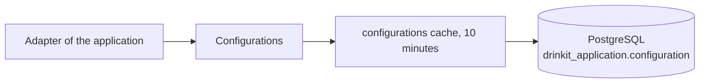

# Configuration Starter

A [tech starter](https://github.com/mboisnard/drinkit/blob/master/docs/src/engineering/architecture/tech-starters.md)
that keeps in PostgreSQL the settings an operator changes without a restart, such as a limit or a switch. A setting
fixed at startup stays a `@ConfigurationProperties` class, and a release to some users goes through the
[feature flags starter](https://github.com/mboisnard/drinkit/blob/master/tech-starters/backend/feature-flags-starter/README.md).



## Usage

A module declares the starter in its build file:

```kotlin
dependencies {
    implementation(project(":configuration-starter"))
}
```

The application declares a `Clock` bean, which dates each write. A key holds the name of its row and its default,
a scalar or a data class stored as JSON:

```kotlin
data class RetryPolicy(val maxAttempts: Int = 3, val delay: Duration = Duration.ofSeconds(1)) {
    init {
        require(maxAttempts in 1..10) { "maxAttempts must be between 1 and 10" }
    }
}

val retryPolicy = configurationKey("partner-api.retry-policy", default = RetryPolicy())

val policy = configurations[retryPolicy]          // the stored value, or RetryPolicy()
configurations[retryPolicy] = RetryPolicy(5)      // inside a transaction only
configurations.reset(retryPolicy)                 // back to the default
```

- **A stored value that cannot be read**, or breaks the `init` rule, is logged at `ERROR` and the default applies.
- **A field missing from the stored JSON** takes its default.
- **An operator changes a value by SQL** while no admin page exists:

```sql
INSERT INTO drinkit_application.configuration (key, value, modified)
VALUES ('partner-api.retry-policy', '{"maxAttempts": 5}', now())
ON CONFLICT (key) DO UPDATE SET value = EXCLUDED.value, modified = EXCLUDED.modified;
```

## Configuration

| Property | Default | Environment variable |
|---|---|---|
| `starters.cache.ttl.configurations` | `10m`, how long an instance serves a value before it reads the table again | `STARTERS_CACHE_TTL_CONFIGURATIONS` |
| `starters.configuration.enabled` | `true`, `false` registers no `Configurations` | `STARTERS_CONFIGURATION_ENABLED` |

## Tests

`InMemoryConfigurations`, from `testFixtures(project(":configuration-starter"))`, replaces `Configurations` in a
unit test.

## Limits

- Never store a secret: whoever reads the database reads the table in clear.
- The key's name identifies its row. A renamed key loses its stored value, and a renamed field needs a changelog, as
  the [database page](https://github.com/mboisnard/drinkit/blob/master/docs/src/engineering/build-and-data/database.md)
  says.
