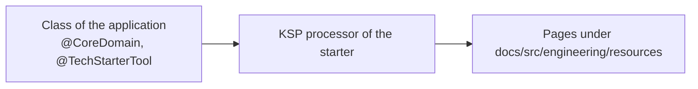

# Documentation Starter

A [tech starter](https://github.com/mboisnard/drinkit/blob/master/docs/src/engineering/architecture/tech-starters.md)
that holds the annotations naming the pattern a class follows, and the KSP processor that writes the
[living documentation](https://github.com/mboisnard/drinkit/blob/master/docs/src/engineering/writing-code/best-practices/living-documentation.md)
from some of them. That page lists the annotations, explains why DrinkIt generates its pages, how to generate them
and when the build requires an annotation. The starter runs at compile time only, so it has no
auto-configuration.



## Usage

No build file declares the starter: the `documentation-convention` plugin, which `library-convention`
and `api-convention` apply, adds it:

```kotlin
dependencies {
    compileOnly(project(":documentation-starter"))
    ksp(project(":documentation-starter"))
}
```

```kotlin
@CoreDomain
data class Cellar(val id: CellarId, val name: CellarName, …)

@TechStarterTool
fun interface EmailSender { … }
```

The processor writes under `docs/src/engineering/resources/`, which is gitignored:

- **`domains/`**: a page per `@CoreDomain`, and the `domains.md` index.
- **`tech-starters/`**: a page per tech starter, its `README.md` followed by an API Reference of its
  `@TechStarterTool` classes, functions and properties, and the `tech-starters.md` index.

## Configuration

No setting.

## Tests

A test needs nothing from this starter.
