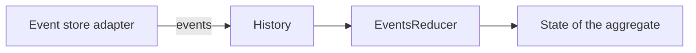

# Event Sourcing Starter

A [tech starter](https://github.com/mboisnard/drinkit/blob/master/docs/src/engineering/architecture/tech-starters.md)
with the building blocks of an event-sourced aggregate: the events, their history and the reducer that folds them
into a state. The
[event sourcing page](https://github.com/mboisnard/drinkit/blob/master/docs/src/engineering/architecture/event-sourcing.md)
explains how DrinkIt applies the pattern. The starter declares no Spring bean.



## Usage

A module that stores an aggregate as events declares the starter in its build file:

```kotlin
dependencies {
    implementation(project(":event-sourcing-starter"))
}
```

It brings `retryable-starter`, which runs the retries of `@RetryableTransactional`.

```kotlin
sealed interface CarEvent : DomainEvent
data class CarCreated(override val sequenceId: SequenceId, val name: String) : CarEvent
data class CarPurchased(override val sequenceId: SequenceId, val owner: String) : CarEvent

data class Car(val name: String, val owner: String? = null) {
    fun apply(event: CarPurchased) = copy(owner = event.owner)
}

val reducer = EventsReducer<Car, CarEvent, CarCreated>(factory = { Car(it.name) })
    .register<CarPurchased>(Car::apply)

val car = reducer.reduce(History.from<CarEvent, CarCreated>(events))
```

[`CarExample.kt`](https://github.com/mboisnard/drinkit/blob/master/tech-starters/backend/event-sourcing-starter/src/test/kotlin/com/drinkit/event/sourcing/CarExample.kt)
holds the whole example. What to know:

- **`History.from`** refuses events whose sequence ids do not strictly increase.
- **`SequenceId.next()`** adds 10, for the
  [gaps between sequence ids](https://github.com/mboisnard/drinkit/blob/master/docs/src/engineering/architecture/event-sourcing.md#gaps-between-sequence-ids).
- **`EventsReducer`** leaves the state as it is for an event type with no handler, unless you pass your own default
  handler. A type registered twice keeps the last handler.
- **`@RetryableTransactional`**, on a use case class, runs it again on `DuplicateSequenceException`, three attempts
  at most, each in a new transaction or a savepoint.

## Configuration

No setting.

## Tests

A test needs nothing from this starter.
