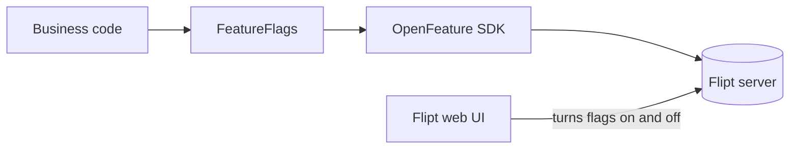

# Feature Flags Starter

A [tech starter](https://github.com/mboisnard/drinkit/blob/master/docs/src/engineering/architecture/tech-starters.md)
that turns a feature on or off at runtime, for everyone or for some users, without a deployment. Business code asks
`FeatureFlags`, and the starter evaluates the flag through [OpenFeature](https://openfeature.dev/) on a
[Flipt](https://flipt.io/) server, whose web UI manages the flags.



## Usage

A module declares the starter in its build file:

```kotlin
dependencies {
    implementation(project(":feature-flags-starter"))
}
```

```kotlin
if (featureFlags.isEnabled("new-checkout-flow")) newCheckoutFlow(cart) else legacyCheckoutFlow(cart)

featureFlags.isEnabledForUser("beta-feature", userId)
featureFlags.isEnabled("new-checkout", FeatureFlagContext(userId = user.id, attributes = mapOf("plan" to "premium")))
```

- **A flag that Flipt does not know**, or cannot evaluate, is off.
- **With Spring Boot Actuator**, `/actuator/health` shows the state of the Flipt provider under `openFeature`.

## Configuration

| Property | Default | Environment variable |
|---|---|---|
| `starters.feature-flags.flipt.url` | None, required | `STARTERS_FEATUREFLAGS_FLIPT_URL` |
| `starters.feature-flags.flipt.namespace` | None, required | `STARTERS_FEATUREFLAGS_FLIPT_NAMESPACE` |

`application-dev.yml` sets both for the Flipt of the local compose file: `http://localhost:8082` and `default`.

## Tests

`InMemoryFeatureFlags`, from `testFixtures(project(":feature-flags-starter"))`, holds flags a test sets, all off
until then, and records each evaluation:

```kotlin
featureFlags.configure("new-checkout-flow", enabled = true)
service.checkout(cart)
featureFlags.wasEvaluated("new-checkout-flow") shouldBe true
```

## Limits

- The starter predates the [convention of the tech starters](https://github.com/mboisnard/drinkit/blob/master/docs/src/engineering/architecture/tech-starters.md):
  the component scan wires it, and it has no `starters.feature-flags.enabled` switch.
- The per-request OpenFeature context is empty for now: pass a `FeatureFlagContext` to target a user.
