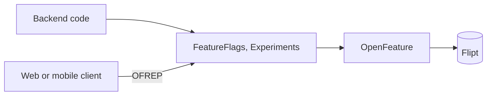
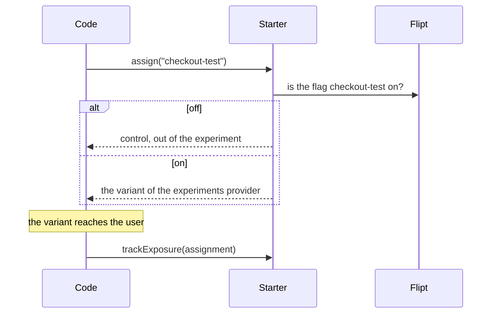

# Feature Management Starter

A [tech starter](https://github.com/mboisnard/drinkit/blob/master/docs/src/engineering/architecture/tech-starters.md)
that turns a feature on or off, for everyone or for some users, and assigns the variants of A/B tests. The code asks
`FeatureFlags` and `Experiments`, which evaluate through [OpenFeature](https://openfeature.dev/), with
[Flipt](https://flipt.io/) as provider. Clients read their flags from the backend over
[OFREP](https://openfeature.dev/docs/reference/other-technologies/ofrep/).



## How it works

An experiment runs behind the Flipt flag of the same key, its gate. The code assigns a variant without side effect,
and reports an exposure only where the variant reaches the user, so that the results count only users who saw theirs.



Until PostHog is wired, no provider draws variants, and exposures go nowhere: every user gets `control`.

## Usage

```kotlin
dependencies {
    implementation(project(":feature-management-starter"))
}
```

```kotlin
if (featureFlags.isEnabled("new-checkout")) newCheckout(cart) else legacyCheckout(cart)
if (featureFlags.isDisabled("new-checkout")) return

// In a platform event handler, outside any request, from the user id the event carries
featureFlags.isEnabled("new-checkout", FlagSubject(event.userId))

val assignment = experiments.assign("checkout-test")
val page = if (assignment.variant == "B") checkoutB() else checkout()
experiments.trackExposure(assignment)

// What a flag may target beyond the roles, such as a plan
@Bean
fun subjectAttributes() = SubjectAttributes { user -> mapOf("plan" to plans.of(user.id)) }
```

- **A flag Flipt does not know**, or a Flipt that does not answer, gives the default of the call, `false` unless
  given.
- **Without a subject**, a flag is evaluated for the signed-in user of the request, with their roles, such as
  `ROLE_ADMIN=true`, and the `SubjectAttributes` of the application, or for the visitor, by id alone. Flipt segments
  target these attributes. Outside a request, the call names its `FlagSubject`.
- **`POST /ofrep/v1/evaluate/flags`** evaluates the keys the client names in its context, `flags` and `experiments`,
  comma separated, for the subject of the request, with an ETag. It asks for the CSRF token like any POST.
- **`POST /experiments/{key}/exposures`** records the exposure a client reports, when its variant is the one the
  backend assigns.
- **Switched off**, the starter answers every flag with its default and every experiment with `control`, and still
  serves both endpoints, so that the code and the clients keep working without Flipt.
- **With Spring Boot Actuator**, `/actuator/health` shows whether Flipt answers.

## Configuration

| Property | Default | Environment variable |
|---|---|---|
| `starters.feature-management.enabled` | `true`, `false` answers every flag with its default and every experiment with `control` | `STARTERS_FEATUREMANAGEMENT_ENABLED` |
| `starters.feature-management.flipt.url` | None, required when enabled | `STARTERS_FEATUREMANAGEMENT_FLIPT_URL` |
| `starters.feature-management.flipt.namespace` | `default` | `STARTERS_FEATUREMANAGEMENT_FLIPT_NAMESPACE` |
| `starters.feature-management.flipt.environment` | Flipt's default environment | `STARTERS_FEATUREMANAGEMENT_FLIPT_ENVIRONMENT` |

`application-dev.yml` points at the Flipt of the local compose file and its `development` environment.

## Tests

`InMemoryFeatureFlags` and `InMemoryExperiments`, from `testFixtures(project(":feature-management-starter"))`, hold
what a test sets and record what the code asked, for the subject they are given as the one of the request. They
answer like the real ones: a flag set off is off whatever the default, an unknown flag gives the default, an
experiment with no variant set gives `control`:

```kotlin
featureFlags.configure("new-checkout", enabled = true)
experiments.assignVariant("checkout-test", "B")
service.checkout(cart)
experiments.exposuresOf("checkout-test").single().variant shouldBe "B"
```

## Limits

- [ADR 0017](https://github.com/mboisnard/drinkit/blob/master/docs/src/engineering/adr/0017-feature-flags-through-openfeature.md)
  and [ADR 0018](https://github.com/mboisnard/drinkit/blob/master/docs/src/engineering/adr/0018-ab-tests-behind-a-flag-with-posthog.md)
  record the choices behind the starter.
- No provider draws variants yet: PostHog waits for DrinkIt's consent management.
- Flipt detects no dead flag.
