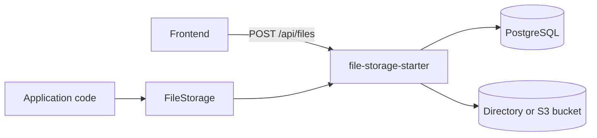
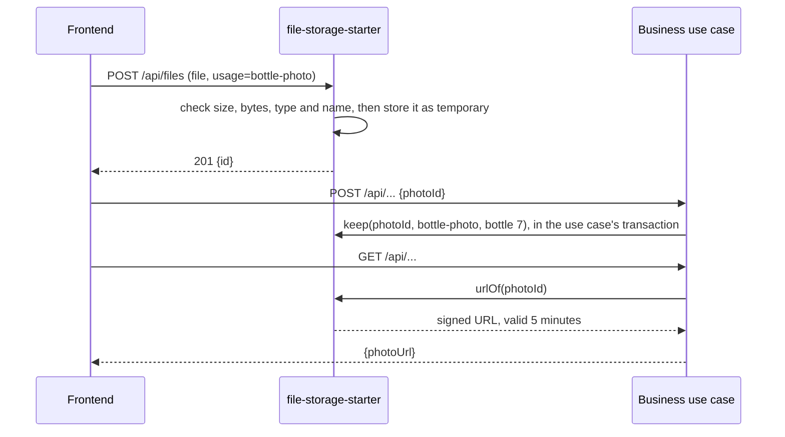
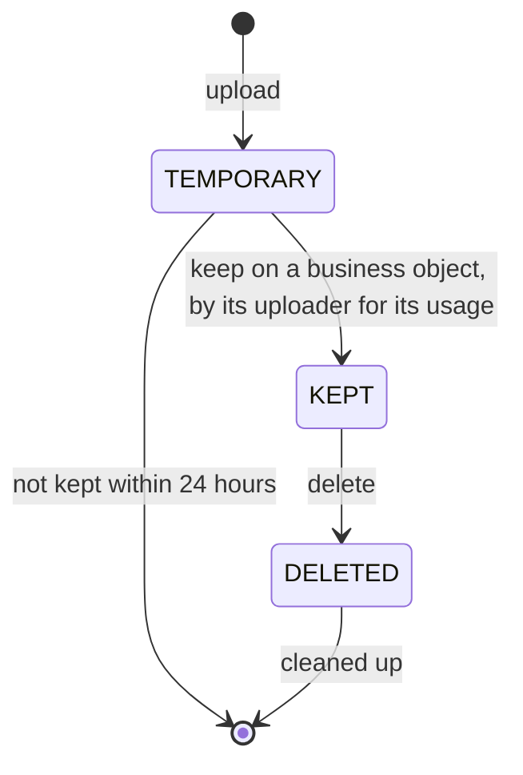
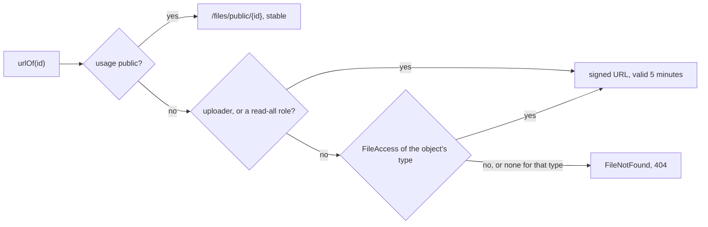

# File Storage Starter

A [tech starter](https://github.com/mboisnard/drinkit/blob/master/docs/src/engineering/architecture/tech-starters.md)
that stores the files users upload, such as bottle photos, or the backend fetches, such as catalog images, on a local
directory or in any S3-compatible bucket. It checks each file, keeps it only when a business use case succeeds, and
lets read it whoever may read the business object it is kept on.
[ADR 0022](https://github.com/mboisnard/drinkit/blob/master/docs/src/engineering/adr/0022-store-uploaded-files-as-temporary-until-a-use-case-keeps-them.md)
explains its design.



## How it works

The frontend uploads a file and gets its id. The business route receives that id, and its use case keeps the file
in its own transaction. A file not kept within 24 hours is deleted.





Each upload checks, before anything is stored, that:

- its user is under the upload limit, 20 per 10 minutes and 200 per day, else 429 with `Retry-After`
- its usage is one the application declares, else 400
- its size is within the usage's, else 413
- the type read from its bytes is one of the usage's, and its extension and declared type match it, else 415.

The type served is always the one read from the bytes, and the file name is kept only as the download name. Each
upload then deletes up to 100 files not kept in time, or deleted.

## Usage

```kotlin
dependencies {
    implementation(project(":file-storage-starter"))
}
```

Declare each usage, with the types and the size it accepts, and whether anyone may read its files:

```yaml
starters.file-storage.usages:
  bottle-photo:
    types: [image/jpeg, image/png, image/webp]
    max-size: 5MB
  avatar:
    types: [image/jpeg, image/png, image/webp]
    max-size: 2MB
    visibility: public
```

The frontend uploads with `uploadFile` of the generated client. The use case keeps the file on its success path
only, next to what it saves:

```kotlin
fun addPhoto(event: Event, photo: FileId) {
    events.save(event.withPhoto(photo))
    fileStorage.keep(photo, "event-photo", FileResource("event", event.id))
}

fun changeAvatar(user: User, avatar: FileId) {
    users.save(user.withAvatar(avatar))
    fileStorage.keep(avatar, "avatar", FileResource("user", user.id))
    user.avatar?.let(fileStorage::delete)
}

fun photoUrl(photo: FileId): URI = fileStorage.urlOf(photo)
```

An importer, outside any request, stores the image it fetched, then keeps it like a use case:

```kotlin
val image = fileStorage.store("catalog-image", "chateau-margaux-2015.jpg", UrlResource(imageUrl))

transactions.executeWithoutResult {
    catalog.save(bottle.withImage(image))
    fileStorage.keep(image, "catalog-image", FileResource("catalog-bottle", bottle.id))
}
```

- **`store`** checks a file as an upload, and commits it as temporary on its own: an import that fails leaves it to
  the cleanup. Call it before the transaction that keeps it, as above: inside one, it holds a second connection of
  the pool. A resource that does not know its size is refused.
- **`keep`** works once, only for the uploader of the file and the usage it was checked for, and only inside a
  transaction: a rollback leaves the file temporary, and so deleted later. It records the object the file belongs to.
- **`delete`** marks a kept file deleted in the caller's transaction, for its uploader or whom its object allows. Its
  bytes go with the next cleanup.
- **`urlOf`** answers a URL to whoever may read the file, as below; **`urlsOf`** answers those of a list, leaving
  out the files the reader may not read.
- **With no signed-in user and outside a request**, in a job or an importer, the backend acts: it owns what it
  stores, and reads and deletes any file. A signed-in user acts wherever their session goes, in a request or not.
- **`FileNotFound`**, answered 404, is the same for an unknown file, someone else's, one of another usage, one not
  kept, one already kept, or one the user may not read or delete.
- A usage that allows a type able to carry a script, such as `image/svg+xml` or `text/html`, stops the application
  at start.

## Who reads a file



The readers of a file are the readers of its object, asked at each `urlOf`: sharing an event with a member shares
its photos at once, and nothing about files changes. One `FileAccess` bean per type of object says who they are,
and who may delete its files beside their uploader. It asks the very rule the use cases of that object ask, never a
copy of it, so that a file is readable exactly when its object is:

```kotlin
@Component
class EventFileAccess(private val events: EventRights) : FileAccess {
    override val resourceType = "event"

    override fun canRead(resourceId: String, readerId: String?) = events.canSee(EventId(resourceId), readerId)

    override fun canDelete(resourceId: String, userId: String?) = events.canEdit(EventId(resourceId), userId)
}
```

`urlsOf` asks each object once, however many of its files the list holds. A type with no `FileAccess` has no other
reader than the uploader and the read-all roles, and no other deleter than the uploader. A public usage's files are
read by anyone, signed in or not, through the starter's `GET /files/public/{id}`, whatever the storage.

## Configuration

| Property | Default | Environment variable |
|---|---|---|
| `starters.file-storage.enabled` | `true` | `STARTERS_FILESTORAGE_ENABLED` |
| `starters.file-storage.provider` | `filesystem`, or `s3` | `STARTERS_FILESTORAGE_PROVIDER` |
| `starters.file-storage.usages.<usage>.types` | None, one usage at least to upload | Set in YAML |
| `starters.file-storage.usages.<usage>.max-size` | `5MB` | Set in YAML |
| `starters.file-storage.usages.<usage>.visibility` | `private`, or `public` | Set in YAML |
| `starters.file-storage.read-all-roles` | `ROLE_ADMIN` | `STARTERS_FILESTORAGE_READALLROLES` |
| `starters.file-storage.temporary-retention` | `24h` | `STARTERS_FILESTORAGE_TEMPORARYRETENTION` |
| `starters.file-storage.url-ttl` | `5m` | `STARTERS_FILESTORAGE_URLTTL` |
| `starters.file-storage.rate-limit.per-ten-minutes` | `20` | `STARTERS_FILESTORAGE_RATELIMIT_PERTENMINUTES` |
| `starters.file-storage.rate-limit.per-day` | `200` | `STARTERS_FILESTORAGE_RATELIMIT_PERDAY` |
| `starters.file-storage.filesystem.directory` | `drinkit-files` in the temporary directory | `STARTERS_FILESTORAGE_FILESYSTEM_DIRECTORY` |
| `starters.file-storage.filesystem.signing-key` | Random at each start, required in production | `STARTERS_FILESTORAGE_FILESYSTEM_SIGNINGKEY` |
| `starters.file-storage.s3.endpoint` | The AWS endpoint of the region | `STARTERS_FILESTORAGE_S3_ENDPOINT` |
| `starters.file-storage.s3.region` | `auto` | `STARTERS_FILESTORAGE_S3_REGION` |
| `starters.file-storage.s3.bucket` | None, required with `s3` | `STARTERS_FILESTORAGE_S3_BUCKET` |
| `starters.file-storage.s3.access-key` | None, required with `s3` | `STARTERS_FILESTORAGE_S3_ACCESSKEY` |
| `starters.file-storage.s3.secret-key` | None, required with `s3` | `STARTERS_FILESTORAGE_S3_SECRETKEY` |

With `filesystem`, the starter serves the signed URLs itself, on `GET /files/{id}`. With `s3`, the bucket stays
private and serves them. The public files go through the application with both, cacheable for a day. The starter also raises Spring's multipart limits to the largest usage, unless the
application sets its own.

For a Cloudflare R2 bucket, for example:

```bash
STARTERS_FILESTORAGE_PROVIDER=s3
STARTERS_FILESTORAGE_S3_ENDPOINT=https://<account-id>.r2.cloudflarestorage.com
STARTERS_FILESTORAGE_S3_BUCKET=drinkit-files
STARTERS_FILESTORAGE_S3_ACCESSKEY=...
STARTERS_FILESTORAGE_S3_SECRETKEY=...
```

## Tests

From `testFixtures(project(":file-storage-starter"))`, `InMemoryFileStorage` stands for the starter in a use case
test: `upload(usage)` gives the id the frontend would send, and `resourceOf(id)` the object the use case kept it on.
It checks no reader: the test of a `FileAccess` proves who reads.

```kotlin
val files = InMemoryFileStorage()
val photo = files.upload("event-photo")

addPhoto(event, photo)

files.resourceOf(photo) shouldBe FileResource("event", event.id)
```

`@RustfsIntegrationTest` starts an S3-compatible RustFS container and injects its `S3Server`.

## Limits

- **One instance with `filesystem`.** Every instance must share the directory, and the signing key.
- **A cleanup on upload.** Files not kept are deleted only when someone uploads.
- **A leaked URL** serves its file until it expires, even once the file is deleted or its reader removed from the
  object. Images are never decoded or resized.
- **Types read from the first bytes.** `tika-core` reads an Office document, such as a docx, as `application/zip`:
  a usage that accepts one needs the Tika parsers.
- **A public file stays in caches for a day** after it is deleted, and its bytes go through the application.
- **A bucket serves its own headers.** Its URLs carry the type and the download name, not `nosniff` nor a CSP, so
  they stay on the bucket's origin, never proxied under the application's.
