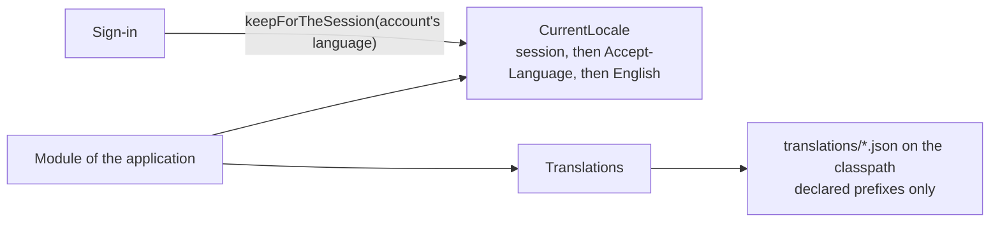

# I18n Starter

A [tech starter](https://github.com/mboisnard/drinkit/blob/master/docs/content/en/1.engineering/2.architecture/6.tech-starters.md)
that writes the backend's texts, such as an email, from the catalog the frontend shares: one flat JSON file of ICU
messages per language, formatted with [ICU4J](https://unicode-org.github.io/icu/userguide/icu4j/), so that a plural
reads the same as in the Nuxt app. It loads only the keys of the prefixes the application declares. It also says
which language the current request reads in.
[ADR 026](https://github.com/mboisnard/drinkit/blob/master/docs/content/en/2.decisions/026-translate-from-one-icu-catalog-the-frontend-and-the-backend-share.md)
says why.



## Usage

```kotlin
dependencies {
    implementation(project(":i18n-starter"))
}
```

```kotlin
val locale = currentLocale.get()
translations.translate("mail.signInCode.body", locale, mapOf("code" to code))

// At sign-in, so that the session reads in the account's language
currentLocale.keepForTheSession(user.preferences.language)
```

- **`Translations`**: the message of a key in the language of a locale, its region ignored, in English when the
  catalog lacks that language, with its values placed by name. A key the catalog lacks fails.
- **`CurrentLocale`**: a language of the catalog, in a request only. The language kept for the session, then the
  first language of `Accept-Language` the catalog holds, then English: a language the catalog lacks is never
  passed on. A text written outside a request takes the locale it was asked in, such as in the event that
  carries it.

The application puts its catalog on the classpath, such as from the root of the repository:

```kotlin
tasks.processResources {
    from(rootProject.layout.projectDirectory.dir("translations")) { into("translations") }
}
```

## Configuration

| Property | Default | Environment variable |
|---|---|---|
| `starters.i18n.enabled` | `true` | `STARTERS_I18N_ENABLED` |
| `starters.i18n.catalog` | `classpath*:translations/*.json`, each file named after its language, `en.json` required | `STARTERS_I18N_CATALOG` |
| `starters.i18n.prefixes` | none, required: such as `[mail]`, the first segment of the keys to load | `STARTERS_I18N_PREFIXES` |

## Tests

From `testFixtures(project(":i18n-starter"))`: `catalogTranslations(prefixes)` reads the catalog of the test classpath,
and `FixedCurrentLocale` answers the language a test gives.

## Limits

- ICU4J and formatjs read the same messages only in the subset ADR 026 names: no date, skeleton nor offset.
