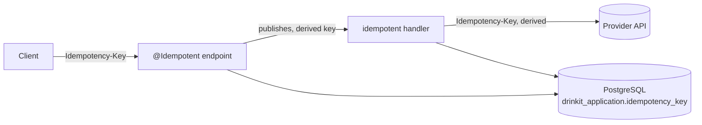
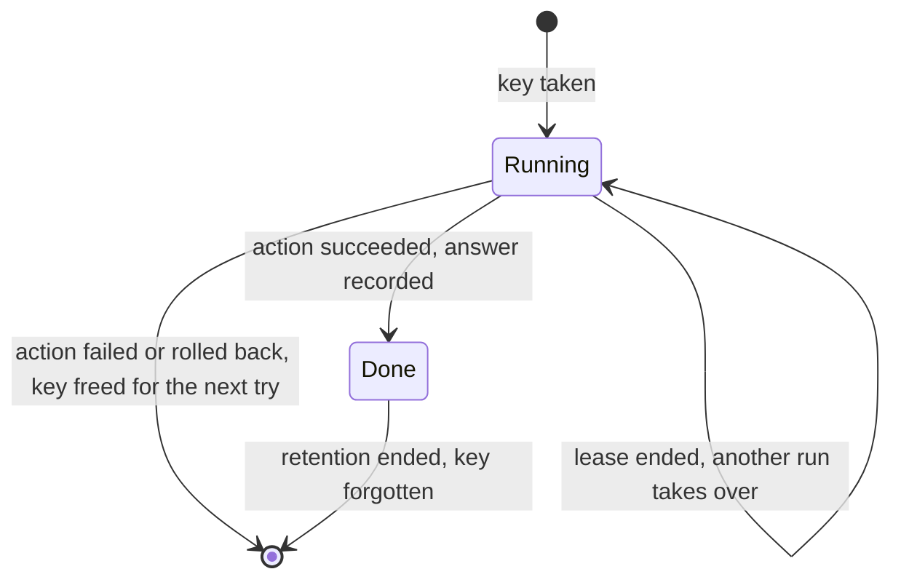
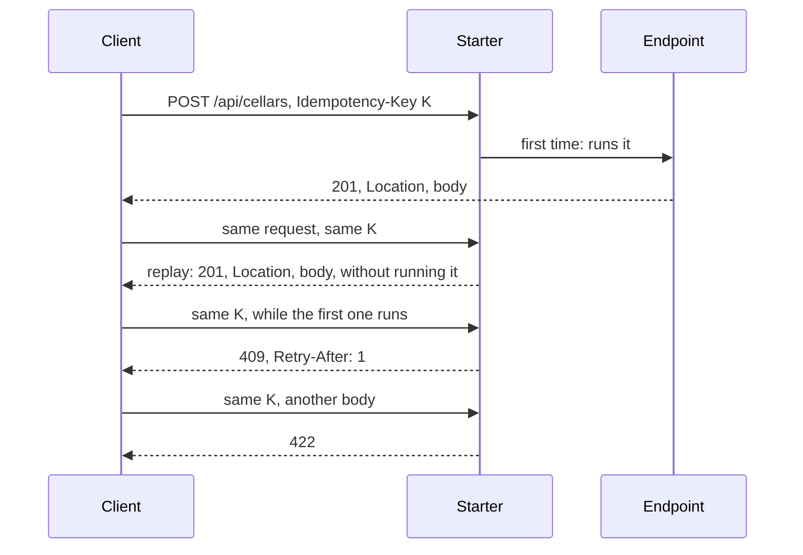
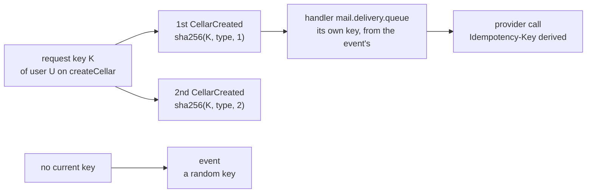

# Idempotency Starter

A [tech starter](https://github.com/mboisnard/drinkit/blob/master/docs/src/engineering/architecture/tech-starters.md)
that runs an action once per key, however many times it is sent:

- **A client retries a request**, after a double click or a timeout: one cellar, not two.
- **A broker delivers an event again**, since delivery is at least once: one welcome email, not two.
- **A request is retried after its commit**, following a server error: the events it publishes again carry the same
  keys, so their handlers skip them, and so do the providers it calls.

It keeps each key in PostgreSQL for 24 hours, with what the first run answered.



## How it works

A key is taken before the action runs, in a transaction of its own, so that every instance sees it. Its holder
keeps it for a lease of 5 minutes. The action then ends in one of three ways:



The answer is recorded in the transaction open around the action, when there is one. An `@Idempotent` endpoint
always runs in one, opened by the starter: the cellar and the answer commit together, so a crash before the commit
leaves neither, and the retry runs again once the lease ends. A run that outlives its lease cannot record its answer
once another run took the key over: it fails, and its writes roll back.

A request sent again with the same key gets one of four answers:



The key of an event follows the key of what published it. A retry of a request, after a server error that came
once its transaction had committed, publishes the same events under the same keys, so its handlers skip them:



## A good key

A key names one action, the same on each of its tries: drawn once by whoever starts the action, or read from the
business data, never from a clock or a random value drawn again on each try.

The email of a sign-in code is the example. Its delivery is keyed by the event that carries the code, so a broker
that delivers it twice sends one email. A second request for a code issues a new code, so a new event and a second
email, which is right: that email holds the code the user now needs. A key built from the email address alone would
drop it.

## Usage

```kotlin
dependencies {
    implementation(project(":idempotency-starter"))
}
```

The application declares a `Clock` bean, which dates the keys.

**An endpoint** gets `@Idempotent` on the method of its controller, the override of the interface generated from
the API contract included, and declares the optional `Idempotency-Key` header in the contract:

```kotlin
@Idempotent
override fun createCellar(createCellarRequest: CreateCellarRequest, idempotencyKey: String?): ResponseEntity<CellarId>
```

- A request without the header runs as before. The client draws one key per action, a UUID, and sends it again on
  each retry of that action.
- The key belongs to the user, or else to the visitor, and to the endpoint: two users never share one.
- A replay gets the status, the `Content-Type`, the `Location` and the body of the first answer, never its cookies.
- The endpoint, its use case included, runs in one transaction with the key. A `5xx`, a `429`, an exception or a
  refusal whose transaction is marked for rollback roll its writes back and free the key: the next try runs again.
- `409` while the first request runs, `422` for a key sent with another method, path or body.
- `400` for a blank key or one over 255 characters, `413` for a body over 64 KB: the fingerprint, of the method,
  path, query string and body, reads at most that much.
- An endpoint answers a body under 64 KB: a larger answer fails, and rolls its writes back.

**A handler** of the messaging starter is idempotent with one attribute:

```kotlin
@PlatformEventHandler("mail.delivery.queue", idempotent = true)
fun deliver(command: SendEmail)

@PlatformEventHandler("order.paid.queue", idempotent = true, idempotencyKey = "#event.orderId")
fun ship(event: OrderPaid)
```

- The key is the delivery's, or the one `idempotencyKey` reads from the event, a SpEL expression on `#event`.
- A delivery that finds its key running on another instance waits for it, without spending an attempt.

**Any other code** calls `Idempotency` itself:

```kotlin
when (val result = idempotency.once(scope = "import.wines", key = fileId) { importWines(file) }) {
    is IdempotentResult.Executed -> result.value
    is IdempotentResult.AlreadyDone -> null
    is IdempotentResult.InFlight -> throw TryLater(result.retryAfter)
    IdempotentResult.Mismatch -> error("Never: no fingerprint given")
}
```

`CurrentIdempotencyKey` holds the key of the request or the event being handled, and `idempotency.key` of the MDC
copies it into the logs.

**A provider** whose API honours `Idempotency-Key` is listed in `starters.webclient.retry.idempotent-groups` of the
web client starter: its `POST`, `PUT`, `PATCH` and `DELETE` then carry a key derived from the current one, and are
retried on a network error.

## Configuration

| Property | Default | Environment variable |
|---|---|---|
| `starters.idempotency.enabled` | `true`, `false` registers no `Idempotency` | `STARTERS_IDEMPOTENCY_ENABLED` |
| `starters.idempotency.retention` | `24h`, how long a key is kept | `STARTERS_IDEMPOTENCY_RETENTION` |
| `starters.idempotency.lease` | `5m`, after which a request or a handler whose instance crashed runs again on the next try | `STARTERS_IDEMPOTENCY_LEASE` |

## Why not a library

[idempotency4j](https://github.com/josipmusa/idempotency4j) 0.6.0, the closest library, failed a spike on DrinkIt,
as [ADR 0019](https://github.com/mboisnard/drinkit/blob/master/docs/src/engineering/adr/0019-run-requests-and-events-once-per-idempotency-key.md)
records. The starter takes its design and keeps what DrinkIt needs:

| | idempotency4j | This starter |
|---|---|---|
| Run once outside HTTP | `IdempotencyEngine`, its `Outcome` | `Idempotency.once`, its `IdempotentResult` |
| Declared on a method | an aspect that proxies the class, which a final Kotlin class refuses | a servlet filter, and an attribute of the handler |
| A key per user | no place for it | the scope holds the user or the visitor and the endpoint |
| Table | `idempotency_records`, outside any schema | `drinkit_application.idempotency_key`, through jOOQ |
| Owner and lease | yes | yes, taken from it |
| Answer committed with the writes | `JOIN_TRANSACTION`, an option | always, for an endpoint |
| Lease renewed while it runs | a heartbeat | a lease long enough for a request or an email |
| Fingerprint | the body | the method, the path, the query string and the body |
| Key carried into events and provider calls | no | `CurrentIdempotencyKey` and its derived keys |
| Purge | `@Scheduled`, on every instance | at each take, until a scheduler exists |

## Tests

`inMemoryIdempotency()`, from `testFixtures(project(":idempotency-starter"))`, keeps the keys in memory. A test of
an idempotent handler without PostgreSQL declares it as its `Idempotency` bean.

## Limits

- A handler that outlives its lease, such as an email held by a slow mail server, may run twice: an email cannot
  roll back.
- A handler outside a transaction that succeeds while the database fails to keep its outcome frees its key: its
  retry runs again.
- The answer of a request stays in clear in the table for 24 hours.
- The current key lives on the thread: code that hands work to another thread passes the key along itself.
