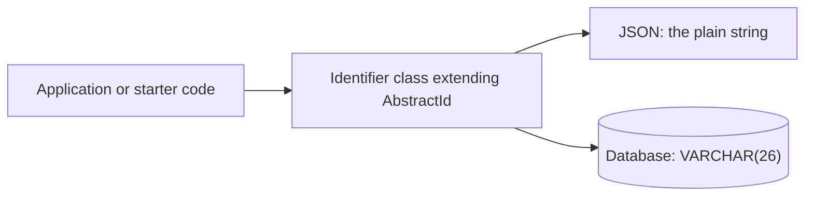

# Identifier Starter

A [tech starter](https://github.com/mboisnard/drinkit/blob/master/docs/content/en/1.engineering/2.architecture/6.tech-starters.md)
that gives every identifier one format: a UUIDv7 written in lowercase Crockford base32, 26 characters such as
`01m86hnx20e6hbrkaydxr834n3`. The same string goes in URLs, logs and the database, sorts by creation time, and is the
suffix of a [TypeID](https://github.com/jetify-com/typeid), so it decodes back into a UUID.
[ADR 028](https://github.com/mboisnard/drinkit/blob/master/docs/content/en/2.decisions/028-draw-identifiers-as-uuidv7-in-crockford-base32-from-identifier-starter.md)
records why.



## Usage

```kotlin
dependencies {
    api(project(":identifier-starter"))
}
```

```kotlin
class CellarId(value: String) : AbstractId(value) {
    companion object : IdFactory<CellarId>(::CellarId)
}

val created = CellarId.create()
val restored = CellarId(record.id)
val requested = CellarId.parseOrNull(pathVariable) ?: throw CellarNotFound()
```

- An identifier class refuses a value of another format, and equals another identifier of the same class and value
  only.
- Its companion `IdFactory` gives `create()`, a new value, and `parseOrNull()`, for a value from a client.
- Jackson writes an identifier as its plain string and reads it back, through `@JsonValue`, with no module.
- The first 10 characters are the creation time in milliseconds, for a person reading the data: a business rule
  reads the date it stored, never the one in an identifier.

## Configuration

No setting.

## Tests

A test that needs any identifier calls `create()`. One that needs a fixed value writes a real one, such as
`01kdvdna00e5mt007j31qpda6g`.
