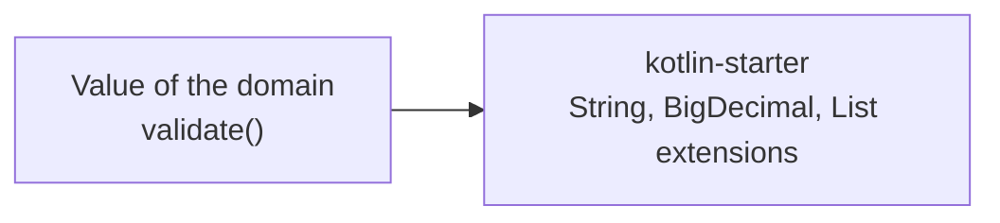

# Kotlin Starter

A [tech starter](https://github.com/mboisnard/drinkit/blob/master/docs/src/engineering/architecture/tech-starters.md)
of plain Kotlin extension functions for the values of the domain: the checks of a name, a password or an email
address, and decimal arithmetic. It also gives its modules kotlin-logging, kotlin-reflect and kotlinx-coroutines. It
has no Spring bean.



## Usage

The `library-convention` and `api-convention` plugins of `build-logic` add the starter. Any other module declares it
in its build file:

```kotlin
dependencies {
    implementation(project(":kotlin-starter"))
}
```

```kotlin
data class CellarName(val value: String) {
    fun validate() = buildList {
        addUnless(value.containsNoInvisibleCharacter(), "Cellar name holds an invisible character, $value")
        addUnless(value.hasLengthBetween(1, MAX_CELLAR_NAME_LENGTH), "Cellar name is too long, $value")
    }
}
```

- **`containsNoInvisibleCharacter`** refuses the Unicode control and format characters (`Cc`, `Cf`), such as a line
  break or a zero-width space. It accepts a no-break space and the joiners of an emoji.
- **`containsASpecialCharacter`** finds any Unicode punctuation or symbol (`P`, `S`), `€` and `«` included.
- **`isEmail`** matches the [OWASP email pattern](https://owasp.org/www-community/OWASP_Validation_Regex_Repository),
  ASCII addresses only.
- **`hasLengthBetween`** and **`BigDecimal.isBetween`** include their bounds, **`LocalDate.isStrictlyBetween`**
  excludes them.
- **`safelyDivide`** stops at the scale you give and rounds half to even, so one divided by three never throws.
- **`addUnless(condition, value)`** adds the value when the condition is false.

## Configuration

No setting.

## Tests

A test needs nothing from this starter.
