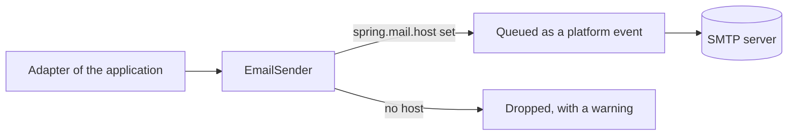
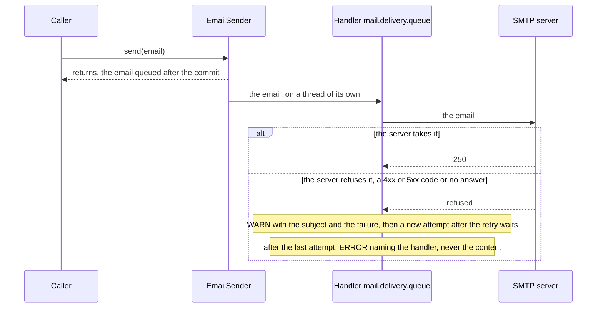

# Mail Starter

A [tech starter](https://github.com/mboisnard/drinkit/blob/master/docs/src/engineering/architecture/tech-starters.md)
that sends the application's emails, such as a sign-in code. An adapter injects
`EmailSender`, and the starter queues each email for an SMTP server or, when none is set, drops it with a warning.



## Usage

A module declares the starter in its build file. The starter delivers through the
[messaging starter](https://github.com/mboisnard/drinkit/blob/master/tech-starters/backend/messaging-starter/README.md),
without which the application refuses to start once a mail server is set:

```kotlin
dependencies {
    implementation(project(":mail-starter"))
}
```

```kotlin
emailSender.send(
    Email(
        sender = Sender("contact@drinkit.com"),
        recipients = Recipients(setOf(Recipient("jane.doe@example.com"))),
        subject = Subject("Your DrinkIt sign-in code"),
        content = Content(TXT, "Your code is 731904"),
    ),
)
```

- **With `spring.mail.host` set**, the email goes to that SMTP server, later and on another thread.
- **Without a host**, the starter warns at startup, then drops each email with a warning that names its subject,
  never its recipients or its content. The application starts without a mail server, and the logs say what it did
  not send.

The `dev` profile of the backend sends to the [Mailpit](https://mailpit.axllent.org/) of the local compose file, whose
web interface on `http://localhost:8025` shows each email.
[ADR 0010](https://github.com/mboisnard/drinkit/blob/master/docs/src/engineering/adr/0010-send-emails-over-smtp-to-a-server-chosen-per-environment.md)
records the SMTP server of each environment.

## When `send` returns

`send` returns once the email is queued, without waiting for the mail server. Inside a transaction, the email is
queued once the transaction commits, and never when it rolls back.



Each email is retried on its own, with the `starters.messaging.retry.*` waits, three attempts in all.
No log line holds the content of an email. The failure of an attempt is logged whole, as the mail server words it:
its message can name an address the server refused.

## What a restart loses

An email still queued, or waiting for its next attempt, lives in memory: a restart loses it, as any platform event
until [#549](https://github.com/mboisnard/drinkit/issues/549).

An email can also leave more than once: a server that takes it but answers after the 5 second timeout fails the
attempt, and the next one sends it again. The delivery is not idempotent yet: [#619](https://github.com/mboisnard/drinkit/issues/619) records what was already sent.

## Configuration

| Property | Default | Environment variable |
|---|---|---|
| `spring.mail.host` | None, required in production: without it, emails are dropped | `SPRING_MAIL_HOST` |
| `spring.mail.username` | None, required in production | `SPRING_MAIL_USERNAME` |
| `spring.mail.password` | None, required in production | `SPRING_MAIL_PASSWORD` |
| `spring.mail.port` | `587`, with STARTTLS and 5 second timeouts | `SPRING_MAIL_PORT` |
| `starters.mail.enabled` | `true`, `false` registers no `EmailSender` | `STARTERS_MAIL_ENABLED` |

## Tests

From `testFixtures(project(":mail-starter"))`, `SpyEmailSender` records the emails an adapter sends, and
`@MailpitIntegrationTest` starts [Mailpit](https://mailpit.axllent.org/), an SMTP server in Docker, for a real send.
`Mailpit.refuseRecipients(451)` makes it refuse every recipient with that code, until `acceptAll()` or the next test.

## Limits

- A refusal for good, such as `550` for an unknown recipient, is retried like a temporary one, to the last attempt.
