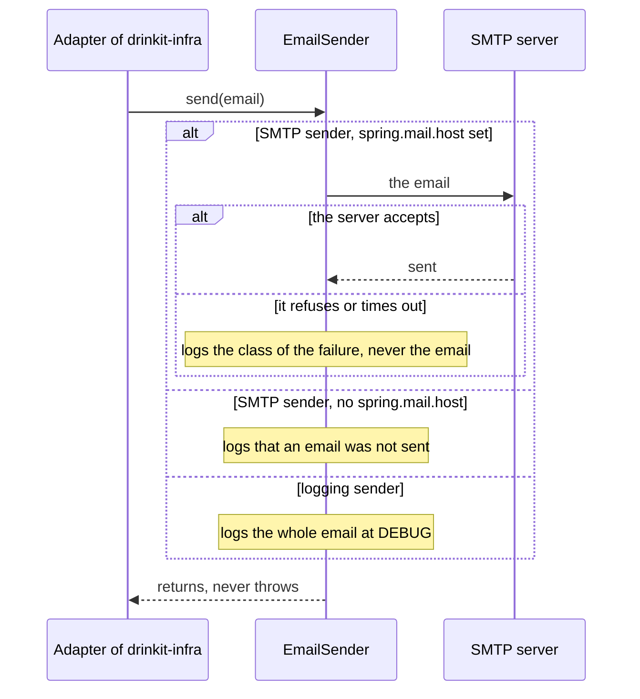
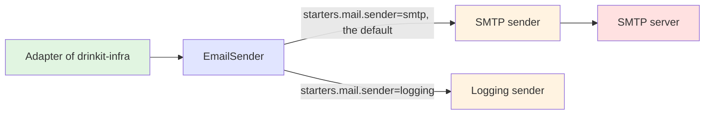

# Mail Starter

A [tech starter](https://github.com/mboisnard/drinkit/blob/master/docs/src/engineering/architecture/tech-starters.md)
that sends the application's emails through `EmailSender`, to an SMTP server or, on a developer's machine, to the
logs. The property `starters.mail.sender` picks one of these two senders, and the `dev` profile picks the logging
one. A failed email is logged and dropped: the caller never sees an exception, and nothing sends it again.

## What is it for?

The application sends transactional emails, such as the verification code at registration. Business code never
calls this starter: the domain declares a port, and an adapter of the infrastructure module, `drinkit-infra`,
implements it with `EmailSender`. `EmailNotificationSender` is that adapter for notifications. The
[hexagonal architecture](https://github.com/mboisnard/drinkit/blob/master/docs/src/engineering/architecture/hexagonal-architecture.md)
explains why the domain sees no infrastructure.

## Architecture Overview



The application's code is green, the starter's API blue, its senders orange, and the external system red:



## Key Features

- **Starts without a mail server.** The SMTP sender is the default, and an application with no `spring.mail.host`
  starts all the same, so that it runs before it has a mail account. Each email is then logged as not sent, without
  its content, and that log line is what shows a production that forgot the host.
- **Failures logged without personal data.** A refused or timed-out email is logged with the class of the failure,
  never with its recipients or its content, which can hold a verification code.
- **One From address.** An email that names no `Sender` goes out from `starters.mail.from`, which the application
  checks at startup: a malformed address stops it there rather than failing each email.
- **Defaults for Spring's mail settings.** Port 587 with authentication and STARTTLS, and a 5 second limit to connect,
  read and write, since JavaMail waits forever by default. The application's own `spring.mail.*` values win.
- **A logging sender for a developer's machine.** It writes the whole email, verification code included, at
  `DEBUG`, which the `dev` profile turns on for it, so that a local registration can be completed. It warns at
  startup that no email leaves: never select it in production.

## Configuration

| Property | Default | Environment variable | Must production set it? |
|---|---|---|---|
| `starters.mail.enabled` | `true` | `STARTERS_MAIL_ENABLED` | No |
| `starters.mail.sender` | `smtp` | `STARTERS_MAIL_SENDER` | No. `logging` writes every email to the logs |
| `starters.mail.from` | `contact@drinkit.com` | `STARTERS_MAIL_FROM` | When the sending domain differs |
| `spring.mail.host` | none | `SPRING_MAIL_HOST` | Yes, or no email leaves |
| `spring.mail.port` | `587` | `SPRING_MAIL_PORT` | When the server listens on another port |
| `spring.mail.username` | none | `SPRING_MAIL_USERNAME` | Yes |
| `spring.mail.password` | none | `SPRING_MAIL_PASSWORD` | Yes, from a secret |

Switched off, the starter registers no `EmailSender`: the application declares its own, or the beans that need one
fail to start.

## Usage

The module that implements the domain's port, `drinkit-infra` in DrinkIt, declares the starter in its
`build.gradle.kts`:

```kotlin
dependencies {
    implementation(project(":mail-starter"))
}
```

The adapter builds the email from the notification it receives, and leaves the From address to the starter:

```kotlin
emailSender.send(
    Email(
        recipients = Recipients(setOf(Recipients.Recipient(recipient.value))),
        subject = Subject(body.title),
        content = Content(format = Content.TextFormat.TXT, value = body.content),
    ),
)
```

A test of the adapter checks what it sent with `SpyEmailSender`, from the test fixtures:

```kotlin
testImplementation(testFixtures(project(":mail-starter")))
```

```kotlin
val spyEmailSender = SpyEmailSender()

EmailNotificationSender(spyEmailSender).send(notification)

spyEmailSender.findLastSentEmail()?.subject shouldBe Subject("Your verification code")
```
