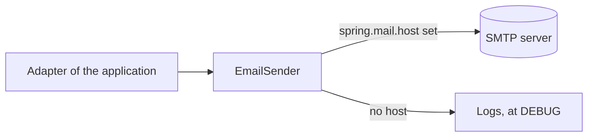

# Mail Starter

A [tech starter](https://github.com/mboisnard/drinkit/blob/master/docs/src/engineering/architecture/tech-starters.md)
that sends the application's emails, such as the verification code at registration. An adapter injects
`EmailSender`, and the starter delivers each email to an SMTP server or, when none is set, writes it to the logs.



## Usage

```kotlin
implementation(project(":mail-starter"))
```

```kotlin
emailSender.send(
    Email(
        sender = Sender("contact@drinkit.com"),
        recipients = Recipients(setOf(Recipient("jane.doe@example.com"))),
        subject = Subject("Your verification code"),
        content = Content(TXT, "Your code is 731904"),
    ),
)
```

| Property | Default | Production |
|---|---|---|
| `spring.mail.host` | none: emails go to the logs | required |
| `spring.mail.username`, `spring.mail.password` | none | required |
| `spring.mail.port` | `587`, with STARTTLS and 5 second timeouts | optional |
| `starters.mail.enabled` | `true`, `false` registers no `EmailSender` | optional |

Each property reads from its environment variable, such as `SPRING_MAIL_HOST`.

## Tests

From `testFixtures(project(":mail-starter"))`, `SpyEmailSender` records the emails an adapter sends, and
`@MailpitIntegrationTest` starts [Mailpit](https://mailpit.axllent.org/), an SMTP server in Docker, for a real send.

## Limits

- A failed send is dropped and logged at `ERROR` with the subject. Nothing retries it.
- Without a host, the starter warns at startup and logs each email at `DEBUG`, a level production does not show.
