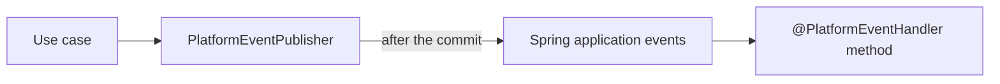
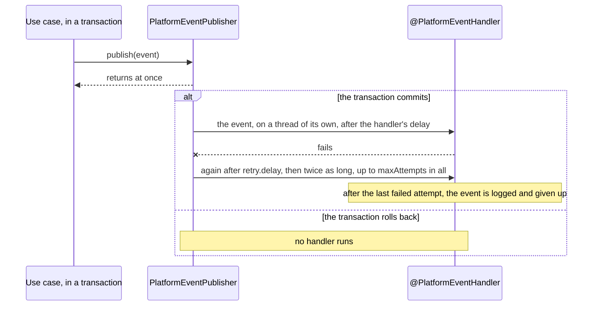

# Messaging Starter

A [tech starter](https://github.com/mboisnard/drinkit/blob/master/docs/src/engineering/architecture/tech-starters.md)
that carries [platform events](https://github.com/mboisnard/drinkit/blob/master/docs/src/engineering/architecture/platform-events.md),
facts such as "a sign-in code was requested", from the code that publishes them to the handlers that react. A
handler runs after the commit, on a thread of its own, and again after a growing wait when it fails. The events
travel as Spring application events today, and a broker can replace them without changing a handler, as
[ADR 0006](https://github.com/mboisnard/drinkit/blob/master/docs/src/engineering/adr/0006-carry-platform-events-through-an-abstraction.md)
records.



## How it works

A handler gets the event once the transaction commits, never when it rolls back, and again after a growing wait each
time it fails:



## Usage

A module declares the starter in its build file:

```kotlin
dependencies {
    implementation(project(":messaging-starter"))
}
```

```kotlin
platformEventPublisher.publish(SignInCodeRequested(email, code, locale))

@Component
internal class SignInCodeEmails(private val notificationSender: NotificationSender) {

    @PlatformEventHandler("send.sign.in.code.queue")
    fun sendTheCode(event: SignInCodeRequested) { … }
}
```

- **An event** carries ids and facts, never an entity, which would be stale by the time the handler runs.
- **The `name` of a handler** is the queue a broker would create for it.
- **`maxAttempts`** counts every attempt, 3 by default, and **`delay`** waits that many milliseconds after the
  commit.
- **The application refuses to start** on a handler that takes anything but one platform event, or reuses a `name`,
  or sets `maxAttempts` below 1 or a negative `delay`.

## Configuration

| Property | Default | Environment variable |
|---|---|---|
| `starters.messaging.retry.delay` | `30s`, doubled at each retry up to one hour | `STARTERS_MESSAGING_RETRY_DELAY` |
| `starters.messaging.retry.exponential-backoff` | `true`, `false` keeps the delay the same | `STARTERS_MESSAGING_RETRY_EXPONENTIALBACKOFF` |
| `starters.messaging.enabled` | `true`, `false` registers no publisher and calls no handler | `STARTERS_MESSAGING_ENABLED` |

## Tests

`SpyPlatformEventPublisher`, from `testFixtures(project(":messaging-starter"))`, records what a use case publishes:

```kotlin
spyEventPublisher.countEventsOfType(SignInCodeRequested::class) shouldBe 1
```

## Limits

- Delivery is at least once and in no set order, so a handler is idempotent.
- An event still waiting when the application stops is lost: the events live in the memory of the process.
- An event published outside a transaction goes to its handlers at once.
