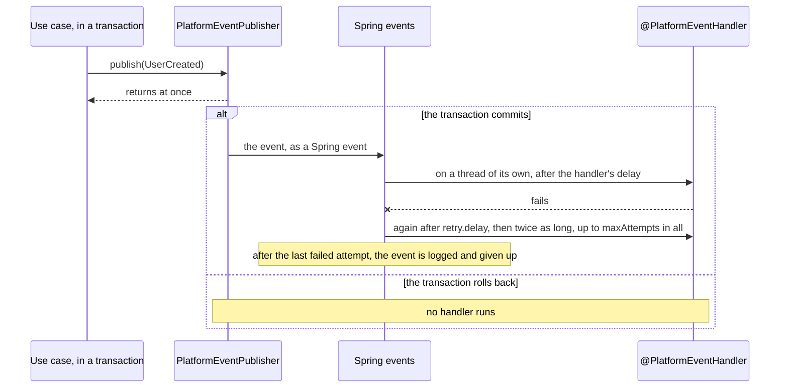
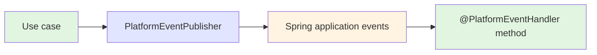

# Messaging Starter

A [tech starter](https://github.com/mboisnard/drinkit/blob/master/docs/src/engineering/architecture/tech-starters.md)
that carries [platform events](https://github.com/mboisnard/drinkit/blob/master/docs/src/engineering/architecture/platform-events.md)
from `PlatformEventPublisher` to the methods annotated `@PlatformEventHandler`. A handler gets an event after the
publishing transaction commits, after the delay it declares, and again after a growing wait when it fails. Declaring
the dependency is enough: the starter wires itself. The events travel as Spring application events, inside the
process. Delivery is at least once while the application runs, in no set order, and an event still waiting when the
application stops is lost.

## What is a platform event?

A platform event states a fact, such as "a user was created", that other parts of the application react to later:
the use case that creates a user publishes `UserCreated`, and a handler sends the verification email. Moving from
Spring events to a broker changes this starter and none of the handlers, since each handler declares in its
annotation what it needs from a broker.

## Architecture Overview



The application's code is green, the starter's API blue, and Spring events, which a broker will replace, orange:



## Key Features

- **After the commit.** A handler never sees an event whose transaction rolled back, nor runs before the data it
  reads is committed. An event published outside a transaction goes to its handlers at once.
- **Off the publisher's thread.** Each delivery runs on a virtual thread of its own, so a slow or failing handler
  neither slows down nor fails the use case.
- **Retries.** A failed handler gets the event up to `maxAttempts` times in all, 3 by default. The wait between two
  attempts is `starters.messaging.retry.delay` and doubles each time, up to one hour, or stays the same with
  `starters.messaging.retry.exponential-backoff` switched off. A broker will follow the same policy, so a handler
  behaves the same on it.
- **Delay.** A handler with a `delay`, in milliseconds, gets the event that long after the commit. A retry does not
  repeat that delay.
- **Failures logged.** A failed attempt and a given-up event are logged with the handler's name and the class of the
  failure.
- **Checked at startup.** The application refuses to start on a handler that does not take exactly one platform
  event, or that sets `maxAttempts` below 1 or a negative `delay`. It also refuses a `name` that another handler
  uses, since a broker would make them share one queue, and a `delay` together with `oneQueuePerInstance`, which asks
  a broker for a queue for each instance: the waiting queue would outlive the instance it feeds. A
  `starters.messaging.retry.delay` that is not positive, or longer than one hour with the exponential backoff, stops
  the start too.

Write each handler idempotent, since it can get the same event more than once.

## Configuration

| Property | Default | Environment variable | Must production set it? |
|---|---|---|---|
| `starters.messaging.enabled` | `true` | `STARTERS_MESSAGING_ENABLED` | No |
| `starters.messaging.retry.delay` | `30s` | `STARTERS_MESSAGING_RETRY_DELAY` | No |
| `starters.messaging.retry.exponential-backoff` | `true` | `STARTERS_MESSAGING_RETRY_EXPONENTIALBACKOFF` | No |

Switched off, the starter registers no publisher and calls no handler, so the application must declare its own
publisher.

## Usage

The application module that wires the beans, `drinkit-backend` in DrinkIt, declares the starter in its
`build.gradle.kts`, and a module that only publishes or handles events needs the same line:

```kotlin
dependencies {
    implementation(project(":messaging-starter"))
}
```

A use case publishes through `PlatformEventPublisher`. The event carries ids and facts, never an entity, which would
be out of date by the time the handler runs:

```kotlin
platformEventPublisher.publish(UserCreated(userId = user.id, locale = command.locale))
```

A handler is a bean method that takes the event as its only parameter. Its `name` is the queue a broker will create
for it, so that the move to a broker changes no handler:

```kotlin
@Component
internal class RegistrationHandler(private val sendVerificationToken: SendVerificationToken) {

    @PlatformEventHandler("send.verification.token.to.created.user.queue")
    fun sendVerificationTokenToTheCreatedUser(event: UserCreated) { … }
}
```

The same annotation takes `maxAttempts` and a `delay` in milliseconds, such as
`@PlatformEventHandler(name = "…", maxAttempts = 5, delay = 2_000)`.

A unit test of a use case passes `SpyPlatformEventPublisher`, from the test fixtures, as its publisher, then checks
what it published:

```kotlin
testImplementation(testFixtures(project(":messaging-starter")))
```

```kotlin
val spyEventPublisher = SpyPlatformEventPublisher()
val createNewUser = CreateNewUser(…, platformEventPublisher = spyEventPublisher)

createNewUser.invoke(command)

spyEventPublisher.countEventsOfType(UserCreated::class) shouldBe 1
```
