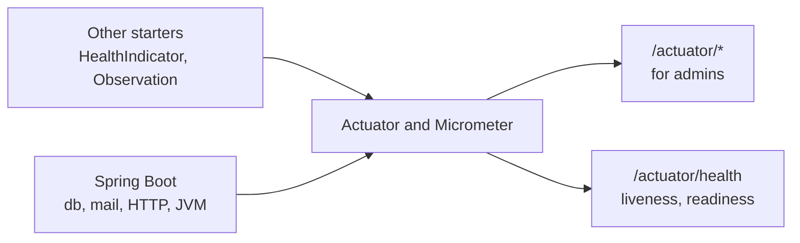

# Observability Starter

A [tech starter](https://github.com/mboisnard/drinkit/blob/master/docs/src/engineering/architecture/tech-starters.md)
that sets up Spring Boot Actuator for the application: which endpoints an admin reads, what readiness waits for, and
what the info endpoint shows. It writes no observability code of its own: each starter contributes what it knows.



## Usage

Every application of the `api-convention` gets it. An application without that convention declares it:

```kotlin
dependencies {
    implementation(project(":observability-starter"))
}
```

- **Endpoints**: `health`, `info`, `metrics`, `loggers`, `caches` and `conditions`, for the `ADMIN` role, all read-only:
  no endpoint changes a logger level or clears a cache. `conditions` tells which starters are on, and why.
- **Health**: anonymous probes get the status alone, an admin gets each component. Liveness checks no third party,
  readiness waits for `readinessState` and `db` only, so a search engine that is down never takes the application
  out of service.
- **Info**: git, build, Java, OS and process.
- **Observations**: the spans of the Spring Security filters are off.
- **Logs**: plain text, and one JSON line per event with `LOGGING_STRUCTURED_FORMAT_CONSOLE=logstash`, each with an
  `application` field. The [logging page](https://github.com/mboisnard/drinkit/blob/master/docs/src/engineering/build-and-data/logging.md)
  says when.

## Monitoring a third party

A starter that talks to a third party brings its own `HealthIndicator`, in an `@AutoConfiguration` of its own guarded
by `@ConditionalOnClass(HealthIndicator::class)`, with `compileOnly("org.springframework.boot:spring-boot-health")`, as
`SearchEngineHealthAutoConfiguration` does. It never depends on this starter. A remote HTTP API, such as an exchange
rate provider, gets no health check, which would spend its quota: the `http.client.requests` metrics of its client
already tell whether it answers.

## Configuration

| Property | Default | Environment variable |
|---|---|---|
| `starters.observability.enabled` | `true`, `false` leaves Actuator to the defaults of Spring Boot | `STARTERS_OBSERVABILITY_ENABLED` |

Every `management.*` key of the application overrides the starter's.

## Tests

Nothing to add: the starter brings no bean that a test replaces.
