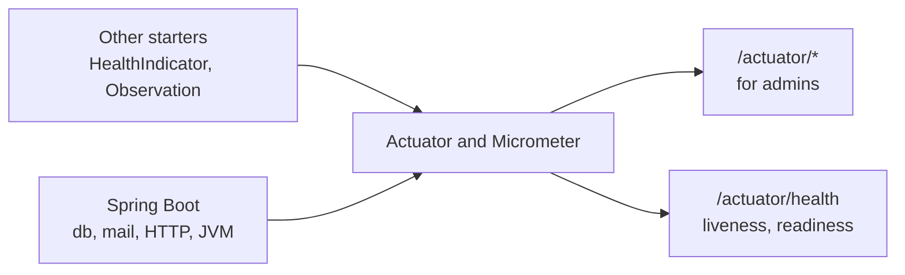

# Observability Starter

A [tech starter](https://github.com/mboisnard/drinkit/blob/master/docs/src/engineering/architecture/tech-starters.md)
that sets up Spring Boot Actuator for the application: which endpoints an admin reads, what readiness waits for, and
what the info endpoint shows, and how every error answers. It instruments nothing itself: each starter contributes
what it knows.



## Usage

Every application of the `api-convention` gets it. An application without that convention declares it:

```kotlin
dependencies {
    implementation(project(":observability-starter"))
}
```

- **Endpoints**: `health`, `info`, `metrics`, `loggers`, `caches` and `conditions`, for the `ADMIN` role, all read-only:
  no endpoint changes a logger level or clears a cache. `conditions` tells which starters are on, and why.
- **Health**: anonymous probes get the status alone, an admin gets each component. Liveness checks no third party,
  readiness waits for `readinessState` and `db` only, so a search engine that is down never takes the application
  out of service.
- **Info**: git, build, Java, OS and process.
- **Observations**: the spans of the Spring Security filters are off.
- **Logs**: plain text, and one JSON line per event with `LOGGING_STRUCTURED_FORMAT_CONSOLE=logstash`, each with an
  `application` field. The [logging page](https://github.com/mboisnard/drinkit/blob/master/docs/src/engineering/build-and-data/logging.md)
  says when.
- **Errors**: every error that Spring MVC answers is a problem detail of RFC 9457 with the `traceId` of the request.
  `IllegalArgumentException` is a 400, and any other unexpected exception a 500 that keeps its message in the logs.
  A servlet filter refuses the same way: it hands an `ErrorResponseException` to the `handlerExceptionResolver` bean
  rather than writing a body. An advice of the application comes first, so one that catches `Exception` also takes
  these refusals.

### OpenTelemetry

Micrometer traces each request and puts its `traceId` and `spanId` in the logs. Nothing leaves the application until
`starters.observability.opentelemetry.enabled=true`: Spring Boot then pushes the metrics and the traces over OTLP to
a collector, such as the Datadog Agent. Switched off, the starter exports nothing, whatever that property. Logs stay
on the console, which the log platform already reads.

To see the traces on your machine, start [Grafana LGTM](https://github.com/grafana/docker-otel-lgtm), then the
application with the export on, and open Grafana on `http://localhost:3000`:

```
docker run --rm -p 3000:3000 -p 4318:4318 grafana/otel-lgtm
STARTERS_OBSERVABILITY_OPENTELEMETRY_ENABLED=true \
MANAGEMENT_OPENTELEMETRY_TRACING_EXPORT_OTLP_ENDPOINT=http://localhost:4318/v1/traces \
MANAGEMENT_TRACING_SAMPLING_PROBABILITY=1.0 \
./gradlew :drinkit-backend:bootRun
```

The application starts a new trace for each request: it ignores the `traceparent` a caller sends, since a caller
from the internet would choose its own `traceId` and force its requests into the samples. Once the export is on, it
sends its own `traceparent` to the APIs it calls. A service behind a gateway that sets a trusted `traceparent` follows it with
`MANAGEMENT_TRACING_PROPAGATION_CONSUME=W3C`.

Spring Boot samples 10 % of the traces by default. A metric or a span of your own goes through the `ObservationRegistry`
of Micrometer, never through the OpenTelemetry API: one observation gives a timer and a span.

```kotlin
Observation.createNotStarted("rates.refresh", observationRegistry)
    .lowCardinalityKeyValue("provider", "exchangerate-api")
    .observe { provider.refresh() }
```

A low-cardinality value, such as a provider, tags the metric and the span. An id goes in a
`highCardinalityKeyValue`, which tags the span alone.

[ADR 0016](https://github.com/mboisnard/drinkit/blob/master/docs/src/engineering/adr/0016-observe-through-micrometer-and-export-over-opentelemetry-on-demand.md)
records why Micrometer, and why the export waits for a switch.

### Monitoring a third party

A starter that talks to a third party brings its own `HealthIndicator`, in an `@AutoConfiguration` of its own guarded
by `@ConditionalOnClass(HealthIndicator::class)`, with `compileOnly("org.springframework.boot:spring-boot-health")`, as
`SearchEngineHealthAutoConfiguration` does. It never depends on this starter. A remote HTTP API, such as an exchange
rate provider, gets no health check, which would spend its quota: the `http.client.requests` metrics of its client
already tell whether it answers.

## Configuration

| Property | Default | Environment variable |
|---|---|---|
| `starters.observability.enabled` | `true`, `false` leaves Actuator to the defaults of Spring Boot, and still exports nothing | `STARTERS_OBSERVABILITY_ENABLED` |
| `starters.observability.opentelemetry.enabled` | `false`, `true` pushes the metrics and the traces over OTLP | `STARTERS_OBSERVABILITY_OPENTELEMETRY_ENABLED` |
| `management.opentelemetry.tracing.export.otlp.endpoint` | None, required in production once the export is on | `MANAGEMENT_OPENTELEMETRY_TRACING_EXPORT_OTLP_ENDPOINT` |
| `management.otlp.metrics.export.url` | `http://localhost:4318/v1/metrics`, set in production once the export is on | `MANAGEMENT_OTLP_METRICS_EXPORT_URL` |
| `management.opentelemetry.resource-attributes.deployment.environment` | None, set in production once the export is on | `MANAGEMENT_OPENTELEMETRY_RESOURCEATTRIBUTES_DEPLOYMENT_ENVIRONMENT` |

Every `management.*` key of the application overrides the starter's.

## Tests

Nothing to add: the starter brings no bean that a test replaces.
