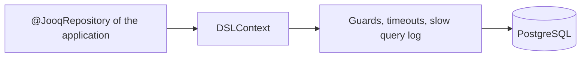
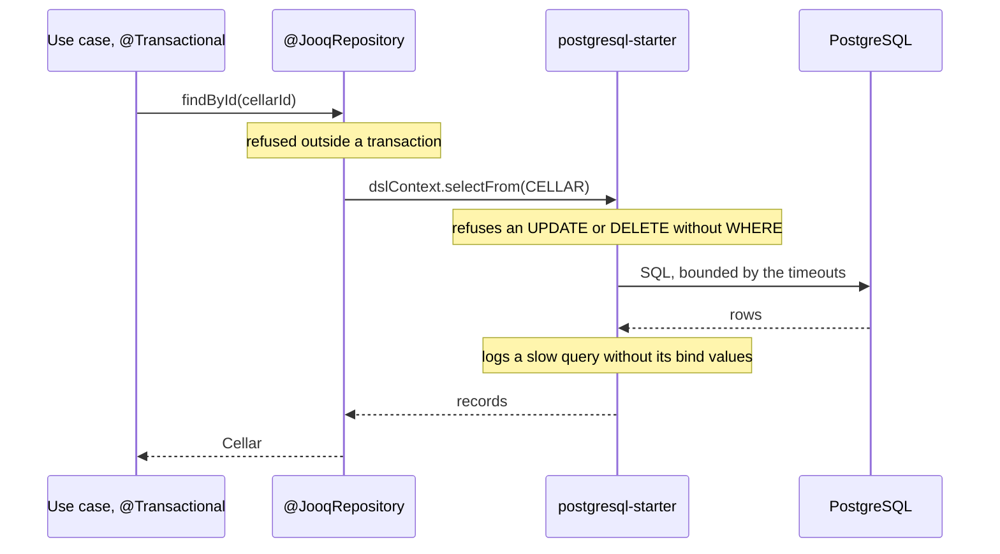

# PostgreSQL Starter

A [tech starter](https://github.com/mboisnard/drinkit/blob/master/docs/src/engineering/architecture/tech-starters.md)
that gives the adapters of the application a jOOQ `DSLContext` and a connection pool on PostgreSQL, guarded against
the mistakes that lose or leak data.
[ADR 0002](https://github.com/mboisnard/drinkit/blob/master/docs/src/engineering/adr/0002-store-data-in-postgresql-and-query-it-with-jooq.md)
says why PostgreSQL and jOOQ. The schema belongs to the
[updater](https://github.com/mboisnard/drinkit/blob/master/deployment/updater/README.md), never to the application.



## How it works

The transaction belongs to the use case, and the starter checks each statement on its way to the database:



## Usage

The [`jooq-codegen-convention`](https://github.com/mboisnard/drinkit/blob/master/docs/src/engineering/build-and-data/build-tool.md)
plugin adds the starter and its test fixtures to a module that generates jOOQ classes. Any other module declares it
in its build file:

```kotlin
dependencies {
    implementation(project(":postgresql-starter"))
}
```

```kotlin
@JooqRepository
internal class JooqCellars(private val dslContext: DSLContext) : Cellars {

    override fun findById(cellarId: CellarId): Cellar? = dslContext.selectFrom(CELLAR)
        .where(CELLAR.ID.eq(cellarId.value))
        .fetchOne { it.toCellar() }
}
```

- **Auto-commit off**, so a `@JooqRepository` call outside a transaction fails instead of writing nothing.
- **No `UPDATE` or `DELETE` without `WHERE`.** A statement that changes every row on purpose says so with
  `.where(trueCondition())`.
- **Timeouts**: 30 s per statement, 5 s per lock, 60 s idle in a transaction. A query slower than the threshold is
  logged at `WARN` with its bind values left as `?`.
- **Optimistic locking**: a table named in `recordVersionFields` of the `jooq` block checks its version on
  `store()`, `update()` and `delete()` of a record, and throws `OptimisticLockingFailureException`.
- **Helpers**: `JSONBToJacksonConverter` maps a JSONB column to a Kotlin type, `multiset(...).mapping(::Bottle)` reads
  a nested collection in one query, `fetchSequence` streams a large read inside the transaction, and
  `exception.violates("cellar_pkey")` tells whether PostgreSQL refused a statement on that constraint.
- **PostgreSQL only**: the application refuses to start on another database.

## Configuration

| Property | Default | Environment variable |
|---|---|---|
| `spring.datasource.url` | None, required | `SPRING_DATASOURCE_URL` |
| `spring.datasource.username` | None, required | `SPRING_DATASOURCE_USERNAME` |
| `spring.datasource.password` | None, required | `SPRING_DATASOURCE_PASSWORD` |
| `starters.postgresql.slow-query-threshold` | `500ms` | `STARTERS_POSTGRESQL_SLOWQUERYTHRESHOLD` |
| `starters.postgresql.enabled` | `true` | `STARTERS_POSTGRESQL_ENABLED` |

The timeouts live in `spring.datasource.hikari.data-source-properties.options`: setting it replaces all three.

## Tests

`@JooqIntegrationTest(schemas = [DrinkitApplication::class])` gives a test a `DSLContext` on a database of its own,
in a PostgreSQL container, with the tables of the schemas it names. Each test is rolled back. The
[Testcontainers page](https://github.com/mboisnard/drinkit/blob/master/docs/src/engineering/writing-code/testing/testcontainers.md)
says how the container is shared.

## Limits

- A `dsl.update(...)` skips the optimistic lock: a versioned table is written through its record.
- A `Sequence` from `fetchSequence` reads from a cursor that closes with the transaction, so the caller consumes it
  inside that transaction.
