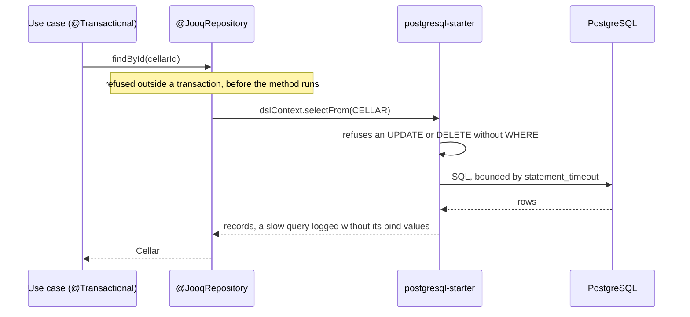
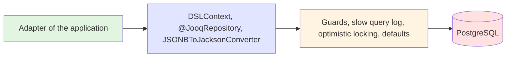

# PostgreSQL Starter

A [tech starter](https://github.com/mboisnard/drinkit/blob/master/docs/src/engineering/architecture/tech-starters.md)
that gives the application a jOOQ `DSLContext` and a connection pool on PostgreSQL, guarded against the mistakes that
lose or leak data.

## What is jOOQ?

jOOQ writes SQL in Kotlin, from classes generated out of the schema, so that the compiler checks each table, column
and type. The adapters of the
[hexagonal architecture](https://github.com/mboisnard/drinkit/blob/master/docs/src/engineering/architecture/hexagonal-architecture.md)
read and write their tables with it, inside the transaction of the use case that calls them: a cellar saved with its
bottles, the events of a user appended to its stream. The tables and their changes belong to the
[updater](https://github.com/mboisnard/drinkit/blob/master/deployment/updater/README.md), which applies the Liquibase
changelogs before the application starts.

## Architecture Overview





## Key Features

- A `@JooqRepository` call outside a transaction fails: with auto-commit off, it would write nothing.
- A statement that updates or deletes without a `WHERE` fails, so that a forgotten condition never empties a table.
- The application refuses to start on a database other than PostgreSQL, since the SQL of the adapters is
  PostgreSQL's.
- Each statement is bounded in time, and a slow one is logged at `WARN` with its bind values left as `?`.
- A lost update on a versioned table becomes Spring's `OptimisticLockingFailureException`.

## Configuration

| Property | Default | Environment variable | Required in production |
|---|---|---|---|
| `spring.datasource.url` | None | `SPRING_DATASOURCE_URL` | Yes |
| `spring.datasource.username`, `spring.datasource.password` | None | `SPRING_DATASOURCE_USERNAME`, `SPRING_DATASOURCE_PASSWORD` | Yes |
| `starters.postgresql.slow-query-threshold` | `500ms` | `STARTERS_POSTGRESQL_SLOWQUERYTHRESHOLD` | No |
| `starters.postgresql.enabled` | `true` | `STARTERS_POSTGRESQL_ENABLED` | No |

The starter sets these defaults, which a property of the application or an environment variable overrides:

- `spring.datasource.hikari.auto-commit=false`: only the transaction of the use case commits.
- `spring.datasource.hikari.data-source-properties.options=-c statement_timeout=30s -c lock_timeout=5s
  -c idle_in_transaction_session_timeout=60s`. Setting `options` replaces all three.
- `spring.datasource.hikari.data-source-properties.ApplicationName` and `spring.datasource.hikari.pool-name` take
  `spring.application.name`, so `pg_stat_activity` tells the applications sharing a database apart. Without it,
  the driver and Hikari keep their own names.
- `spring.jooq.sql-dialect=postgres`: jOOQ never guesses the dialect, a guess that falls back to a generic one on failure.
  The starter's jOOQ customizer sets the same dialect after this property, so the property counts only once the
  application replaces that customizer.
- `logging.level.org.jooq.Constants=off`, which hides the jOOQ logo and its tips.

A statement that updates or deletes every row on purpose says so with `.where(trueCondition())`. A slow query keeps
its bind values as `?`, so that no personal data reaches the logs.

A `DefaultConfigurationCustomizer` bean named `postgresqlJooqCustomizer` replaces the starter's dialect, optimistic
locking and `WHERE` guards: the dialect then comes from `spring.jooq.sql-dialect`, `postgres` unless the application
sets another. A customizer with another name adds to them.

## Usage

The [`jooq-codegen-convention`](https://github.com/mboisnard/drinkit/blob/master/docs/src/engineering/build-and-data/build-tool.md)
plugin adds the starter and its test fixtures to a module that generates jOOQ classes. A repository is a
`@JooqRepository`, a Spring repository whose methods require an open transaction: with auto-commit off, a call
without one would write nothing, so it fails.

```kotlin
@JooqRepository
internal class JooqCellars(private val dslContext: DSLContext) : Cellars {

    override fun findById(cellarId: CellarId): Cellar? = dslContext.selectFrom(CELLAR)
        .where(CELLAR.ID.eq(cellarId.value))
        .fetchOne { it.toCellar() }
}
```

`JSONBToJacksonConverter(CityLocation::class.java, jsonMapper)` maps a JSONB column to a Kotlin type with the
application's `JsonMapper`. The starter brings `jooq-kotlin`: `multiset(...).mapping(::Bottle)` reads a nested
collection, such as the bottles of each cellar, in the same query as its parent, into Kotlin constructors that the
compiler checks.
[ADR 0007](https://github.com/mboisnard/drinkit/blob/master/docs/src/engineering/adr/0007-jooq-kotlin-maps-nested-multiset-reads.md)
says why. A read whose size the repository cannot know returns a `Sequence` from `fetchSequence`,
an extension of a jOOQ `Select` that streams the rows from a cursor, a thousand at a time. The cursor lives as long as
the transaction, so the caller reads the `Sequence` inside it: a use case that returns one is
`@Transactional(propagation = MANDATORY)`, and the controller that maps it opens the transaction, as the architecture
tests check.

```kotlin
@Transactional(readOnly = true)
override fun findCellars() = ResponseEntity.ok(CellarsResponse(findCellars.byOwnerId(owner).map { it.toResponse() }.toList()))
```

`@JooqIntegrationTest(schemas = [DrinkitApplication::class])` gives the test a `DSLContext` on a database of its
own, in a PostgreSQL container, with the tables of the generated schema classes it names, such as
`DrinkitApplication` for `drinkit_application`. Each test is rolled back. The
[Testcontainers](https://github.com/mboisnard/drinkit/blob/master/docs/src/engineering/writing-code/testing/testcontainers.md)
page says how the container is shared.

## Optimistic locking

A table whose version column the `jooq` block of the build names in `recordVersionFields` gets jOOQ's optimistic
locking on `store()`, `update()` and `delete()`. When another transaction changed the row since it was read, the
repository throws an `OptimisticLockingFailureException`. A `dsl.update(...)` skips the check: a versioned table is
written through its record.
