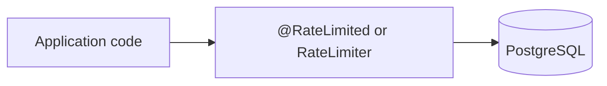
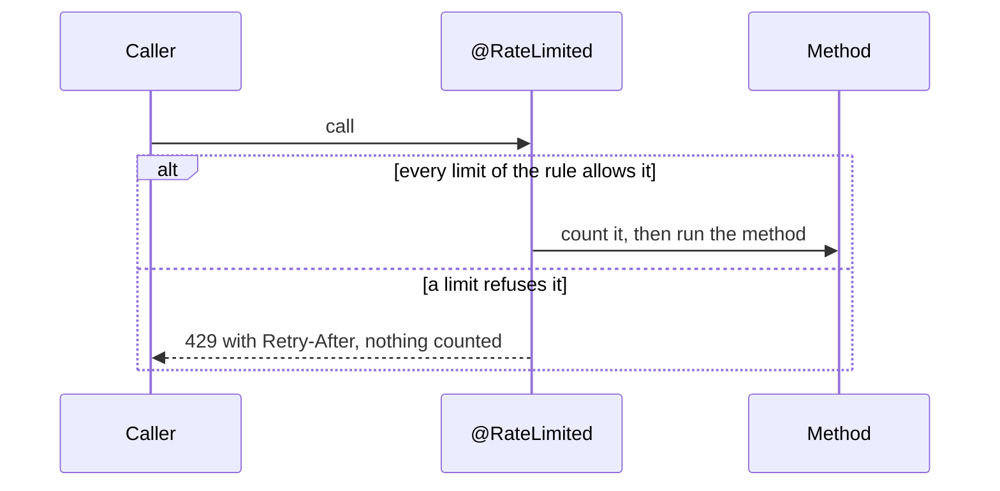

# Rate Limit Starter

A [tech starter](https://github.com/mboisnard/drinkit/blob/master/docs/src/engineering/architecture/tech-starters.md)
that limits how often a key can call a use case: a user, a visitor, an email or an IP address. Its counts live in
PostgreSQL, so that every instance of the application shares them.
[ADR 0020](https://github.com/mboisnard/drinkit/blob/master/docs/src/engineering/adr/0020-rate-limit-in-the-application-with-gcra-on-postgresql.md)
explains why it is built in-house.



## How it works

The starter runs the generic cell rate algorithm, GCRA: a limit of `N` calls per period gives back one call every
`period / N`. With 5 calls per hour, a key may spend its 5 calls at once, then gets one back every 12 minutes.



A rule may hold several limits, such as 3 per 10 minutes and 10 per day: a call must pass all of them.

## Usage

```kotlin
dependencies {
    implementation(project(":rate-limit-starter"))
}
```

On a method of a Spring bean, `@RateLimited` names a policy: a bean that holds the rule and reads the key in the
method's arguments.

```kotlin
@Component
class SignInCodeLimit : RateLimitPolicy {
    override val rule = RateLimitRule("signincode", listOf(RateLimit(3, ofMinutes(10)), RateLimit(10, ofDays(1))))

    override fun key(call: RateLimitedCall) = call.argument<CodeRequest>().email.lowercase()
}

@RateLimited(SignInCodeLimit::class)
fun requestCode(request: CodeRequest) { … }
```

A policy is a bean, so it can read the request through another bean, such as `CurrentUser` to count a user and let
an admin through:

```kotlin
@Component
class ExportLimit(private val currentUser: CurrentUser) : RateLimitPolicy {
    override val rule = RateLimitRule("export", listOf(RateLimit(5, ofHours(1))))

    override fun key(call: RateLimitedCall) = currentUser.get().takeIf { "ROLE_ADMIN" !in it.roles }?.id
}
```

Or from code, with a cost, such as the tokens of an LLM call:

```kotlin
private val assistant = RateLimitRule("assistant", listOf(RateLimit(100_000, Duration.ofHours(1))))

rateLimiter.consume(assistant, userId, cost = estimatedTokens).orThrow()
```

- **The key.** The policy or the code gives it, normalized: an email in lowercase. Only its SHA-256 hash is stored.
  A policy that returns `null` lets the call through uncounted, such as for an admin.
- **The arguments.** `argument<T>()` reads the one argument of type `T`, and throws when the method has none or
  several, such as two `String`s: read `call.arguments` by position then.
- **Before the authorization.** `@RateLimited` counts the call before `@PreAuthorize` and the transaction of the
  method, so a call refused for its rights is counted too.
- **A refusal.** `orThrow()` and `@RateLimited` throw `RateLimitExceededException`, answered 429 with
  `Retry-After`. It logs one warning, without the key.
- **The cost.** From 1 to the smallest limit of the rule: a higher one could never pass, so it throws.

## Configuration

| Property | Default | Environment variable |
|---|---|---|
| `starters.rate-limit.enabled` | `true` | `STARTERS_RATELIMIT_ENABLED` |

## Tests

From `testFixtures(project(":rate-limit-starter"))`: `inMemoryRateLimiter(clock)` runs the same algorithm in
memory.

## Limits

- **A rate, not a cap per hour.** With 5 per hour, up to 9 calls fit within one hour: 5 at once, then one every 12
  minutes. A second, shorter limit spreads them.
- **Its own transaction.** A count survives a rollback of the caller, and takes a second connection when it runs
  inside a transaction.
- **A Spring proxy.** `@RateLimited` never applies to a call from inside the same class.
