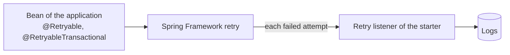
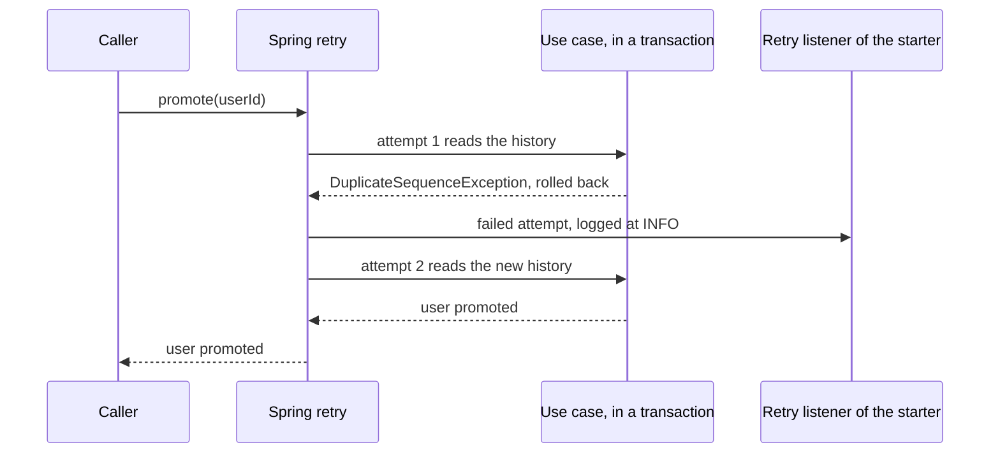

# Retryable Starter

A [tech starter](https://github.com/mboisnard/drinkit/blob/master/docs/src/engineering/architecture/tech-starters.md)
that turns on the `@Retryable` of Spring Framework, so that a method runs again when it fails with an exception its
policy names, and logs each failed attempt. DrinkIt needs it for concurrent writes on an event-sourced aggregate:
`event-sourcing-starter` brings it to run the retries of `@RetryableTransactional`.



## How it works

With `@RetryableTransactional`, the retry wraps the transaction, so the attempt that loses a race runs again on the
new history:



## Usage

A module declares the starter in its build file:

```kotlin
dependencies {
    implementation(project(":retryable-starter"))
}
```

```kotlin
@Retryable(includes = [DuplicateSequenceException::class], maxRetries = 2, delay = 0)
fun promote(userId: UserId) { … }
```

- **`maxRetries`** counts the retries after the first attempt: `maxRetries = 2` makes three attempts.
- **Logs**: each failed attempt at `INFO`, the end of the retries at `WARN`, with the class of the exception and never
  its message, which can hold personal data.
- **Your own listener**: an `ApplicationListener<MethodRetryEvent>` bean of the application replaces the logging.

## Configuration

| Property | Default | Environment variable |
|---|---|---|
| `starters.retryable.enabled` | `true`, `false` makes every method run once | `STARTERS_RETRYABLE_ENABLED` |

## Tests

`SpyRetryListener`, from `testFixtures(project(":retryable-starter"))`, declared as a bean, counts the failed
attempts:

```kotlin
spyRetryListener.countFailedAttempts() shouldBe 1
```

## Limits

- The retry goes through the Spring proxy: a unit test without Spring, or a call from the same object, makes one
  attempt.
