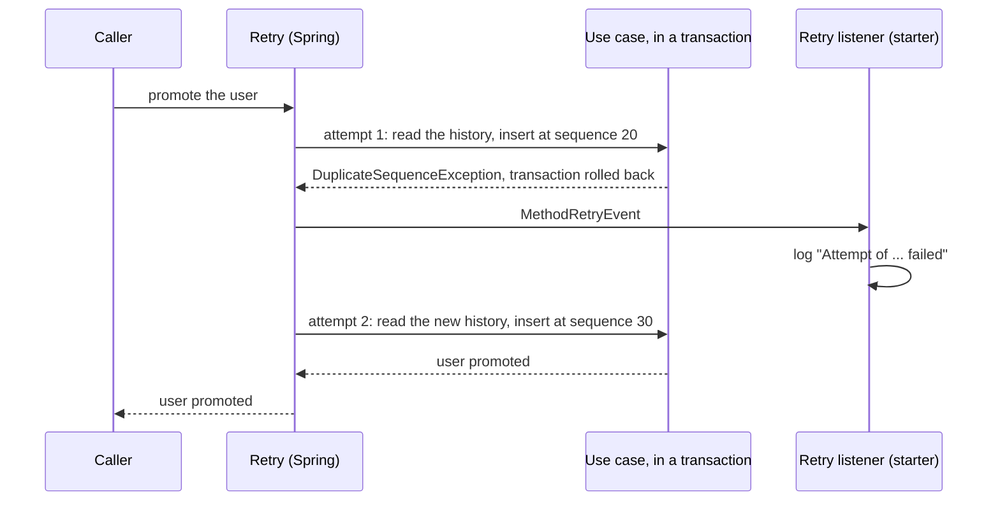

# Retryable Starter

A [tech starter](https://github.com/mboisnard/drinkit/blob/master/docs/src/engineering/architecture/tech-starters.md)
that turns on the `@Retryable` of Spring Framework and logs each failed attempt. DrinkIt needs it for concurrent
writes on an event-sourced aggregate: the use case that loses the race runs again on the new history.
`event-sourcing-starter` brings it, so an application gets it with that starter.

## What it is for

Two use cases can read the same history of a user and compute the same next sequence id. The primary key refuses
the second insert, which throws `DuplicateSequenceException`. The `@RetryableTransactional` of
`event-sourcing-starter` retries on that exception, and this starter makes the retry run.

The retry wraps the transaction, so that each attempt reads the history again:



When the last attempt fails too, the listener logs that the retries are exhausted and the caller gets the exception.
A failure the retry policy does not cover reaches the caller at once, after a single line for its failed attempt.

## Key Features

- The `@Retryable` of `org.springframework.resilience.annotation` runs on any bean, with no AspectJ to ship.
- Each failed attempt is logged at `INFO` with the class of its exception, which the caller never sees, and the
  exhausted retries at `WARN`. The message of the exception stays out of the logs, since it can hold personal data.
- An application that declares its own `ApplicationListener<MethodRetryEvent>` bean replaces the starter's logging,
  to send the failures elsewhere.

## Configuration

| Property | Default | Environment variable | Must production set it? |
|---|---|---|---|
| `starters.retryable.enabled` | `true` | `STARTERS_RETRYABLE_ENABLED` | No. Switched off, no `@Retryable` method runs again |

## Usage

An application that needs the retry declares the starter in its `build.gradle.kts`:

```kotlin
dependencies {
    implementation(project(":retryable-starter"))
}
```

A retry policy names the exceptions worth a new attempt, as `@RetryableTransactional` does:

```kotlin
@Retryable(includes = [DuplicateSequenceException::class], maxRetries = 2, delay = 0)
```

`maxRetries` counts the retries after the first attempt: `maxRetries = 2` makes three attempts.

A unit test calls the method without Spring and sees one attempt. A test of the retry builds the Spring context,
with an `ApplicationContextRunner` or an integration test. `SpyRetryListener`, in the starter's test fixtures, counts
the failed attempts there. Declared as a bean, it replaces the starter's logging in that context:

```kotlin
testImplementation(testFixtures(project(":retryable-starter")))
```

```kotlin
runner.withBean(SpyRetryListener::class.java, { spyRetryListener })
    .run { context ->
        context.getBean<SaveEvent>().invoke()

        spyRetryListener.countFailedAttempts() shouldBe 1
    }
```
