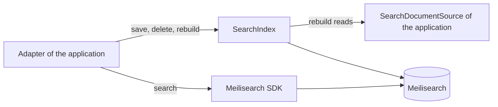
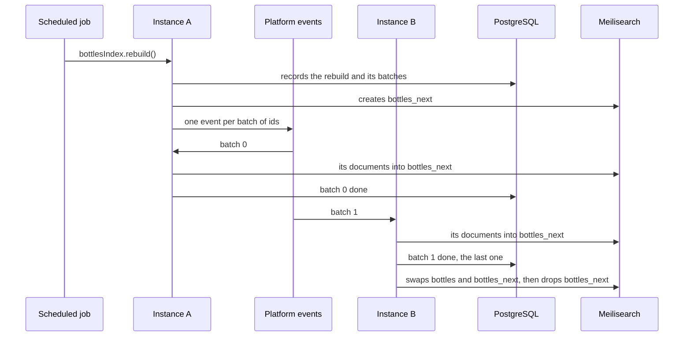

# Search Engine Starter

A [tech starter](https://github.com/mboisnard/drinkit/blob/master/docs/src/engineering/architecture/tech-starters.md)
that keeps a copy of the application's data, such as its bottles, in a [Meilisearch](https://www.meilisearch.com/)
index built for search. The database stays the source of truth. The application writes documents through a
`SearchIndex`, searches through the Meilisearch SDK, and rebuilds an index from its database without downtime.
[ADR 0008](https://github.com/mboisnard/drinkit/blob/master/docs/src/engineering/adr/0008-index-through-an-abstraction-search-with-meilisearch.md)
says why writes go through the starter and searches through the SDK.



## How it works

A rebuild sends one [platform event](https://github.com/mboisnard/drinkit/blob/master/docs/src/engineering/architecture/platform-events.md)
per batch of ids. With a broker, the batches spread over the instances, and the one that finishes the last batch swaps
the indexes:



Today the platform events travel inside the process, so the instance that calls `rebuild()` loads every batch.
[ADR 0009](https://github.com/mboisnard/drinkit/blob/master/docs/src/engineering/adr/0009-rebuild-search-indexes-in-batches-tracked-in-postgresql.md)
says why the batches are tracked in PostgreSQL.

## Usage

A module declares the starter in its build file:

```kotlin
dependencies {
    implementation(project(":search-engine-starter"))
}
```

The starter needs `messaging-starter`, a `JsonMapper` and a `Clock` bean, and its `search_index_rebuild` table, which
the [updater](https://github.com/mboisnard/drinkit/blob/master/deployment/updater/README.md) creates. Without jOOQ's
`DSLContext`, it declares nothing, not even the Meilisearch client.

Declare an index with its source, which gives a rebuild the ids of the table page by page, then the documents of a
page:

```kotlin
data class BottleDocument(val id: String, val name: String, val type: String, val vintage: Int?)

class BottleDocuments(private val dsl: DSLContext) : SearchDocumentSource<BottleDocument> {
    override fun ids(after: String?, limit: Int): List<String> = …   // WHERE id > after ORDER BY id LIMIT limit
    override fun documents(ids: List<String>): List<BottleDocument> = …   // leaves out the rows that are gone
}

@Bean
fun bottlesIndex(indexes: SearchIndexes, documents: BottleDocuments): SearchIndex<BottleDocument> =
    indexes.declare("bottles", documents)
```

The index reads its settings from `search/bottles.json` on the classpath, in
[Meilisearch's format](https://www.meilisearch.com/docs/reference/api/settings), and its id from the `id` field.
Then write, search and rebuild:

```kotlin
bottlesIndex.save(document)   // waits for the engine, throws SearchIndexingFailed when it refuses
bottlesIndex.delete(id)

client.index(bottlesIndex.name).search(SearchRequest.builder().q("margaux").build())

@Scheduled(cron = "0 0 4 * * *")
fun rebuildBottles() {
    bottlesIndex.rebuild()
}
```

- **A rebuild** fills `bottles_next` from the source in batches, then swaps it with `bottles`, so that a search never
  sees a half-filled index. The writes made meanwhile go to both indexes.
- **`searchEngine.information()`** gives the state of the engine and of each index for an admin page.

## Configuration

| Property | Default | Environment variable |
|---|---|---|
| `starters.search-engine.enabled` | `true` | `STARTERS_SEARCHENGINE_ENABLED` |
| `starters.search-engine.meilisearch.url` | `http://localhost:7700`, production sets it | `STARTERS_SEARCHENGINE_MEILISEARCH_URL` |
| `starters.search-engine.meilisearch.api-key` | None, required in production: a key that can write | `STARTERS_SEARCHENGINE_MEILISEARCH_APIKEY` |
| `starters.search-engine.task-timeout` | `30s` per write | `STARTERS_SEARCHENGINE_TASKTIMEOUT` |
| `starters.search-engine.rebuild.batch-size` | `1000` ids | `STARTERS_SEARCHENGINE_REBUILD_BATCHSIZE` |
| `starters.search-engine.rebuild.restart-after` | `30m`, then a stuck rebuild starts over | `STARTERS_SEARCHENGINE_REBUILD_RESTARTAFTER` |

## Tests

From `testFixtures(project(":search-engine-starter"))`, `InMemorySearchIndexes` stands for both `SearchIndexes` and
`SearchEngine` in a test of business code, and `@MeilisearchIntegrationTest` starts a real Meilisearch in Docker for
a test of an adapter.

## Limits

- Meilisearch keeps a number as a double: `12.50` comes back as `12.5`. Keep a price in cents, or as a string.
- The last write wins. Keep the index up to date from a handler that reads the row again, since the payload of an
  event delivered late would overwrite a newer document.
- `ids` pages by the id itself: with an offset, a row inserted during a rebuild would shift the pages.
