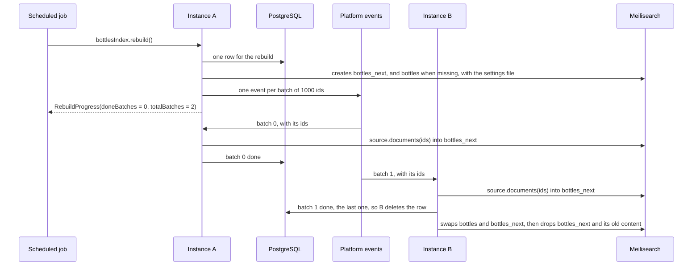
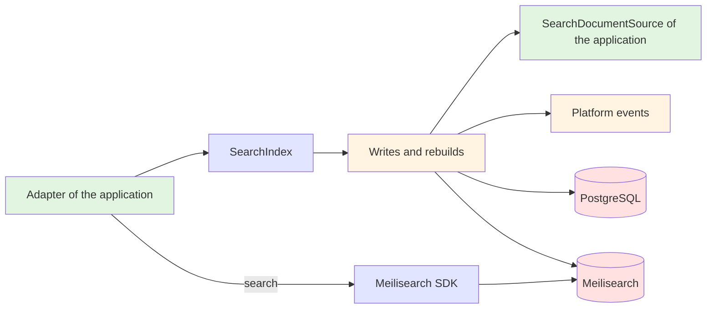

# Search Engine Starter

A [tech starter](https://github.com/mboisnard/drinkit/blob/master/docs/src/engineering/architecture/tech-starters.md)
that copies the application's data, such as its bottles, into a [Meilisearch](https://www.meilisearch.com/) index.
The application writes documents through a `SearchIndex`, searches through the Meilisearch SDK, and rebuilds the index
from its database without downtime.

## What is a search index?

A search index is a copy of the data built for search: a bottle found by a word of its name, a typo included, or
filtered by its type and vintage. The database stays the source of truth, and the index follows it a moment after each
commit. A rebuild fills the index again from the database, when its settings change or to catch a missed write.
[ADR 0009](https://github.com/mboisnard/drinkit/blob/master/docs/src/engineering/adr/0009-search-index-writes-through-the-starter-searches-through-the-engine-sdk.md)
says why writes go through the starter and searches through the SDK.

## Architecture Overview

`rebuild()` fills a second index, `bottles_next`, from the source, then swaps it with `bottles` in one step, so a
search never sees a half-filled index. It publishes one event per batch of ids and returns without waiting for them.
The instance that finishes the last batch swaps the indexes:



The diagram shows the batches spread by a broker. Today the
[platform events](https://github.com/mboisnard/drinkit/blob/master/docs/src/engineering/architecture/platform-events.md)
travel inside the process, so the instance that calls `rebuild()` loads every batch.

The application's code is green, the starter's API blue, its implementation orange, and the systems it talks to red:



## Key Features

### Write one document or a list

```kotlin
bottlesIndex.save(document)
bottlesIndex.save(documents)   // one task for the whole list
bottlesIndex.delete(id)
bottlesIndex.delete(ids)
```

Each write waits for its Meilisearch task, up to `task-timeout`, so a read right after it sees the write. A task that
fails throws `SearchIndexingFailed` with the engine's code, such as `missing_document_id`.

Meilisearch keeps no version of a document, and the last write wins. The engine keeps a number as a double: `12.50`
comes back as `12.5`, and a number of more than 15 digits loses its last ones. Keep a price in cents, or as a string.

### Search through the SDK

A query goes through the SDK, on the name of the index, which always names the live index:

```kotlin
client.index(bottlesIndex.name).search(
    SearchRequest.builder().q("margaux").filter(arrayOf("type = WINE")).build(),
)
```

`find(id)` reads one document back. The SDK also covers what `SearchIndex` does not offer, such as a partial update or
a deletion by filter.

A vector is a field of the document. With a `userProvided` embedder in the settings file, the document carries its
vectors under `_vectors.<embedder>`, and a `hybrid` search passes the vector of the query. The
starter computes no vector. An embedder that Meilisearch runs itself, such as `openAi`, needs no code, but each rebuild
computes every vector again.

### Rebuild from scratch, blue/green

```kotlin
@Scheduled(cron = "0 0 4 * * *")
fun rebuildBottles() {
    bottlesIndex.rebuild()
}
```

- **The source is the truth.** Each document is built again from the database, so the index gets the latest version
  of each bottle, and none of the deleted ones.
- **Writes go to both indexes.** While a rebuild runs, `save` and `delete` write to `bottles_next` too, on any
  instance, so the swap keeps them.
- **A lost index comes back.** A rebuild creates `bottles` with its settings when the engine lost it or never got it.
- **A stuck rebuild starts over.** After a lost event, a stopped instance or a swap left without its end, the first
  `rebuild()` past `restart-after` starts from scratch. Before then, `rebuild()` returns the progress of the running
  one.

`rebuildProgress()` gives the progress later, and `null` once the indexes are swapped.
[ADR 0010](https://github.com/mboisnard/drinkit/blob/master/docs/src/engineering/adr/0010-search-index-rebuilds-in-batches-tracked-in-postgresql.md)
says why a rebuild goes in batches tracked in PostgreSQL.

With Elasticsearch, the same rebuild applies: `bottles_next` becomes `bottles_<timestamp>`, and the swap moves the
alias `bottles` to it in one `_aliases` call. The interface of the starter stays the same.

### Information for an admin page

| Call | Gives | For |
|---|---|---|
| `searchEngine.information()` | the version and size of the engine, and each index with its documents, whether it is indexing, and the progress of its rebuild | a page that shows the state of the engine |
| `searchIndexes.all()` | the declared indexes | rebuilding one by its name |

`information()` lists the indexes the application did not declare too: the `_next` index of a running rebuild, or one
left behind.

## Configuration

| Property | Default | Environment variable | Required in production |
|---|---|---|---|
| `starters.search-engine.meilisearch.url` | `http://localhost:7700` | `STARTERS_SEARCHENGINE_MEILISEARCH_URL` | Yes |
| `starters.search-engine.meilisearch.api-key` | none | `STARTERS_SEARCHENGINE_MEILISEARCH_APIKEY` | Yes, a key that can write, never committed |
| `starters.search-engine.task-timeout` | `30s` | `STARTERS_SEARCHENGINE_TASKTIMEOUT` | No |
| `starters.search-engine.rebuild.batch-size` | `1000` | `STARTERS_SEARCHENGINE_REBUILD_BATCHSIZE` | No |
| `starters.search-engine.rebuild.restart-after` | `30m` | `STARTERS_SEARCHENGINE_REBUILD_RESTARTAFTER` | No |
| `starters.search-engine.enabled` | `true` | `STARTERS_SEARCHENGINE_ENABLED` | No |

The starter needs a `JsonMapper` and a `Clock` bean, and the platform events of `messaging-starter`. Its table,
`search_index_rebuild`, comes with the
[changelogs](https://github.com/mboisnard/drinkit/blob/master/docs/src/engineering/build-and-data/database.md), which
the updater applies before the application starts. With Spring Boot's health module on the classpath, a
`meilisearchHealthIndicator` reports whether the engine answers.

## Usage

The module of the application that holds its adapters declares the starter:

```kotlin
dependencies {
    implementation(project(":search-engine-starter"))
}
```

### Declare an index and its source

A document is the data class the index stores, with an id. Its `SearchDocumentSource` gives a rebuild the ids of the
table, page after page, and the documents of a page of ids:

```kotlin
data class BottleDocument(val id: String, val name: String, val type: String, val vintage: Int?)

class BottleDocuments(private val dsl: DSLContext) : SearchDocumentSource<BottleDocument> {

    override fun ids(after: String?, limit: Int): List<String> = …   // WHERE id > after ORDER BY id LIMIT limit

    override fun documents(ids: List<String>): List<BottleDocument> = …
}

@Bean
fun bottlesIndex(indexes: SearchIndexes, documents: BottleDocuments): SearchIndex<BottleDocument> =
    indexes.declare("bottles", documents)
```

`ids` pages by the id itself, in a stable order. With an offset, a row inserted during a rebuild would shift the pages,
and an id would be read twice or never. `documents` leaves out the ids whose row is gone.

The id field defaults to `id`, and the settings file to `search/bottles.json` on the classpath, in
[Meilisearch's format](https://www.meilisearch.com/docs/reference/api/settings):

```json
{
  "searchableAttributes": ["name"],
  "filterableAttributes": ["type", "vintage"]
}
```

Declaring the index sends the file to the engine, which creates the index when missing, and a changed file applies at
the next start. The startup does not wait for the engine. A key removed from the file keeps its value until the next
rebuild, which starts from an empty index.

### Follow the database

A use case publishes a platform event, and its handler reads the bottle again, then saves or deletes it:

```kotlin
@PlatformEventHandler(name = "catalog.index-bottle")
fun on(event: BottleChanged) {
    val bottle = bottles.find(event.bottleId)
    if (bottle == null) bottlesIndex.delete(event.bottleId) else bottlesIndex.save(bottle.toDocument())
}
```

A handler that reads the row writes the latest bottle whatever the order of the events. The payload of an event
delivered late would overwrite a newer bottle.

### Test

```kotlin
testImplementation(testFixtures(project(":search-engine-starter")))
```

| A test of | Runs against | Gets |
|---|---|---|
| Business code | `InMemorySearchIndexes`, both the `SearchIndexes` and the `SearchEngine` | a rebuild done when it returns |
| An adapter | a real Meilisearch, with `@MeilisearchIntegrationTest` | the `Client` of the container, or a `MeilisearchServer`, its URL and key, to start an application on it |
