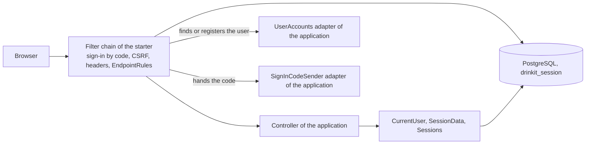
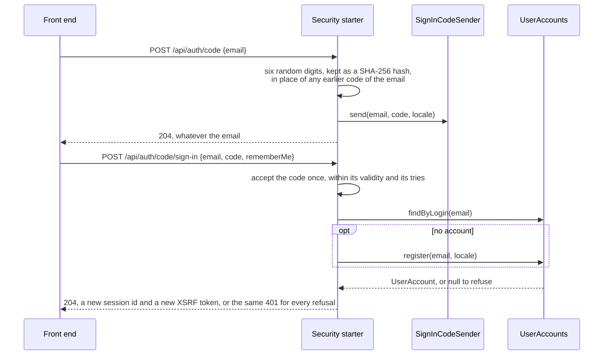
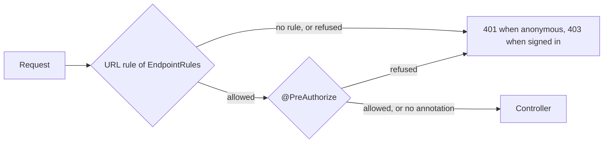

# Security Starter

A [tech starter](https://github.com/mboisnard/drinkit/blob/master/docs/src/engineering/architecture/tech-starters.md)
that secures a Spring MVC application serving a single-page front end: sign-in with a code sent by email, sign-out,
remember-me, a session kept in PostgreSQL, CSRF, the security headers and the access rules of the endpoints. Every
endpoint is refused until the application gives it a rule. The
[security principles](https://github.com/mboisnard/drinkit/blob/master/docs/src/engineering/security/principles.md)
explain the choices behind the defaults.



## How it works

A sign-in takes two calls. The first draws a code and hands it to the application, the second trades it for a
session:



A request then passes the URL rule, then the `@PreAuthorize` of the controller method when it has one:



## Usage

A module declares the starter in its build file:

```kotlin
dependencies {
    implementation(project(":security-starter"))
}
```

The application implements two ports, declares its access rules as `EndpointRules`, and gives the `Clock` the
starter reads the time from. The starter calls the ports
from its filters, outside any use case, so the adapters open their own transactions.

`UserAccounts` gives the accounts. A disabled or deleted account is not found, and roles are full authority names
such as `ROLE_USER`. `register` gives the account of an email that a code has just proven, when `findByLogin` found
none: a new account, or one the application brings back. Null refuses the sign-in.

```kotlin
@Component
internal class DomainUserAccounts(
    private val users: Users,
    private val createNewUser: CreateNewUser,
    private val reactivateUser: ReactivateUser,
) : UserAccounts {
    @Transactional(readOnly = true)
    override fun findByLogin(login: String): UserAccount? = …

    @Transactional(readOnly = true)
    override fun findById(id: String): UserAccount? = users.findEnabledBy(UserId(id))?.toAccount()

    @Transactional
    override fun register(login: String, locale: Locale): UserAccount? {
        val email = Email(login)
        return users.findDeletedBy(email)?.let(::reactivate) ?: create(email, locale)
    }
}
```

`SignInCodeSender` sends the code. The starter calls it before it answers, so hand the sending off, such as to a
platform event, and never log the code:

```kotlin
@Component
internal class SignInCodeEmails(
    private val publisher: PlatformEventPublisher,
    private val notificationSender: NotificationSender,
) : SignInCodeSender {
    override fun send(login: String, code: String, locale: Locale) {
        publisher.publish(SignInCodeRequested(login, code, locale))
    }

    @PlatformEventHandler("send.sign.in.code.queue")
    fun sendTheCode(event: SignInCodeRequested) { … }
}

@Bean
fun drinkitEndpoints() = endpointRules {
    authorize("/api/registration/**", authenticated)
    authorize("/api/**", hasRole("USER"))
}
```

A controller reads and changes the connected user:

```kotlin
currentUser.get()                   // the connected user, or a 401 for an anonymous caller
currentUser.signIn(userId)          // a user proven another way, with a new session id
currentUser.refresh()               // after the user's roles changed
currentVisitor.id()                 // the browser behind the request, signed in or not
sessions.revokeAll(userId)          // signs another user out everywhere
sessionData.getOrPut(PREFERENCES) { preferencesOf(currentUser.get().id) }   // computed once per session
```

- **Endpoints**: the starter serves `POST /api/auth/code`, which takes `{email}`, `POST /api/auth/code/sign-in`,
  which takes `{email, code, rememberMe}`, `POST /api/auth/logout` and `GET /api/auth/csrf`. The email is trimmed
  and lower-cased.
  [Calling the API](https://github.com/mboisnard/drinkit/blob/master/docs/src/engineering/security/calling-the-api.md)
  shows how a front end or Postman uses them.
- **Visitor**: each request gets its visitor, a random id that a `visitor` cookie keeps for 30 days after the last
  visit, also logged as `visitor.id`. A visitor is a browser, not a person: two people on one browser share it.
- **Requests without CSRF token**: `endpointRules(csrfFree = listOf(matcher)) { … }` frees from the token a request
  that changes no state on the server, next to its access rule. Fetch Metadata still refuses it cross-site.
- **Logs**: each log of a signed-in user's request carries `user.id`, and each refusal its `traceId`, as the
  [logging page](https://github.com/mboisnard/drinkit/blob/master/docs/src/engineering/build-and-data/logging.md)
  says.
- **Tables**: the [updater](https://github.com/mboisnard/drinkit/blob/master/deployment/updater/README.md) creates
  the `drinkit_session` tables of the sessions, the remember-me tokens and the sign-in codes. The sign-in by code needs
  PostgreSQL.
- **Choices**: ADRs [0011](https://github.com/mboisnard/drinkit/blob/master/docs/src/engineering/adr/0011-sign-in-without-a-password.md),
  [0012](https://github.com/mboisnard/drinkit/blob/master/docs/src/engineering/adr/0012-keep-sessions-in-postgresql.md),
  [0013](https://github.com/mboisnard/drinkit/blob/master/docs/src/engineering/adr/0013-remember-me-with-a-rotating-hashed-token.md)
  and [0014](https://github.com/mboisnard/drinkit/blob/master/docs/src/engineering/adr/0014-protect-against-csrf-with-a-cookie-token-and-fetch-metadata.md)
  record the choices of the sign-in, the sessions, the remember-me and the CSRF protection.

## Configuration

| Property | Default | Environment variable |
|---|---|---|
| `starters.security.session.idle-timeout` | `30m` | `STARTERS_SECURITY_SESSION_IDLETIMEOUT` |
| `starters.security.session.absolute-timeout` | `8h` | `STARTERS_SECURITY_SESSION_ABSOLUTETIMEOUT` |
| `starters.security.remember-me.validity` | `30d` after the sign-in | `STARTERS_SECURITY_REMEMBERME_VALIDITY` |
| `starters.security.code.validity` | `10m` | `STARTERS_SECURITY_CODE_VALIDITY` |
| `starters.security.code.max-attempts` | `3` wrong tries per email in each window, at least `1` | `STARTERS_SECURITY_CODE_MAXATTEMPTS` |
| `starters.security.code.attempts-window` | `1h` | `STARTERS_SECURITY_CODE_ATTEMPTSWINDOW` |
| `starters.security.code.max-email-length` | `320`, the longest email the application takes | `STARTERS_SECURITY_CODE_MAXEMAILLENGTH` |
| `starters.security.cookie.prefix` | `__Host-`, empty over plain http | `STARTERS_SECURITY_COOKIE_PREFIX` |
| `starters.security.cookie.secure` | `true`, `false` over plain http | `STARTERS_SECURITY_COOKIE_SECURE` |
| `starters.security.visitor.validity` | `30d` after the last visit | `STARTERS_SECURITY_VISITOR_VALIDITY` |
| `starters.security.enabled` | `true` | `STARTERS_SECURITY_ENABLED` |

## Tests

From `testFixtures(project(":security-starter"))`:

- `connectedAs(ConnectedUser(id, setOf("ROLE_USER")))` signs a MockMvc request in, with its CSRF token.
- `InMemoryUserAccounts` is the double of `UserAccounts`, and `UserAccountsTestContract` the contract its adapter
  runs. Its `register` creates an account with `ROLE_REGISTRATION_IN_PROGRESS`, unless the login was given to
  `refuseRegistrationOf`.
- `SpySignInCodeSender` keeps the last code sent to each login, for the test to sign in with, and `failFor(login)`
  makes the sending throw, as an unreachable mail server would.
- `EndpointRulesCoverage(rules, apiPackage).unruledEndpoints()` lists the operations of the API contract that no rule
  matches, without starting the application. It applies the rules that the other tech starters of the classpath bring,
  such as the stream of `sse-starter`. Rules given by bean name replace the starter's rule of that name, and
  `properties`, such as `starters.sse.enabled=false`, are those the application runs with. It finds a starter's
  rule in an auto-configuration of `AutoConfiguration.imports` whose `@ConditionalOnClass` names `EndpointRules` by
  class.

```kotlin
val accounts = InMemoryUserAccounts("ada@drinkit.test" to UserAccount("ada-id", setOf("ROLE_USER")))
accounts.refuseRegistrationOf("blocked@drinkit.test")        // its sign-in gets the 401 of a refusal
val code = signInCodeSender.lastCodeOf("ada@drinkit.test")   // once POST /api/auth/code asked for it
```

## Limits

- Nothing limits the requests for a code per email or per address yet.
- The starter refuses to start with `cookie.secure` set to `false` and a prefix left: a browser drops a `__Host-`
  cookie that is not `Secure`.
