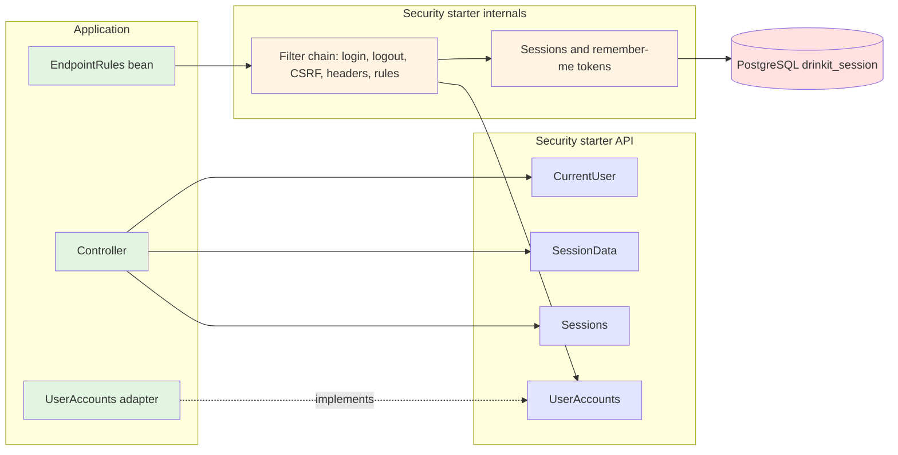
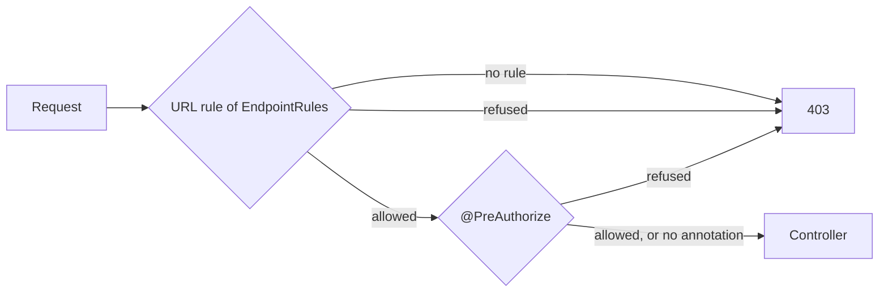

# Security Starter

A [tech starter](https://github.com/mboisnard/drinkit/blob/master/docs/src/engineering/architecture/tech-starters.md)
that secures a Spring MVC application serving a single-page front end:
- sign-in, sign-out and remember-me
- a session kept in PostgreSQL
- CSRF and the security headers
- the access rules of the endpoints

Every endpoint is refused until the application declares a rule for it. The business code then reads the connected
user, signs them in, keeps values in their session or signs them out everywhere through four small interfaces.

## What is it for?

An application that adds this starter gets the security of a browser session without writing a filter chain. It
writes only:
- where its users come from, through the `UserAccounts` port
- who may call each endpoint, through `EndpointRules`

The choices behind the defaults are explained with their diagrams in
[the security principles](https://github.com/mboisnard/drinkit/blob/master/docs/src/engineering/security/principles.md).
A front end or a tool such as Postman calls the API as
[calling the API](https://github.com/mboisnard/drinkit/blob/master/docs/src/engineering/security/calling-the-api.md)
shows.

## Architecture Overview



A request passes two layers of authorization: the URL rule, then `@PreAuthorize` on the controller method. Each one
catches what the other forgets.



## Key Features

- **Endpoints of its own:**
  - `POST /api/auth/login` takes `{username, password, rememberMe}` and answers 204 with a new CSRF cookie, or 401
  - `POST /api/auth/logout` answers 204
  - `GET /api/auth/csrf` sets the CSRF cookie.
- **Errors in ProblemDetail JSON:** an anonymous caller gets a 401, a refused one a 403. Every failed login gets the same body.
- **Sessions in PostgreSQL:**
  - stored as JSONB, with 256-bit ids
  - they expire after 30 idle minutes and 8 hours at most
  - the id changes at each sign-in.
- **Remember-me:**
  - a rotating token, of which only the hash is stored
  - it lasts 30 days from the password sign-in
  - a stolen token replayed after its rotation signs the user out everywhere.
- **Passwords in Argon2id** at the OWASP minimum, each hash prefixed with `{argon2}`, one hash per processor at once.
- **Security events logged** with the OWASP vocabulary, without email, token or session id.

## Configuration

| Property | Default | Environment variable | Required in production |
|---|---|---|---|
| `starters.security.enabled` | `true` | `STARTERS_SECURITY_ENABLED` | No |
| `starters.security.session.idle-timeout` | `30m` | `STARTERS_SECURITY_SESSION_IDLETIMEOUT` | No |
| `starters.security.session.absolute-timeout` | `8h` | `STARTERS_SECURITY_SESSION_ABSOLUTETIMEOUT` | No |
| `starters.security.remember-me.validity` | `30d` | `STARTERS_SECURITY_REMEMBERME_VALIDITY` | No |
| `starters.security.cookie.prefix` | `__Host-` | `STARTERS_SECURITY_COOKIE_PREFIX` | No |
| `starters.security.cookie.secure` | `true` | `STARTERS_SECURITY_COOKIE_SECURE` | No |

On a laptop served over plain http, set `cookie.secure` to `false` and `cookie.prefix` to an empty string: a
browser drops a `__Host-` cookie that is not `Secure`, and the starter refuses to start with that mix. The
changelogs of the [updater](https://github.com/mboisnard/drinkit/blob/master/deployment/updater/README.md) create
the `drinkit_session` tables, never the application.

## Usage

```kotlin
dependencies {
    implementation(project(":security-starter"))
    testImplementation(testFixtures(project(":security-starter")))
}
```

### Give the users and the rules

The application implements the port. A disabled or deleted account is not found, and roles are full authority
names such as `ROLE_USER`. The starter calls the port from its filters, outside any use case, so the adapter opens
its own transactions:

```kotlin
@Component
internal class DomainUserAccounts(private val users: Users) : UserAccounts {

    @Transactional(readOnly = true)
    override fun findByLogin(login: String) =
        Email(login).takeIf { it.validate().isEmpty() }?.let(users::findEnabledBy)?.toAccount()

    @Transactional(readOnly = true)
    override fun findById(id: String) = users.findEnabledBy(UserId(id))?.toAccount()

    private fun User.toAccount() = UserAccount(id.value, password.value, roles.allAsString())
}
```

Its endpoints get their rules in the Kotlin DSL of Spring Security. Any endpoint no rule matches is refused:

```kotlin
@Bean
fun drinkitEndpoints() = endpointRules {
    authorize(HttpMethod.POST, "/api/registration/new", permitAll)
    authorize("/api/**", hasRole("USER"))
}
```

### Read and change the connected user

A controller injects `CurrentUser`, since the interfaces generated from the API contract leave no room for an extra
parameter:

```kotlin
override fun deleteCellar(cellarId: CellarId): ResponseEntity<Unit> {
    deleteCellar(cellarId, currentUser.get().author)    // 401 before this line for an anonymous caller
    return ResponseEntity.noContent().build()
}

currentUser.signIn(createdUserId)   // right after a registration
currentUser.refresh()               // after the user's roles changed: new session id, roles read again
sessions.revokeAll(userId)          // another user's roles or password changed: signed out everywhere
```

A value computed once per session goes in `SessionData`, read back with its type:

```kotlin
private val PREFERENCES = sessionKey<Preferences>("preferences")

val preferences = sessionData.getOrPut(PREFERENCES) { preferencesOf(currentUser.get().userId) }
```

### Test

- `connectedAs(ConnectedUser(id, setOf("ROLE_USER")))` signs a MockMvc request in, with its CSRF token.
- `InMemoryUserAccounts` is the double of the port, and `UserAccountsTestContract` is the contract its real
  adapter runs.
- `EndpointRulesCoverage` lists the operations of an API package that no rule declares, without starting the
  application: it reads the mappings of the interfaces generated from the contract, and builds the starter's
  filter chain with the given rules alone. One test of the application fails when an endpoint has no rule:

```kotlin
@Test
fun `every operation of the API contract has an access rule`() {
    EndpointRulesCoverage(
        rules = listOf(SecurityConfiguration().drinkitEndpoints()),
        apiPackage = "com.drinkit.api.generated.api",
    ).unruledEndpoints() shouldBe emptyList()
}
```
