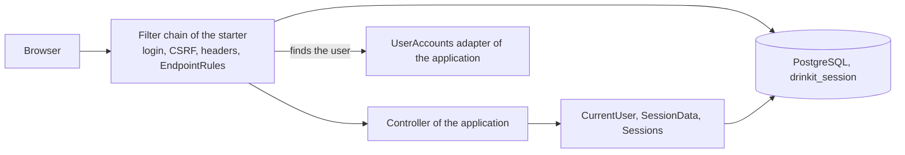
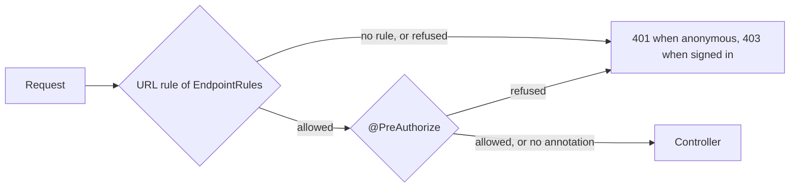

# Security Starter

A [tech starter](https://github.com/mboisnard/drinkit/blob/master/docs/src/engineering/architecture/tech-starters.md)
that secures a Spring MVC application serving a single-page front end: sign-in and sign-out, remember-me, a session
kept in PostgreSQL, CSRF, the security headers and the access rules of the endpoints. Every endpoint is refused until
the application gives it a rule. The
[security principles](https://github.com/mboisnard/drinkit/blob/master/docs/src/engineering/security/principles.md)
explain the choices behind the defaults.



## Usage

```kotlin
implementation(project(":security-starter"))
```

The application gives its users through the `UserAccounts` port and its access rules as `EndpointRules`. The starter
calls the port from its filters, outside any use case, so the adapter opens its own transactions. A disabled or
deleted account is not found, and roles are full authority names such as `ROLE_USER`.

```kotlin
@Component
internal class DomainUserAccounts(private val users: Users) : UserAccounts {
    @Transactional(readOnly = true)
    override fun findByLogin(login: String): UserAccount? = …

    @Transactional(readOnly = true)
    override fun findById(id: String) = users.findEnabledBy(UserId(id))?.let {
        UserAccount(it.id.value, it.password.value, it.roles.allAsString())
    }
}

@Bean
fun drinkitEndpoints() = endpointRules {
    authorize(HttpMethod.POST, "/api/registration/new", permitAll)
    authorize("/api/**", hasRole("USER"))
}
```

A request passes the URL rule, then the `@PreAuthorize` of the controller method when it has one:



A controller reads and changes the connected user:

```kotlin
currentUser.get()                   // the connected user, or a 401 for an anonymous caller
currentUser.signIn(createdUserId)   // right after a registration
currentUser.refresh()               // after the user's roles changed
sessions.revokeAll(userId)          // signs another user out everywhere
sessionData.getOrPut(PREFERENCES) { preferencesOf(currentUser.get().id) }   // computed once per session
```

The starter serves `POST /api/auth/login`, which takes `{username, password, rememberMe}`, `POST /api/auth/logout`
and `GET /api/auth/csrf`. [Calling the API](https://github.com/mboisnard/drinkit/blob/master/docs/src/engineering/security/calling-the-api.md)
shows how a front end or Postman uses them.

| Property | Default | Environment variable |
|---|---|---|
| `starters.security.session.idle-timeout` | `30m` | `STARTERS_SECURITY_SESSION_IDLETIMEOUT` |
| `starters.security.session.absolute-timeout` | `8h` | `STARTERS_SECURITY_SESSION_ABSOLUTETIMEOUT` |
| `starters.security.remember-me.validity` | `30d` after the password sign-in | `STARTERS_SECURITY_REMEMBERME_VALIDITY` |
| `starters.security.cookie.prefix` | `__Host-`, empty over plain http | `STARTERS_SECURITY_COOKIE_PREFIX` |
| `starters.security.cookie.secure` | `true`, `false` over plain http | `STARTERS_SECURITY_COOKIE_SECURE` |
| `starters.security.enabled` | `true` | `STARTERS_SECURITY_ENABLED` |

The [updater](https://github.com/mboisnard/drinkit/blob/master/deployment/updater/README.md) creates the
`drinkit_session` tables. ADRs [0010](https://github.com/mboisnard/drinkit/blob/master/docs/src/engineering/adr/0011-keep-sessions-in-postgresql.md),
[0011](https://github.com/mboisnard/drinkit/blob/master/docs/src/engineering/adr/0012-remember-me-with-a-rotating-hashed-token.md)
and [0012](https://github.com/mboisnard/drinkit/blob/master/docs/src/engineering/adr/0013-protect-against-csrf-with-a-cookie-token-and-fetch-metadata.md)
record the choices of the sessions, the remember-me and the CSRF protection.

## Tests

From `testFixtures(project(":security-starter"))`:

- `connectedAs(ConnectedUser(id, setOf("ROLE_USER")))` signs a MockMvc request in, with its CSRF token.
- `InMemoryUserAccounts` is the double of the port, and `UserAccountsTestContract` the contract its adapter runs.
- `EndpointRulesCoverage(rules, apiPackage).unruledEndpoints()` lists the operations of the API contract that no rule
  matches, without starting the application.

## Limits

- The starter refuses to start with `cookie.secure` set to `false` and a prefix left: a browser drops a `__Host-`
  cookie that is not `Secure`.
