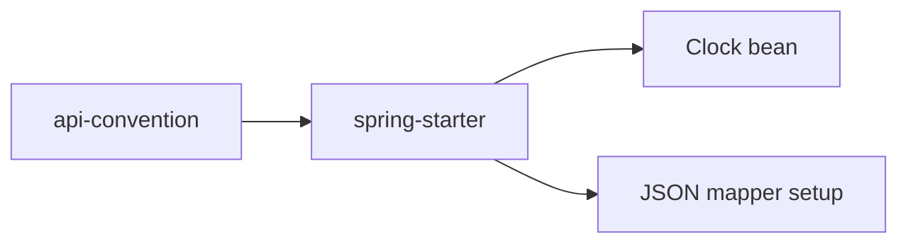

# Spring Starter

A [tech starter](https://github.com/mboisnard/drinkit/blob/master/docs/content/en/1.engineering/2.architecture/6.tech-starters.md)
that holds the Spring beans every DrinkIt application declares the same way: the `Clock` and the setup of the JSON
mapper. They belong to the application, not to one technical concern, so they live here rather than in each
application. The starter is not meant to grow: a bean joins it only when every application would copy it.

## Usage

No build file declares the starter: `com.drinkit.api-convention`, the archetype of an application, adds it. A tech
starter never depends on it, so a starter that injects a `Clock` relies on the application to provide one.

- **Clock**: the system clock of the default zone, which a use case or a starter receives as its `Clock`. An
  application that declares its own `Clock` keeps it.
- **JSON mapper**: Kotlin's module, set so that a `null` in a body takes the default value of the property. It adds
  to Spring Boot's own setup. An application's `JsonMapperBuilderCustomizer` or `JacksonModule` bean adds to it too,
  and only a customizer named `applicationJsonMapperBuilderCustomizer` replaces it.

## Configuration

| Property | Default | Environment variable |
|---|---|---|
| `starters.spring.enabled` | `true` | `STARTERS_SPRING_ENABLED` |

Switched off, the application declares its own `Clock`, and the JSON mapper keeps Spring Boot's setup.

## Tests

A test fixes and moves the time with `ControlledClock` of `test-starter`, declared as the `Clock` bean or passed to
the constructor.
