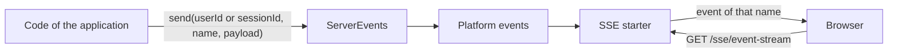
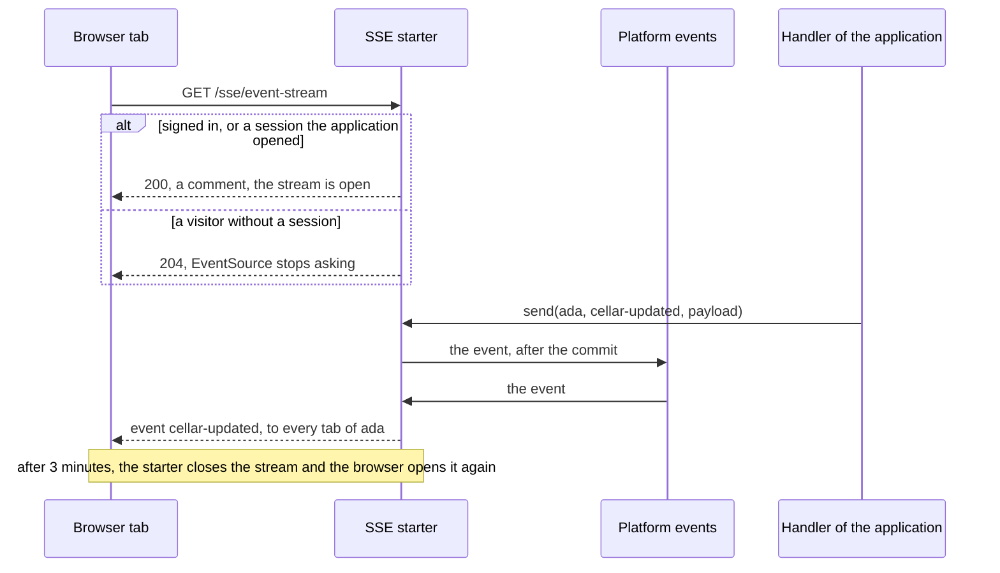

# SSE Starter

A [tech starter](https://github.com/mboisnard/drinkit/blob/master/docs/src/engineering/architecture/tech-starters.md)
that pushes events from the server to the browser with
[Server-Sent Events](https://developer.mozilla.org/en-US/docs/Web/API/Server-sent_events). Each tab opens one stream,
and the application sends an event to a user, or to the session of a visitor who is not signed in, who gets it in
every tab open on the instance.



## How it works

An event is queued as a platform event, after the commit of the transaction that sends it, and written to the
streams of its recipient that the instance holds. A comment every 30 seconds keeps a stream open through the
proxies:



[ADR 0015](https://github.com/mboisnard/drinkit/blob/master/docs/src/engineering/adr/0015-push-server-events-over-sse-to-a-user-or-a-session.md)
records why a stream belongs to a user or a session, carries signals, and comes with its access rule.

## Usage

A module declares the starter in its build file:

```kotlin
dependencies {
    implementation(project(":sse-starter"))
}
```

The browser opens one stream per tab, under the context path of the application, and listens to the events it needs
by name:

```javascript
const events = new EventSource('/drinkit/sse/event-stream');
events.addEventListener('cellar-updated', (event) => refreshCellar(JSON.parse(event.data).cellarId));
```

The application sends an event to a user from a handler or an adapter, never from the domain, which calls a port of
its own:

```kotlin
serverEvents.send(userId = owner.id, eventName = "cellar-updated", payload = mapOf("cellarId" to cellarId))
serverEvents.sendToSession(sessionId = session.id, eventName = "price-changed", payload = mapOf("bottleId" to id))
```

- The stream of a signed-in user gets the events sent to that user. The stream of a visitor gets those sent to the
  session the application opened for the visitor, and a visitor without one gets 204, which tells `EventSource` to stop
  asking: the page opens the stream again once a call of the application has opened the session, and again after the
  sign-in, which renews the session id.
- The payload is written as JSON. It says what changed, and the page reads the data again through the API: an event
  sent while a tab reconnects is lost.
- With `security-starter`, the starter opens the stream to anyone, and each caller gets their own events only. An
  application bean named `serverEventsAccessRules` replaces that rule:

```kotlin
@Bean
fun serverEventsAccessRules() = endpointRules {
    authorize(HttpMethod.GET, "/sse/event-stream", authenticated)
}
```

- The coverage test of the application's access rules leaves the stream out, since the starter's tests cover it:
  `EndpointRulesCoverage(rules, apiPackage, servedByStarters = listOf("GET /sse/event-stream"))`.
- When the application stops, the starter closes every stream, and the browser opens it again on another instance.

## Configuration

| Property | Default | Environment variable |
|---|---|---|
| `starters.sse.timeout` | `3m`, kept under the idle timeout of the proxies in front of the application | `STARTERS_SSE_TIMEOUT` |
| `starters.sse.heartbeat` | `30s` between two comments on each stream | `STARTERS_SSE_HEARTBEAT` |
| `starters.sse.max-streams-per-user` | `5` per user or session, the oldest stream closes when one more opens | `STARTERS_SSE_MAXSTREAMSPERUSER` |
| `starters.sse.enabled` | `true` | `STARTERS_SSE_ENABLED` |

## Tests

`SpyServerEvents`, from `testFixtures(project(":sse-starter"))`, records what the code under test sends:

```kotlin
val serverEvents = SpyServerEvents()
// the code under test sends
serverEvents.sentTo("ada-id").single().eventName shouldBe "cellar-updated"
```

## Limits

- An event reaches only the streams of the instance that published it, since the
  [platform events](https://github.com/mboisnard/drinkit/blob/master/docs/src/engineering/architecture/platform-events.md)
  travel inside the process. A broker would deliver it to every instance.
- A signed-in tab keeps its stream until the stream times out, even after a sign out or a revocation: the events
  it gets meanwhile are signals, whose data the API no longer serves to that tab.
