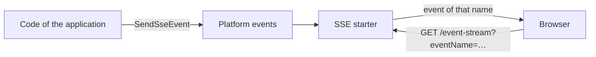
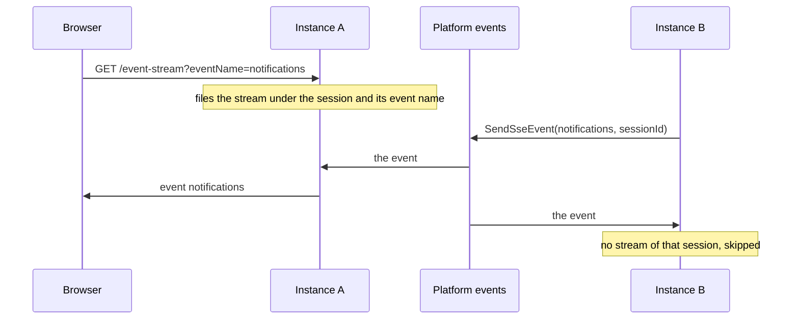

# SSE Starter

A [tech starter](https://github.com/mboisnard/drinkit/blob/master/docs/src/engineering/architecture/tech-starters.md)
that pushes events from the server to the browser with
[Server-Sent Events](https://developer.mozilla.org/en-US/docs/Web/API/Server-sent_events). A browser opens a named
stream, and the business code sends to it by publishing a platform event, without knowing about SSE.



## Usage

```kotlin
implementation(project(":sse-starter"))
```

The browser opens one stream per event name at `/event-stream`, under the context path of the application. The
starter files the stream under the HTTP session of the request:

```javascript
const notifications = new EventSource('/event-stream?eventName=notifications');
notifications.addEventListener('notifications', (event) => console.log(JSON.parse(event.data)));
```

The application sends to the streams of a session that have that event name:

```kotlin
platformEventPublisher.publish(
    SendSseEvent(eventName = "notifications", sessionId = sessionId, payload = mapOf("message" to message)),
)
```

With a broker, every instance would get the event, and only the one that holds a stream of that session sends it:



A stream closes after 3 minutes, and the browser's `EventSource` opens it again. The starter has no setting.

## Limits

- With `security-starter`, the stream is refused until the application gives `/event-stream` an access rule.
- An event reaches only the streams of the instance that published it, since the
  [platform events](https://github.com/mboisnard/drinkit/blob/master/docs/src/engineering/architecture/platform-events.md)
  travel inside the process. A broker would deliver it to every instance.
- The component scan of the application wires the starter, so no property turns it off.
