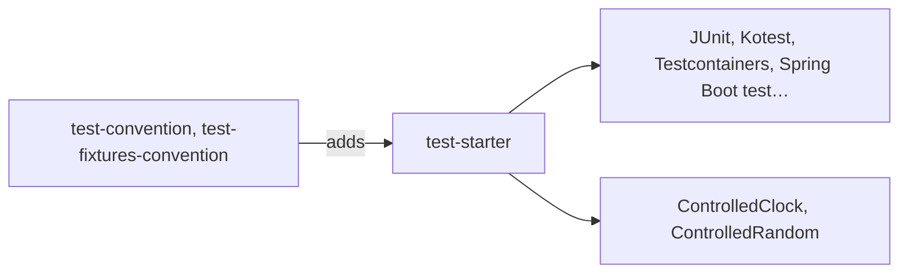

# Test Starter

A [tech starter](https://github.com/mboisnard/drinkit/blob/master/docs/src/engineering/architecture/tech-starters.md)
that puts DrinkIt's test libraries on a module's test classpath, with a clock and a random generator that a test
controls. It has no Spring bean.



## Usage

No build file declares the starter: the `test-convention` plugin, which the base plugin of every Kotlin
module applies, adds it to `testImplementation`, and `test-fixtures-convention` to
`testFixturesImplementation`:

```kotlin
dependencies {
    testImplementation(project(":test-starter"))
    testFixturesImplementation(project(":test-starter"))
}
```

- **Libraries**: JUnit Jupiter, Spring Boot test, Kotest assertions, kotlin-test, Testcontainers, Kotlin Faker,
  REST Assured, Cucumber and ApprovalTests.
- **What the build refuses**: the
  [architecture tests](https://github.com/mboisnard/drinkit/blob/master/docs/src/engineering/writing-code/testing/architecture-tests.md)
  refuse Mockito and the AssertJ and kotlin-test assertions. A test asserts with Kotest and uses hand-written
  doubles.

## Configuration

No setting.

## Tests

`ControlledClock` is a `java.time.Clock` that follows the system clock until a test fixes it, and the code under test
receives it as its `Clock`:

```kotlin
val clock = ControlledClock().fix(Instant.parse("2026-11-03T10:15:30Z"))

clock.add(Duration.ofMinutes(16))
clock.instant() shouldBe Instant.parse("2026-11-03T10:31:30Z")
```

`reset()` makes it follow the system clock again, and `add` throws on a clock that is not fixed.
`ControlledRandom.value` is a `kotlin.random.Random` with a fixed seed, so that each run draws the same values.

## Limits

- `ControlledRandom` is one object for the whole test JVM: the values a test draws depend on the tests that drew
  before it.
- No Cucumber scenario runs: `cucumber-junit` is a JUnit 4 runner, and no vintage engine is on the classpath.
- Give Kotlin Faker a seed, or its data changes from one run to the next.
