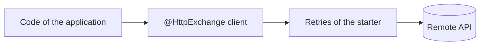
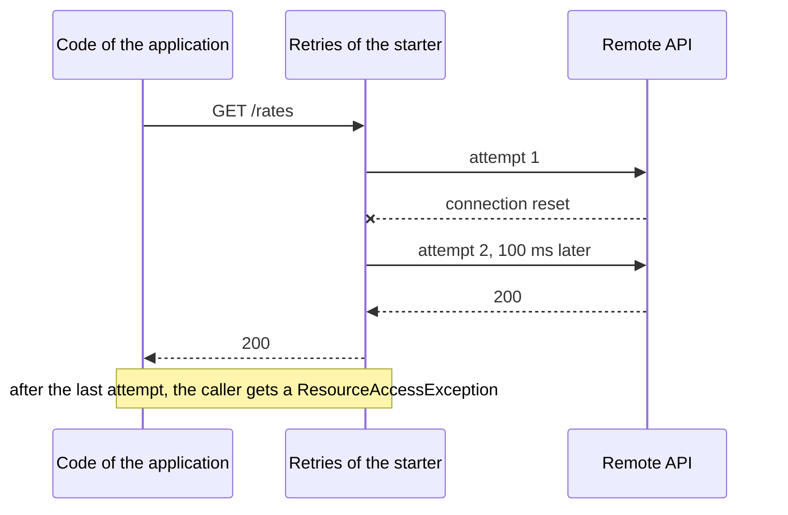

# Web Client Starter

A [tech starter](https://github.com/mboisnard/drinkit/blob/master/docs/src/engineering/architecture/tech-starters.md)
for the HTTP clients that Spring Boot builds from an `@HttpExchange` interface. It gives every client default
timeouts, and sends a safe request again when it fails on a network error, which Spring Boot does not do.



## How it works

A `GET`, `HEAD` or `OPTIONS` that fails on an I/O error is sent again, up to three more times. A `POST`, `PUT`,
`PATCH` or `DELETE` is sent once, since sending it again could apply it twice:



A response, even a `503`, is never retried: only a request that got no answer is.

A group whose API honours the `Idempotency-Key` header is listed in `starters.webclient.retry.idempotent-groups`. Its
`POST`, `PUT`, `PATCH` and `DELETE` that carry the header are retried too, and those sent while a request or an event
is handled get a key derived from its own, through the
[idempotency starter](https://github.com/mboisnard/drinkit/blob/master/tech-starters/backend/idempotency-starter/README.md):
a replay of the request or the event sends the same key, which the provider recognizes.

## Usage

A module declares the starter in its build file:

```kotlin
dependencies {
    implementation(project(":webclient-starter"))
}
```

Then it registers its clients in a group, whose base URL is set under `spring.http.serviceclient.<group>`:

```kotlin
@Configuration(proxyBeanMethods = false)
@ImportHttpServices(group = "rates", types = [RatesClient::class])
internal class RatesClients
```

- **Timeouts**: 2 seconds to connect and 5 seconds to read, for every client. `spring.http.clients.*` changes them
  for all clients, `spring.http.serviceclient.<group>.*` for one group.
- **Your own group configurers**: a `RestClientHttpServiceGroupConfigurer` of the application, such as one that
  reads XML, keeps the retries.
- **Your own retries**: a bean named `retryingHttpServiceGroupConfigurer` replaces the starter's.

## Configuration

| Property | Default | Environment variable |
|---|---|---|
| `starters.webclient.enabled` | `true`, `false` removes the retries and the default timeouts | `STARTERS_WEBCLIENT_ENABLED` |
| `starters.webclient.retry.max-retries` | `3`, the retries after the first attempt | `STARTERS_WEBCLIENT_RETRY_MAXRETRIES` |
| `starters.webclient.retry.delay` | `100ms`, between two attempts | `STARTERS_WEBCLIENT_RETRY_DELAY` |
| `starters.webclient.retry.idempotent-groups` | none, the groups whose API honours `Idempotency-Key` | `STARTERS_WEBCLIENT_RETRY_IDEMPOTENTGROUPS` |

## Tests

Nothing to add: a test replaces the client, or the remote API, as it would without the starter.
