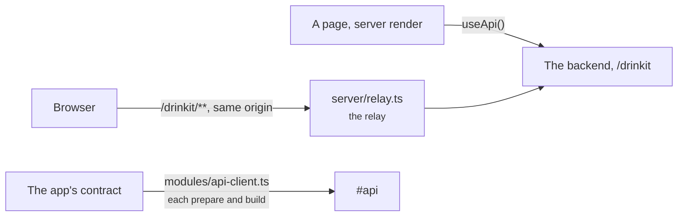

# API Client Starter

A frontend [tech starter](https://github.com/mboisnard/drinkit/blob/master/docs/content/en/1.engineering/2.architecture/6.tech-starters.md)
that calls the backend of a Nuxt app: a client that [Hey API](https://heyapi.dev/) generates from the app's OpenAPI
contract, the cookies of the page relayed during a server render, and a relay of the API's path on the app's origin
for the calls of the browser. Each app names its own contract, path and backend, so a second app with its own
backend extends the same starter. It is a [Nuxt layer](https://nuxt.com/docs/guide/going-further/layers), published in
the pnpm workspace as `@drinkit/api-client-starter`.
[ADR 024](https://github.com/mboisnard/drinkit/blob/master/docs/content/en/2.decisions/024-generate-the-frontend-api-client-with-hey-api-at-each-build.md)
records why Hey API, and
[Calling the API](https://github.com/mboisnard/drinkit/blob/master/docs/content/en/3.reference/2.security/2.calling-the-api.md)
draws both paths.



## Usage

```json
{
  "dependencies": {
    "@drinkit/api-client-starter": "workspace:*",
    "ofetch": "catalog:"
  }
}
```

```ts
// nuxt.config.ts
import { defineNuxtConfig } from 'nuxt/config';

export default defineNuxtConfig({
  extends: ['@drinkit/nuxt-starter', '@drinkit/api-client-starter'],
  apiClient: {
    contract: '../drinkit-api-contract/contract/api-definition.yaml',
    path: '/drinkit',
    backendUrl: 'http://127.0.0.1:8080',
    csrfPath: '/api/auth/csrf',
  },
});
```

```ts
// app/composables/useGreeting.ts
import { useAsyncData } from '#app';
import { useApi } from '@drinkit/api-client-starter/use-api';
import { getConnectedUserInfo } from '#api';

export function useGreeting() {
  const api = useApi();

  return useAsyncData('greeting', async () => (await getConnectedUserInfo(api)).data.firstname);
}
```

The generated client imports `ofetch`, which the app declares. `nuxt dev` generates the client when it starts:
restart it after a change of the contract.

## What it gives

- **`#api`**, the client of the app's contract, one function per operation and its types, generated under
  `.nuxt/openapi` at each prepare, dev and build, never committed. A call the backend refuses throws.
- **`useApi()`**, from `@drinkit/api-client-starter/use-api`, the options every call takes. Read it before any
  `await`. In the browser, the call goes to the relay with the CSRF token. In a server render, it goes to the
  backend with the cookies of the page and the address of the browser, and the cookies the backend sets reach the
  page once per name. A call without it fails at once, rather than leave without the cookies of its user.
- **`ProblemError`**, from `@drinkit/api-client-starter/problem-error`, the error of a refused call: its `status`,
  and the ProblemDetail of the backend in `data`, which the error page of `nuxt-starter` shows. Each one also goes
  to the `drinkit:api:problem` hook.
- **The relay**, the API's path on the app's origin, `/drinkit/**` for DrinkIt, which forwards the call of the browser with only the headers the
  API reads, the `Sec-Fetch-*` headers included, and streams its body. A path whose dot segments climb out of
  the API's path gets a 404, so that no other path of the backend's origin is reachable from the app's.
- **Only the cookies of the API** reach the backend, on both paths: `SESSION`, `XSRF-TOKEN`, `remember-me` and
  `visitor`, with or without their `__Host-` prefix.

## Configuration

| Key | Environment variable | Default | Effect |
|---|---|---|---|
| `apiClient.contract` | none | none: no client, no relay | The contract the client is generated from, relative to the app |
| `apiClient.path` | none | none, required with a contract | The path of the API on the backend, which the browser calls on the app's origin |
| `apiClient.backendUrl` | `NUXT_API_CLIENT_BACKEND_URL` | none, required with a contract | The origin of the backend, which only the server reaches: the local one in `nuxt.config.ts`, the variable elsewhere |
| `apiClient.csrfPath` | `NUXT_PUBLIC_API_CLIENT_CSRF_PATH` | none: a write without the cookie leaves without a token | The path under the API that writes the CSRF cookie. A write that finds no cookie, the first of a visitor or the first after a sign-out, calls it once before leaving |

The CSRF token is read from `__Host-XSRF-TOKEN`, then from `XSRF-TOKEN`, the name of the `dev` profile.

## Checks

```
pnpm --filter @drinkit/api-client-starter lint
pnpm --filter @drinkit/api-client-starter typecheck
pnpm --filter @drinkit/api-client-starter test
```

The relay and the server render are tested through the UI tests of the app, which build it with a contract.

## Limits

- `X-Forwarded-For` and `X-Forwarded-Proto` describe the connection to the app. Behind an ingress, that is the
  ingress's connection: the headers the ingress sets must then be trusted, or every user shares the limits per
  address of the backend.
- No retry, no cache and no validation of the responses at run time: the type check against the contract stands
  for the last one.
