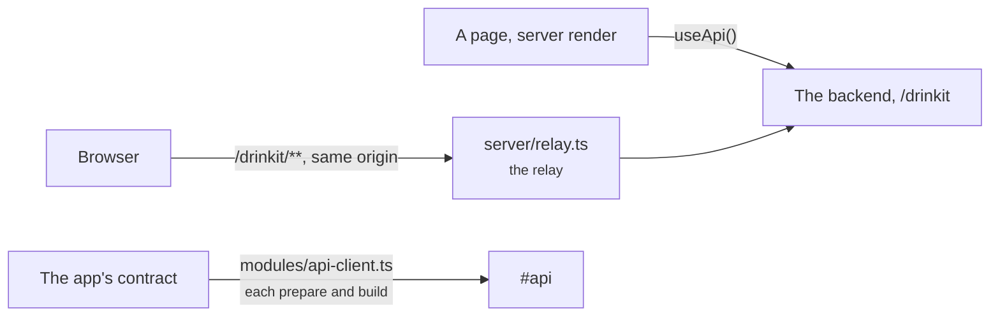
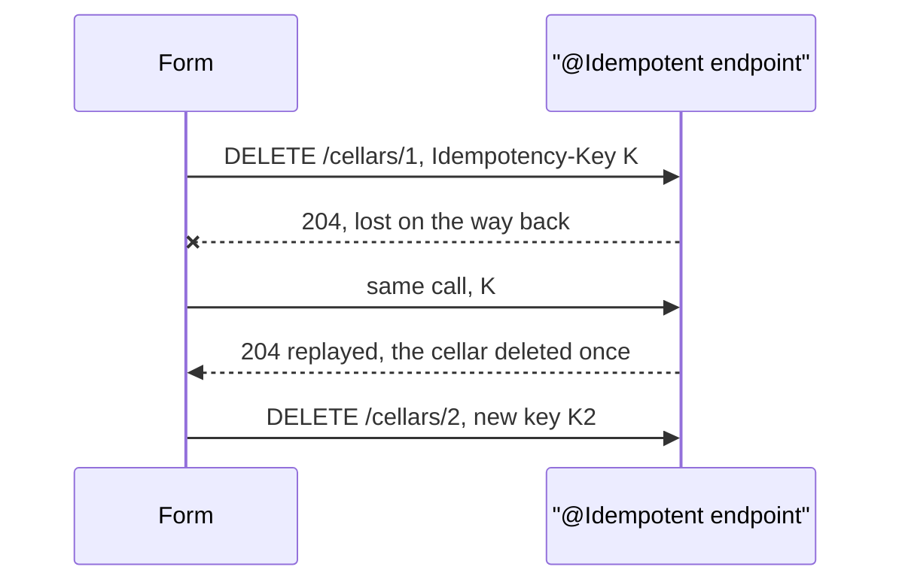

# API Client Starter

A frontend [tech starter](https://github.com/mboisnard/drinkit/blob/master/docs/content/en/1.engineering/2.architecture/6.tech-starters.md)
that calls the backend of a Nuxt app: a client that [Hey API](https://heyapi.dev/) generates from the app's OpenAPI
contract, the cookies of the page relayed during a server render, and a relay of the API's path on the app's origin
for the calls of the browser. Each app names its own contract, path and backend, so a second app with its own
backend extends the same starter. It is a [Nuxt layer](https://nuxt.com/docs/guide/going-further/layers), published in
the pnpm workspace as `@drinkit/api-client-starter`.
[ADR 024](https://github.com/mboisnard/drinkit/blob/master/docs/content/en/2.decisions/024-generate-the-frontend-api-client-with-hey-api-at-each-build.md)
records why Hey API, and
[Calling the API](https://github.com/mboisnard/drinkit/blob/master/docs/content/en/3.reference/2.security/2.calling-the-api.md)
draws both paths.



## Usage

```json
{
  "dependencies": {
    "@drinkit/api-client-starter": "workspace:*",
    "ofetch": "catalog:"
  }
}
```

```ts
// nuxt.config.ts
import { defineNuxtConfig } from 'nuxt/config';

export default defineNuxtConfig({
  extends: ['@drinkit/nuxt-starter', '@drinkit/api-client-starter'],
  apiClient: {
    contract: '../drinkit-api-contract/contract/api-definition.yaml',
    path: '/drinkit',
    backendUrl: 'http://127.0.0.1:8080',
    csrfPath: '/api/auth/csrf',
  },
});
```

```ts
// app/composables/useGreeting.ts
import { useAsyncData } from '#app';
import { useApi } from '@drinkit/api-client-starter/use-api';
import { getConnectedUserInfo } from '#api';

export function useGreeting() {
  const api = useApi();

  return useAsyncData('greeting', async () => (await getConnectedUserInfo(api)).data.firstname);
}
```

The generated client imports `ofetch`, which the app declares. `nuxt dev` generates the client when it starts:
restart it after a change of the contract.

## What it gives

- **`#api`**, the client of the app's contract, one function per operation and its types, generated under
  `.nuxt/openapi` at each prepare, dev and build, never committed. A call the backend refuses throws.
- **`useApi()`**, from `@drinkit/api-client-starter/use-api`, the options every call takes. Read it before any
  `await`. In the browser, the call goes to the relay with the CSRF token. In a server render, it goes to the
  backend with the cookies of the page and the address of the browser, and the cookies the backend sets reach the
  page once per name. A call without it fails at once, rather than leave without the cookies of its user. On both
  paths, `Accept-Language` names the language of the page, such as `fr-FR`, not the browser's, so that the backend
  answers in the language the user reads.
- **`ProblemError`**, from `@drinkit/api-client-starter/problem-error`, the error of a refused call: its `status`,
  and the ProblemDetail of the backend in `data`, which the error page of `nuxt-starter` shows. Each one also goes
  to the `drinkit:api:problem` hook.
- **`useSubmission()`**, from `@drinkit/api-client-starter/submission`, the sending of a form, with its
  `Idempotency-Key`, as [below](#a-form-sent-once) explains.
- **The relay**, the API's path on the app's origin, `/drinkit/**` for DrinkIt, which forwards the call of the browser with only the headers the
  API reads, the `Sec-Fetch-*` headers included, and streams its body. A path whose dot segments climb out of
  the API's path gets a 404, so that no other path of the backend's origin is reachable from the app's.
- **Only the cookies of the API** reach the backend, on both paths: `SESSION`, `XSRF-TOKEN`, `remember-me` and
  `visitor`, with or without their `__Host-` prefix.

## A form sent once

A double click, or a retry after an answer lost on the way back, sends a form twice. The backend runs an
[`@Idempotent`](../../backend/idempotency-starter/README.md) endpoint once per `Idempotency-Key`, so `useSubmission`
gives a key to each unsafe call of a submission, by the rule of the
[IETF draft](https://datatracker.ietf.org/doc/draft-ietf-httpapi-idempotency-key-header/) and of Stripe:

- the key stays while the outcome of the call is unknown: a network error, a `5xx`, a `429`, a `409`;
- a known answer, a `2xx` or another `4xx`, or another method, URL or body gives a new key;
- a submission sent while one runs is ignored, and a `409`, the first one still running, is sent again after its
  `Retry-After`, three times at most.

```ts
// app/composables/useCellarDeletion.ts
const { pending, problem, submit } = useSubmission();

const remove = (cellarId: string) => submit((api) => deleteCellar({ ...api, path: { cellarId } }));
```

`submit` hands its function the options of `useApi()` with the key added: a call made with them carries it, a call
made with `useApi()` never does. A `GET` carries none, and an endpoint without `@Idempotent` ignores it. `pending`
disables the button, and `problem` holds the refusal as the user reads it: the detail the backend gives, or the
text a function given to `useSubmission` returns, that detail again when it returns `undefined`:

```ts
const { problem, submit } = useSubmission((refusal) => refusal.status === 401 ? t('signIn.wrongCode') : undefined);
```



**In a UI test**, `idempotentEndpoint(resolver)` of `@drinkit/api-client-starter/testing` wraps the MSW resolver of
an endpoint as the backend's `IdempotencyFilter` runs it: a key already answered gets that answer back. `executions`
counts the runs, `keys` lists the key of each request, and `loseNextAnswer()` drops the next answer, as a network
failure would. It has no contract suite: the CI of the frontend runs no backend, and the replay it copies is tested
by the integration tests of `idempotency-starter`.

```ts
const deletion = idempotentEndpoint(() => new HttpResponse(null, { status: 204 }));
fakeBackend.use(http.delete('/drinkit/api/cellars/:cellarId', deletion.resolver));

// then, after a double click
expect(deletion.executions).toBe(1);
```

## Configuration

| Key | Environment variable | Default | Effect |
|---|---|---|---|
| `apiClient.contract` | none | none: no client, no relay | The contract the client is generated from, relative to the app |
| `apiClient.path` | none | none, required with a contract | The path of the API on the backend, which the browser calls on the app's origin |
| `apiClient.backendUrl` | `NUXT_API_CLIENT_BACKEND_URL` | none, required with a contract | The origin of the backend, which only the server reaches: the local one in `nuxt.config.ts`, the variable elsewhere |
| `apiClient.csrfPath` | `NUXT_PUBLIC_API_CLIENT_CSRF_PATH` | none: a write without the cookie leaves without a token | The path under the API that writes the CSRF cookie. A write that finds no cookie, the first of a visitor or the first after a sign-out, calls it once before leaving |
| `apiClient.serverRenderTimeout` | `NUXT_API_CLIENT_SERVER_RENDER_TIMEOUT` | `60000` | The milliseconds a call of the server render waits for the backend's answer, as [below](#the-timeout-of-a-server-render) explains |

The CSRF token is read from `__Host-XSRF-TOKEN`, then from `XSRF-TOKEN`, the name of the `dev` profile.

## The timeout of a server render

A backend that is down refuses the connection, and the page fails at once, whatever the timeout. One that accepts
the connection but never answers, stuck on a lock or on a slow service it calls, would leave the page blank for the
five minutes of Node's own limit: past `serverRenderTimeout`, the call fails with a `FetchError` instead, and the
page shows the error page. A minute leaves room to a page that is slow for a good reason.

A call of the browser has no timeout: the user sees the page load, and an action, such as a call to an AI model, may
take longer than a page should.

## Checks

```
pnpm --filter @drinkit/api-client-starter lint
pnpm --filter @drinkit/api-client-starter typecheck
pnpm --filter @drinkit/api-client-starter test
```

The relay and the server render are tested through the UI tests of the app, which build it with a contract.

## Limits

- `X-Forwarded-For` and `X-Forwarded-Proto` describe the connection to the app. Behind an ingress, that is the
  ingress's connection: the headers the ingress sets must then be trusted, or every user shares the limits per
  address of the backend.
- No retry, other than a submission the backend still runs, no cache and no validation of the responses at run
  time: the type check against the contract stands for the last one.
- A replay carries no cookie. An endpoint that renews the session in its answer, as the registration and the sign-in
  do, leaves a client that lost the answer with the old session: the key protects it from a double click only.
- `crypto.randomUUID()` needs a secure context: the app is served over HTTPS, or on `localhost` in development.
