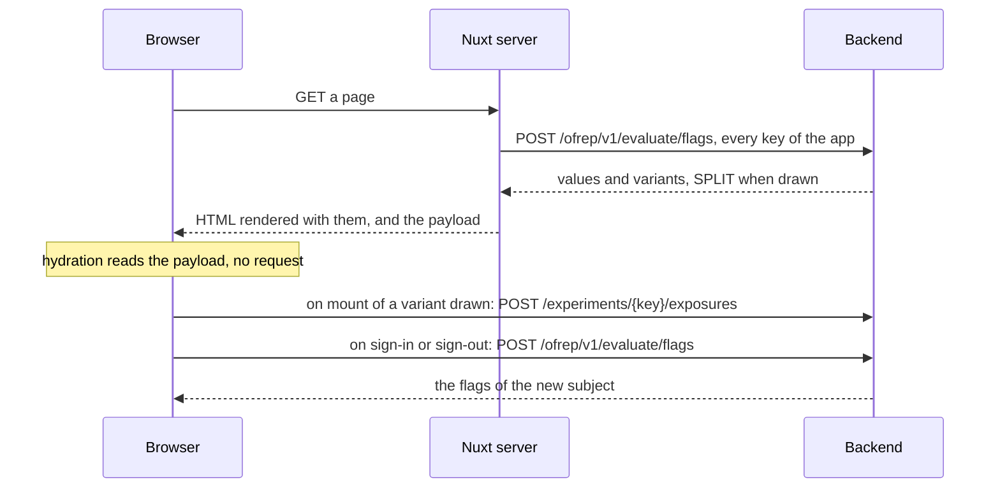

# Feature Management Starter

A frontend [tech starter](https://github.com/mboisnard/drinkit/blob/master/docs/content/en/1.engineering/2.architecture/6.tech-starters.md)
that reads the feature flags and the A/B test variants of a Nuxt app from its backend, over the OFREP bulk endpoint
the backend `feature-management-starter` serves, and reports the exposure of a variant shown.
[ADR 017](https://github.com/mboisnard/drinkit/blob/master/docs/content/en/2.decisions/017-feature-flags-through-openfeature.md)
and [ADR 018](https://github.com/mboisnard/drinkit/blob/master/docs/content/en/2.decisions/018-ab-tests-behind-a-flag-with-posthog.md)
record why. It is a Nuxt layer, published in the pnpm workspace as `@drinkit/feature-management-starter`, on top of
`api-client-starter`.



The flags are read once per server render, for the user or the visitor of the session, and again on the
`drinkit:signed-in` and `drinkit:signed-out` hooks, where the answer of the last one wins. Without a server render,
as an SPA, the browser reads them before the app mounts. A backend that cannot evaluate them leaves every flag to its
default, never to the value of the previous subject. Nothing is kept in `localStorage`.

## Usage

```json
{
  "dependencies": {
    "@drinkit/feature-management-starter": "workspace:*"
  }
}
```

```ts
export default defineNuxtConfig({
  extends: ['@drinkit/feature-management-starter'],
  featureManagement: {
    flags: ['cellar-count'],
    experiments: ['cellars-heading'],
  },
});
```

```ts
import { useFlag } from '@drinkit/feature-management-starter/use-flag';
import { useVariant } from '@drinkit/feature-management-starter/use-variant';

const showsCount = useFlag('cellar-count');         // ComputedRef<boolean>, false by default
const heading = useVariant('cellars-heading');      // ComputedRef<string>, 'control' outside the experiment
```

The keys are typed from the options: a key the app does not declare fails the type check. Call `useVariant` in the
component that renders in every variant, `control` included, where the variant takes effect: once mounted, it reports
one exposure when the backend drew the user, another when a sign-in or a sign-out draws another variant while it
stays mounted, and none outside the experiment or during a server render.

## Configuration

| Key | Environment variable | Default | Effect |
|---|---|---|---|
| `featureManagement.flags` | none | `[]` | The keys of the flags the app reads |
| `featureManagement.experiments` | none | `[]` | The keys of the A/B tests the app runs |

The endpoints are those of the backend `feature-management-starter`, under the path of the API:
`/ofrep/v1/evaluate/flags` and `/experiments/{key}/exposures`.

## Testing

`@drinkit/feature-management-starter/testing` gives the UI tests of an app both endpoints in memory, for the fake
backend of `test-starter`:

```ts
const ofrep = ofrepBackendDouble({ apiPath: '/drinkit', evaluate: (request) => flagsOf(request) });
fakeBackend.use(...ofrep.handlers);
ofrep.exposures;                                    // [{ experiment, variant }], in the order reported
```

## Checks

```
pnpm --filter @drinkit/feature-management-starter lint
pnpm --filter @drinkit/feature-management-starter typecheck
pnpm --filter @drinkit/feature-management-starter test
```

## Limits

- The backend evaluates at most 50 keys per request, each matching `^[a-z0-9][a-z0-9-]{0,99}$`, and answers 400
  otherwise, which leaves every flag to its default.
- A flag switched in Flipt reaches an open page at its next full load, sign-in or sign-out.
- A variant shown again after a navigation reports another exposure.
