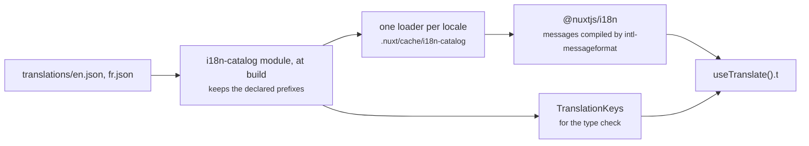

# I18n Starter

A frontend [tech starter](https://github.com/mboisnard/drinkit/blob/master/docs/content/en/1.engineering/2.architecture/6.tech-starters.md)
that translates a Nuxt app and its starters from one catalog of ICU messages, `translations/` at the root of the
repository, which the backend reads too. Each layer declares the prefixes of the keys it shows, and only those reach
the browser. The `t` it gives takes only a key of that catalog, with the values its message places, so an unknown key or a
missing value fails the type check.
[ADR 026](https://github.com/mboisnard/drinkit/blob/master/docs/content/en/2.decisions/026-translate-from-one-icu-catalog-the-frontend-and-the-backend-share.md)
records why. It is a Nuxt layer on [`@nuxtjs/i18n`](https://i18n.nuxtjs.org), published in the pnpm workspace as
`@drinkit/i18n-starter`, and the base of [`nuxt-starter`](../nuxt-starter/README.md), so every app and starter
has it.



## Usage

The app names its locales and the catalog, and each layer adds its prefixes:

```ts
// nuxt.config.ts of the app
export default defineNuxtConfig({
  extends: ['@drinkit/nuxt-starter'],
  i18n: {
    locales: [{ code: 'en', language: 'en-GB' }, { code: 'fr', language: 'fr-FR' }],
    defaultLocale: 'en',
    baseUrl: 'http://localhost:3000',
  },
  i18nCatalog: {
    catalog: '../../translations',
    prefixes: ['home', 'cellars'],
  },
});

// nuxt.config.ts of a starter
export default defineNuxtConfig({
  i18nCatalog: { prefixes: ['auth'] },
});
```

A component takes `t` in its `<script setup>` and calls it in its template:

```vue
<template>
  <p>{{ t('cellars.bottles', { count }) }}</p>
  <time>{{ d(openedAt, 'dateLong', timeZone) }}</time>
</template>

<script setup lang="ts">
  import { useTranslate } from '@drinkit/i18n-starter/translate';

  const { t, d } = useTranslate();
</script>
```

A link to a public page stays in the language of the page through `NuxtLinkLocale` or `useLocalePath()` of `#i18n`.
`security-starter` takes the prefix off every other page, which shows in the language of the account.

## Configuration

| Key | Default | Effect |
|---|---|---|
| `i18nCatalog.catalog` | none: no message loaded | The folder of the catalog, relative to the app |
| `i18nCatalog.prefixes` | `[]` | The first segments of the keys a layer shows, added up across the app and its layers. A prefix with no key in `en.json` fails the build |
| `i18n.strategy` | `prefix_except_default` | The default locale at `/`, the others under their code |
| `i18n.detectBrowserLanguage` | `false` | The URL alone decides the locale, so that a page renders the same for every request |
| `i18n.baseUrl` | none | The origin of the links to the other languages in the `<head>`, `NUXT_PUBLIC_I18N_BASE_URL` in a deployment. A built app refuses to start on a local origin, which a search engine cannot reach |

## What it exports

| Export | What it gives |
|---|---|
| `@drinkit/i18n-starter/translate` | `useTranslate()`: `t` for a key of the catalog and the values its message places, `exists` for a key built at run time, such as one per status, `d` and `n` in the named formats of a date in the time zone the caller gives, or of a number, an amount in the currency the caller gives, `locale` and `language`, such as `fr-FR` |
| `@drinkit/i18n-starter/locale-state` | `isLocaleState()`: the keys of `useState` a reset of the app's state spares, or the page loses its locales |
| `@drinkit/i18n-starter/testing` | `expectLocaleParity()` and `expectValidMessages()` for the catalog, `i18nTestSettings()` for the Nuxt tests of a starter |

The plugin `locale-head` writes the `lang` and `dir` of `<html>` and the links to the other languages.

## How it is built

| File | What it does |
|---|---|
| `modules/i18n-catalog.ts` | Filters the catalog by prefix, writes one loader per locale under the cache folder of the build, registers them with `@nuxtjs/i18n` and declares the keys and their values for the type check |
| `shared/message-arguments.ts` | The values a message places, a number to count, a text to choose a branch |
| `server/plugins/base-url.ts` | Stops a built app whose `i18n.baseUrl` is not a public origin |
| `i18n/i18n.config.ts` | Compiles each message with `intl-messageformat`, `en` as fallback |
| `shared/catalog-checks.ts` | What the checks of the catalog refuse: a key missing from a locale, an argument renamed, a message outside the ICU subset the backend reads the same |
| `shared/formats.ts` | The named formats of `d` and `n`, the one place that calls `Intl` |

A loader is a `.ts` file rather than JSON: `@nuxtjs/i18n` precompiles a JSON locale file with vue-i18n's syntax, which
fails on an ICU plural. A loader holds its messages, so the hash of the URL the browser loads them from follows the
text.

## Testing

A starter's Nuxt tests load the catalog with the locales an app would name:

```ts
// vitest.config.ts
export default defineVitestProjects({
  nuxtOverrides: { ...i18nTestSettings('../../../translations') },
});
```

A test that resets the state with `clearNuxtState` spares the locales: `clearNuxtState((key) => !isLocaleState(key))`.
An app checks its catalog in a unit test:

```ts
test('every locale of the catalog holds the keys of en.json, with the same values', () => {
  expectLocaleParity(catalog);
});
```

## Checks

```
pnpm --filter @drinkit/i18n-starter lint
pnpm --filter @drinkit/i18n-starter typecheck
pnpm --filter @drinkit/i18n-starter test
```
