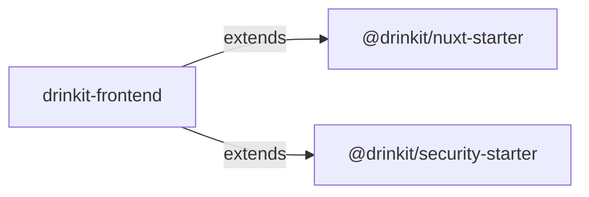

# Nuxt Starter

A frontend [tech starter](https://github.com/mboisnard/drinkit/blob/master/docs/content/en/1.engineering/2.architecture/6.tech-starters.md)
that every Nuxt app of DrinkIt extends: explicit imports, the error page, the browsers it builds for and the hooks
the other starters share. The security headers come from [`security-starter`](../security-starter/README.md). It is
a [Nuxt layer](https://nuxt.com/docs/guide/going-further/layers), published in the pnpm workspace as
`@drinkit/nuxt-starter`.
[ADR 023](https://github.com/mboisnard/drinkit/blob/master/docs/content/en/2.decisions/023-render-the-frontend-with-nuxt-on-tech-starters-in-a-pnpm-workspace.md)
records why.



## Usage

```json
{
  "dependencies": {
    "@drinkit/nuxt-starter": "workspace:*"
  }
}
```

```ts
// nuxt.config.ts
import { defineNuxtConfig } from 'nuxt/config';

export default defineNuxtConfig({
  extends: ['@drinkit/nuxt-starter'],
});
```

## What it sets

| Setting | Effect |
|---|---|
| `imports.autoImport: false`, `components.dirs: []` | Every Vue API, composable and component comes from an import |
| `routeRules` | A year of cache on the hashed files of `/_nuxt/` |
| `typescript.tsConfig`, `erasableSyntaxOnly` | No `enum`, namespace nor parameter property: the compiler refuses TypeScript it cannot strip to JavaScript |
| `vite.build.target` | The browsers of `.browserslistrc`, which `eslint-plugin-compat` checks the code against |

An app overrides any of them in its own `nuxt.config.ts`: the app wins over the layer.

## What it exports

- **`toProblemDetail()`**, from `@drinkit/nuxt-starter/problem-detail`: the ProblemDetail an error carries, or its
  status alone, which `app/error.vue` shows.
- **The hooks** of `app/hooks.d.ts`, typed: `drinkit:api:problem`, which `api-client-starter` calls,
  `drinkit:signed-in` and `drinkit:signed-out`, which `security-starter` calls. A starter calls them, another
  listens, and a wrong name fails the type check.

## Checks

```
pnpm --filter @drinkit/nuxt-starter lint
pnpm --filter @drinkit/nuxt-starter typecheck
pnpm --filter @drinkit/nuxt-starter test
```

The tests run on Vitest. The lint rules live apart, in
[`code-analysis/eslint`](https://github.com/mboisnard/drinkit/blob/master/code-analysis/eslint/README.md).
