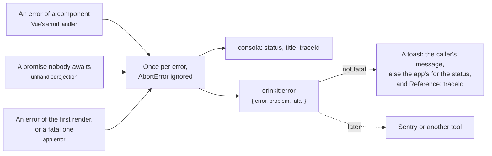

# Observability Starter

A frontend [tech starter](https://github.com/mboisnard/drinkit/blob/master/docs/content/en/1.engineering/2.architecture/6.tech-starters.md)
that catches every error a Nuxt app leaves unhandled in the browser. It logs the error once with the backend's
`traceId`, hands it to the `drinkit:error` hook, where an alerting tool can plug in, and shows it to the user in a
toast. The page needs no code for this. The `traceId` is the one the backend writes in its own logs and returns in
every problem detail, so a user who reports the reference of a toast leads to the logs of that request.
[ADR 016](https://github.com/mboisnard/drinkit/blob/master/docs/content/en/2.decisions/016-observe-through-micrometer-and-export-over-opentelemetry-on-demand.md)
records why. It is a Nuxt layer, published in the pnpm workspace as `@drinkit/observability-starter`.



The starter runs in the browser only, so it works the same whether the app renders on the server or not. It takes
over the browser's own report of a promise nobody awaits, from any code of the page, so that each one is logged once,
and it passes each error of a component on to the error handler another layer installed, such as an alerting
module. When the
app renders on the server, Nitro logs an error of that render itself, with the problem detail and its `traceId`.

## Usage

```json
{
  "dependencies": {
    "@drinkit/observability-starter": "workspace:*",
    "@nuxt/ui": "catalog:",
    "tailwindcss": "catalog:"
  }
}
```

```ts
// nuxt.config.ts
export default defineNuxtConfig({
  extends: ['@drinkit/nuxt-starter', '@drinkit/observability-starter'],
  modules: ['@nuxt/ui'],
  css: ['~/assets/css/main.css'], // @import "tailwindcss"; @import "@nuxt/ui";
});
```

The toasts render inside `<UApp>` of Nuxt UI, which wraps the app in its `app.vue`.

An error the code catches never reaches the starter: a form that shows a refusal next to its fields keeps doing so.
An action whose failure deserves a message of its own wraps the function it calls:

```ts
import { withErrorMessage } from '@drinkit/observability-starter/error-message';

const signOut = withErrorMessage(useCurrentUser().signOut, 'Sign-out failed. Try again.');
```

The wrapped function has the same signature, and still throws the error it got, a `ProblemError` for instance. An
action wrapped twice, by a composable and then by its page, shows the message of the outermost wrapper.

## Configuration

The default messages live in the starter's `app.config.ts`, which Nuxt merges with the app's. The app overrides a
message, or adds one for any status:

```ts
// app/app.config.ts
export default defineAppConfig({
  observability: {
    errorMessages: { 409: 'This already exists.' },
  },
});
```

| Key | Default |
|---|---|
| `default` | `Something went wrong. Try again.` |
| `network`, a call that got no answer | `The server cannot be reached. Check your connection and try again.` |
| `401` | `Your session has ended. Sign in again.` |
| `403` | `You are not allowed to do this.` |
| `502`, `503`, `504`, the backend or its gateway is down | `The server is unavailable. Try again in a moment.` |

A toast never shows the `detail` of the backend. The messages are texts of the interface, so they live in the
`app.config`, which a build fixes, rather than in the runtime config, which an environment changes.

## Alerting

`drinkit:error` is called once per error, fatal or not, with the thrown error, its problem detail and `fatal`. A
plugin of the app sends it on:

```ts
export default defineNuxtPlugin((nuxtApp) => {
  nuxtApp.hook('drinkit:error', ({ error, problem }) => {
    Sentry.captureException(error, { tags: { traceId: problem.traceId } });
  });
});
```

`@sentry/nuxt` catches the errors of Vue itself: with it, read the `traceId` from the event's error in `beforeSend`
rather than listening to the hook, or each error is reported twice.

## How it is built

| File | What it does |
|---|---|
| `app/plugins/report-errors.client.ts` | Catches each unhandled error once, logs it, calls `drinkit:error` |
| `app/plugins/toast-errors.client.ts` | Listens to `drinkit:error` and shows the toast of an error that is not fatal |
| `app/error-message.ts` | `withErrorMessage`, which ties a message to the error of an action |
| `app/app.config.ts` | The default messages |

The toast is a listener of the hook like any other, so moving it to the starter of a design system moves one file.

## Testing

`renderSuspended` of `@nuxt/test-utils` mounts a component in a Vue app of its own. A test of an error that reaches
the starter gives it the error handler of the app:

```ts
await renderSuspended(component, { global: { config: { errorHandler: useNuxtApp().vueApp.config.errorHandler } } });
```

A UI test whose page leaves an error unhandled sees the line of the log as a console error, and lists it in
`ignoredConsoleErrors`.

## Checks

```
pnpm --filter @drinkit/observability-starter lint
pnpm --filter @drinkit/observability-starter typecheck
pnpm --filter @drinkit/observability-starter test
```
