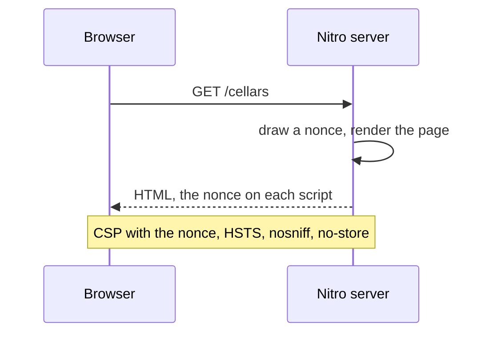

# Security Starter

A frontend [tech starter](https://github.com/mboisnard/drinkit/blob/master/docs/content/en/1.engineering/2.architecture/6.tech-starters.md)
that secures every page of a DrinkIt Nuxt app, as the backend `security-starter` secures every endpoint: the security
headers of [`nuxt-security`](https://nuxt-security.vercel.app/), a Content Security Policy with a new nonce on each
response, and no cache. It is a Nuxt layer, published in the pnpm workspace as `@drinkit/security-starter`. The
sign-in and the session join it with #677.



## Usage

```json
{
  "dependencies": {
    "@drinkit/security-starter": "workspace:*"
  }
}
```

```ts
// nuxt.config.ts
import { defineNuxtConfig } from 'nuxt/config';

export default defineNuxtConfig({
  extends: ['@drinkit/nuxt-starter', '@drinkit/security-starter'],
});
```

## What it sets

| Setting | Effect |
|---|---|
| `nuxt-security` | A Content Security Policy with `strict-dynamic` and a nonce per response, HSTS, `X-Content-Type-Options`, and the module's other default headers |
| Rate limiter, XSS validator and CORS handler off | The backend rate limits and checks its input, and the app answers its own origin only |
| `routeRules` | `Cache-Control: no-store` on every page: it may hold the data of a signed-in user, and its nonce changes on each response |

The hashed files of `/_nuxt/` keep a year of cache, from `nuxt-starter`: the most specific route rule wins.

## Checks

```
pnpm --filter @drinkit/security-starter lint
pnpm --filter @drinkit/security-starter typecheck
```

The starter is configuration only: `curl -sI` of a page on the built app proves its headers.
