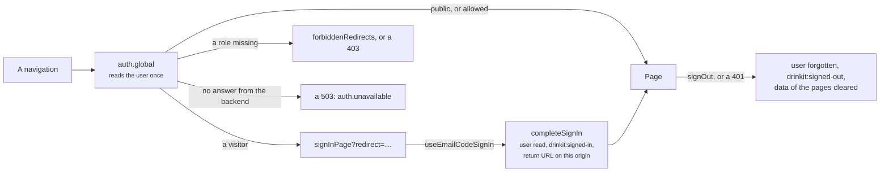

# Security Starter

A frontend [tech starter](https://github.com/mboisnard/drinkit/blob/master/docs/content/en/1.engineering/2.architecture/6.tech-starters.md)
that secures every page of a Nuxt app, as the backend `security-starter` secures every endpoint: the security
headers of [`nuxt-security`](https://nuxt-security.vercel.app/) with a nonce per response, no cache, and the
backend's session as the pages see it. The app holds no session of its own: the starter reads the current user from
the backend, speaks its sign-in protocol, and opens each page to whom it declares.
[ADR 025](https://github.com/mboisnard/drinkit/blob/master/docs/content/en/2.decisions/025-follow-the-backend-session-in-the-nuxt-app-and-declare-the-access-of-every-page.md)
records why. It is a Nuxt layer, published in the pnpm workspace as `@drinkit/security-starter`, on top of
`api-client-starter`.



## Usage

```json
{
  "dependencies": {
    "@drinkit/security-starter": "workspace:*"
  }
}
```

```ts
// nuxt.config.ts
export default defineNuxtConfig({
  extends: ['@drinkit/nuxt-starter', '@drinkit/security-starter', '@drinkit/api-client-starter'],
  apiClient: { /* …, */ csrfPath: '/api/auth/csrf' },
  auth: {
    currentUserPath: '/api/user/me',
    forbiddenRedirects: { ROLE_REGISTRATION_IN_PROGRESS: '/registration' },
  },
});
```

```ts
// app/auth.d.ts: the user the current user path answers, from the app's contract
import type { ConnectedUserInformation } from '#api';

declare module '@drinkit/security-starter/types' {
  interface AuthTypes {
    user: ConnectedUserInformation;
  }
}
```

```ts
// any page
definePageMeta({ auth: 'ROLE_USER' });

const { user, signedIn, hasRole, signOut } = useCurrentUser();
```

## What it gives

- **`useCurrentUser()`**, from `./use-current-user`: `user`, `null` for a visitor, `signedIn`, `hasRole(role)`,
  `refresh()` once the backend changed the user, and `signOut()`. The user is read once per app, on the server for the
  first page, whose payload hands it to the browser.
- **`useEmailCodeSignIn()`**, from `./use-email-code-sign-in`: `requestCode(email)`, then
  `signIn({ email, code, rememberMe })`, which throws the `ProblemError` of a refused code.
- **The access of a page**, `definePageMeta({ auth })`: `'public'`, `'signed-in'` or a role, typed by the app's
  roles. A page without it fails the type check, as the build lists it into `.nuxt/auth/pages-without-auth.ts`, and
  is treated as `'signed-in'` at run time. Write it as a literal: the build does not read a constant.
- **`safeRedirect(value)`**, from `./safe-redirect`: a return URL when it stays on the app's origin, `undefined`
  otherwise.
- **The hooks** `drinkit:signed-in` and `drinkit:signed-out` of `nuxt-starter`, called after a sign-in and a sign-out
  in the page. A session restored by the remember-me cookie, or opened by a redirect, calls neither: a listener also
  reads `useCurrentUser()` when it starts.
- **A 401 to a signed-in user**, an ended session, forgets them and sends them to sign in, back to the page after.
- **The headers**: a Content Security Policy with `strict-dynamic` and a nonce per response, `default-src` and
  `connect-src` on the app's origin, `frame-ancestors 'none'` with `X-Frame-Options: DENY`, HSTS for a year,
  `X-Content-Type-Options` and the module's other defaults, and `Cache-Control: no-store` on every page. The rate
  limiter, XSS validator, request size limiter and CORS handler of `nuxt-security` are off: the backend rate limits,
  checks its input and the size of a body, the relay streams the body without holding it, and the app answers its
  own origin only. Its removal of `console` calls is off too: Vite ignores it.

A new way of signing in, a passkey or Google, is a composable of its own that ends with the shared step of
`app/complete-sign-in.ts`: the state, the middleware and the pages stay as they are.

## How it is built

Each file holds one step of the session, so that a change to a step reads in one place.

| File | What it does | Why apart |
|---|---|---|
| `app/use-current-user.ts` | The public composable: the user, their roles, `refresh` and `signOut` | The only API the pages need |
| `app/current-user-state.ts` | The `useState` that holds the user, read once, and forgotten on sign-out or a 401 | Shared by the composable, the middleware and the plugin, without exposing `load` and `forget` to the pages |
| `app/auth-backend.ts` | Every call to the backend: the current user, the code, the sign-in, the sign-out | The protocol of the backend in one file, through `useApi()` |
| `app/use-email-code-sign-in.ts` | The sign-in by email code | One file per way of signing in |
| `app/complete-sign-in.ts` | What every sign-in ends with: the user read, the hook, the return URL | The step a passkey or Google reuses |
| `app/middleware/auth.global.ts` | Sends each navigation where `accessTo` says | Runs on every page, server and browser |
| `app/plugins/forget-on-unauthorized.ts` | A 401 to a signed-in user sends them to sign in | Listens to every call of the app, not only the starter's |
| `shared/access.ts` | Decides, from the page's `auth` and the user, whether to open, sign in, redirect or refuse | A plain function, tested without Nuxt |
| `shared/safe-redirect.ts` | Keeps a return URL only on the app's origin | A plain function, tested without Nuxt |
| `modules/auth.ts` | Reads the options, and lists the pages without `auth` into a file that fails the type check | Runs at build time |
| `app/types.ts`, `app/page-auth.d.ts` | The user and the roles of the app, and the `auth` of `definePageMeta` | Typed by each app's contract |
| `testing/` | The protocol in memory for the UI tests of an app, and the suite that holds it to the backend | Ships to the tests only |

The files that hold a rule of OWASP ASVS name it, and the
[security principles](https://github.com/mboisnard/drinkit/blob/master/docs/content/en/3.reference/2.security/1.principles.md)
map every defense of the app to its requirement.

## Configuration

| Key | Environment variable | Default | Effect |
|---|---|---|---|
| `auth.currentUserPath` | `NUXT_PUBLIC_AUTH_CURRENT_USER_PATH` | none, required once the app has a page | The path under the API that answers the current user, or 401 to a visitor |
| `auth.signInPage` | `NUXT_PUBLIC_AUTH_SIGN_IN_PAGE` | `/sign-in` | Where a visitor goes when a page asks to sign in |
| `auth.forbiddenRedirects` | none | `{}` | The page a signed-in user goes to, by a role they hold, when a page needs a role they lack, rather than a 403 |

The paths are written without the prefix of a locale: the starter adds the one of the page.

A backend that gives no answer to the read of the user within the `apiClient.serverRenderTimeout` of
`api-client-starter`, or a gateway in front of it that answers 502 or 504, shows the error page of a 503 whose problem
has the texts of `auth.unavailable.title` and `auth.unavailable.detail` of the
[catalog](../i18n-starter/README.md), in the language of the page. A refused page has the `auth.forbidden` text. A page
whose `auth` is not `public` has no language prefix, and shows in the language that `locale` of the current user
names, such as `fr`, when the app offers it. Each redirect stays in the current language: a visitor reading `/fr`
who opens `/cellars` signs in at `/fr/sign-in`. The sign-out clears the state of the pages but
keeps the locales of `@nuxtjs/i18n`.

The sign-in protocol is the backend `security-starter`'s, under the path of the API: `/api/auth/code`,
`/api/auth/code/sign-in` and `/api/auth/logout`.

## Testing

`@drinkit/security-starter/testing` gives the UI tests of an app the protocol in memory, for the fake backend of
`test-starter`:

```ts
const auth = authBackendDouble({ apiPath: '/drinkit', currentUserPath: '/api/user/me', newUser: () => newAccount });
fakeBackend.use(...auth.handlers);
auth.lastCodeOf('camille@drinkit.dev');         // the code the user reads in their mailbox
auth.signedInAs(user);                          // the cookies of an open session, for context.addCookies
auth.userOf(request);                           // the user of a request, for the app's own handlers
```

`authBackendContract` holds what the app relies on in that protocol. The tests of the starter run it on the double,
and it runs on the real backend with the code read in Mailpit, before a change of the protocol.

## Checks

```
pnpm --filter @drinkit/security-starter lint
pnpm --filter @drinkit/security-starter typecheck
pnpm --filter @drinkit/security-starter test
```

The headers are checked with `curl -sI` on a page of the built app, the pages and the sign-in by the UI tests of the
app.
