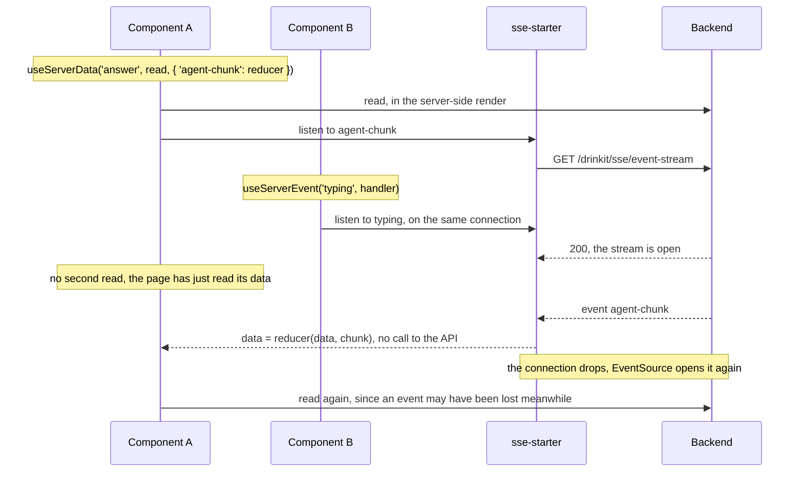
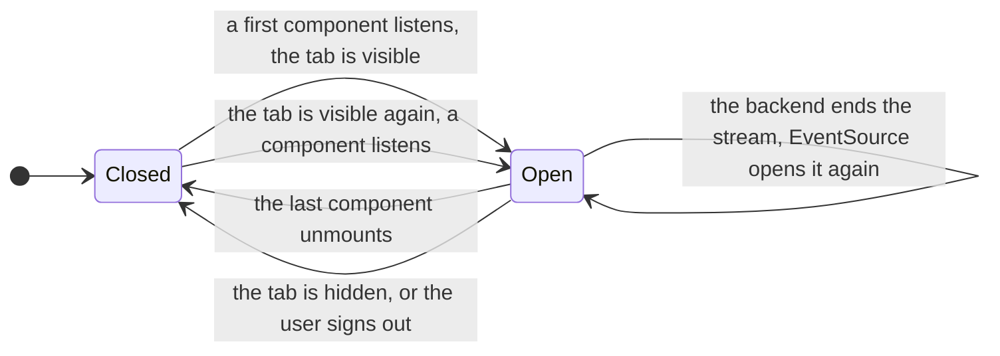

# SSE Starter

A frontend [tech starter](https://github.com/mboisnard/drinkit/blob/master/docs/content/en/1.engineering/2.architecture/6.tech-starters.md)
that keeps a page up to date as the backend pushes events to its user, such as the chunks of an answer an AI agent
writes, on the [server-sent events](https://developer.mozilla.org/en-US/docs/Web/API/Server-sent_events) stream of
the backend [`sse-starter`](../../backend/sse-starter/README.md). The backend replays no event a tab missed. A page
with data to show takes `useServerData`: it reads the data through the API client, applies each event to it with no
other call, and reads it again after a reconnection. A component that only reacts to an event takes
`useServerEvent`. The starter is a
[Nuxt layer](https://nuxt.com/docs/guide/going-further/layers) that extends
[`api-client-starter`](../api-client-starter/README.md), published in the pnpm workspace as `@drinkit/sse-starter`.
[ADR 015](https://github.com/mboisnard/drinkit/blob/master/docs/content/en/2.decisions/015-push-server-events-over-sse-to-a-user-or-a-session.md)
records the choices of the stream.

## How it works

Every component of a tab shares one connection, the browser's `EventSource`, since a browser holds only six
connections per origin over HTTP/1.1, all tabs together. It goes through the
[relay](../api-client-starter/README.md#how-it-works) of `api-client-starter`, on the app's origin, which forwards the
session cookie:



Each opening of the stream is a request that keeps the backend session alive. The connection is therefore open only
while a component listens and the tab is visible, so that the session of a tab nobody looks at expires. The sign-in
gives the backend session a new id, so the connection opens again on it:



The backend ends each stream after [3 minutes](../../backend/sse-starter/README.md#configuration), under the idle
timeout of the proxies. An event sent while the connection is closed is lost, so `useServerData` reads again at each
opening but the one its mount starts. A page mounted in a hidden tab, whose stream waits for the tab to be shown, reads
again at that first opening too.

## Usage

```json
{
  "dependencies": {
    "@drinkit/sse-starter": "workspace:*"
  }
}
```

```ts
// nuxt.config.ts
export default defineNuxtConfig({
  extends: ['@drinkit/sse-starter'],
});
```

| Export | What it gives |
|---|---|
| `/use-server-data` | `useServerData(key, read, reducers)`: the `AsyncData` of `useAsyncData(key, read)`, which each event named in `reducers` changes through its reducer, `(data, payload) => data`, and which a reconnection reads again |
| `/use-server-event` | `useServerEvent(name, handler)`: calls `handler` with the payload of each event of that name, until the component unmounts. `onStreamOpen(handler)`: calls `handler` at each opening after the one the mount starts. Only an event listener opens the connection |

A reducer or a handler declares the type of its payload, `(chunk: AnswerChunk) => ...`. An error it throws, or a
payload that is not JSON, goes to the error handler of the app, named `server event <name>`.

```vue
<script setup lang="ts">
import { findAnswer } from '#api';
import type { Answer, AnswerChunk } from '#api';
import { useApi } from '@drinkit/api-client-starter/use-api';
import { useServerData } from '@drinkit/sse-starter/use-server-data';
import { useServerEvent } from '@drinkit/sse-starter/use-server-event';

const { id } = defineProps<{ id: string }>();

const { data: answer } = await useServerData(`answer-${id}`, async () => findAnswer(useApi(), id), {
  'agent-chunk': (answer: Answer, chunk: AnswerChunk) => withChunk(answer, chunk),
});

// Another use of the same event, or a page with nothing to read: the stream alone
useServerEvent('agent-chunk', (chunk: AnswerChunk) => scrollTo(chunk));
</script>
```

## Configuration

None. The stream is `/sse/event-stream` under the `apiClient.path` of the app.

## Tests

`@drinkit/sse-starter/testing` gives `FakeEventSource`, the browser's `EventSource` with the server in the hands of
the test. Its contract, the tests of what the starter relies on in `EventSource`, runs on the fake and on the
`EventSource` of Node, behind `--experimental-eventsource`, so that the fake keeps behaving like the real one:

```ts
vi.stubGlobal('EventSource', FakeEventSource);
FakeEventSource.instances[0]?.accept();             // the backend answers 200, the stream opens
FakeEventSource.instances[0]?.emit('cellar-updated', { id: 'c1' });
FakeEventSource.active();                           // the connections not closed
```

## Limits

- An event sent between the read of a page and the opening its mount starts, a fraction of a second at the load of
  the page, is lost: reading again at that opening would call the API twice at each load. An event that comes before
  the first read of a page lands is left to that read.
- `useServerData` reads again at each reconnection, every 3 minutes while its tab is visible, since the backend sends
  no event id that would tell whether the tab missed one:
  [#719](https://github.com/mboisnard/drinkit/issues/719).
- A stream the backend refuses stays closed until the tab is visible again or the user signs in: `EventSource` tells
  no status, so the 204 that ends the stream of a visitor without a session looks like the 5xx of a deploy.
- The API contract does not describe the payloads: the type a reducer or a handler declares is checked by nothing.
- Chunks of an answer, such as those of an AI agent, may arrive out of order across the instances of the backend:
  each chunk carries its position, and its reducer places it there.
