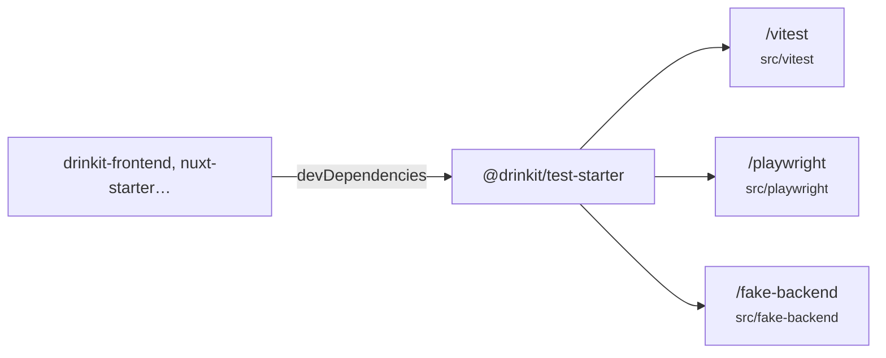

# Test Starter

A frontend [tech starter](https://github.com/mboisnard/drinkit/blob/master/docs/content/en/1.engineering/2.architecture/6.tech-starters.md)
that gives a Nuxt app or a frontend starter the same test setup: Vitest projects, Playwright checks and a fake
backend. Unlike the other frontend starters it is no Nuxt layer and holds no runtime code: a package lists it in its
`devDependencies` only. The
[frontend tests](https://github.com/mboisnard/drinkit/blob/master/docs/content/en/1.engineering/5.writing-code/2.testing/5.frontend-tests.md)
page says what each level proves and why a test replaces a boundary, never a module.

## How it works



Each folder of `src` is one export, and its `index.ts` lists what the export gives. The starter's own tests sit in
`test`, where each one takes the path of the file it tests.

## Usage

Each export needs the libraries it runs, which the package declares from the catalog: the starter lists them as
peer dependencies, so that one copy of each runs.

| Export | What it gives | The package also declares |
|---|---|---|
| `/vitest` | `defineVitestProjects()`: `test/unit/**/*.test.ts` in Node, `test/nuxt/**/*.test.ts` in the Nuxt environment on happy-dom, Testing Library cleaned after each test. Its `nuxtOverrides` give the Nuxt tests the settings an app would give a starter, its `unitNodeFlags` the Node tests a flag such as `--experimental-eventsource` | `vitest`, `@nuxt/test-utils`, `happy-dom`, `@vue/test-utils`, `@testing-library/vue` |
| `/playwright` | `defineUiTestConfig()`, `test` with its `fakeBackend` fixture, `expect`, `expectAccessible()`, `expectGoodWebVitals()`, `expectSameServerRender()` | `@playwright/test`, `@nuxt/test-utils`, `@axe-core/playwright`, `web-vitals`, `msw` |
| `/fake-backend` | `startFakeBackend(...handlers)`, outside Playwright | `msw` |

```ts
// vitest.config.ts
import { defineVitestProjects } from '@drinkit/test-starter/vitest';

export default defineVitestProjects();
```

```ts
// playwright.config.ts
import { defineUiTestConfig } from '@drinkit/test-starter/playwright';

export default defineUiTestConfig();
```

```ts
// test/ui/home.test.ts
import { expect, expectAccessible, test } from '@drinkit/test-starter/playwright';
import { http, HttpResponse } from 'msw';

test('the home page greets the signed-in user', async ({ page, goto, fakeBackend }) => {
  fakeBackend.use(http.get('/drinkit/api/user/me', () => HttpResponse.json({ firstname: 'Camille', roles: [] })));

  await goto('/', { waitUntil: 'hydration' });

  await expect(page.getByText('Welcome back, Camille')).toBeVisible();
  await expectAccessible(page);
});
```

## What it checks

- **`test`** extends the Playwright fixtures of `@nuxt/test-utils`, so `goto('/', { waitUntil: 'hydration' })` waits
  for Vue to take over the page. Each test fails when the page logs an error to the console or throws one it never
  catches, such as a hydration mismatch. `test.use({ ignoredConsoleErrors: [/pattern/] })` ignores a message the
  page cannot avoid.
- **`expectAccessible(page)`** runs axe for WCAG 2.2 AA, and fails a page without a level one heading.
- **`expectGoodWebVitals(page)`** measures the page with Google's `web-vitals`, and fails past an LCP of 2.5 s or a
  CLS of 0.1, the thresholds Google rates good. It measures what happened so far: call it once the content shows.
- **`expectSameServerRender(request, url)`** renders the page twice on the server, the nonces aside: a difference
  means the second request saw state the first one left behind.
- **`fakeBackend`**, a fixture of `test`, is the backend of the app under test: a fake started before the app,
  whose URL reaches the server as `NUXT_API_CLIENT_BACKEND_URL`, the setting of
  [`api-client-starter`](../api-client-starter/README.md). `fakeBackend.use(...handlers)` adds MSW handlers for one
  test, and they go once it ends.
- **`startFakeBackend(...handlers)`** serves MSW handlers on a real port, so the server render reaches them, which a
  mock in the browser never does. A request no handler knows gets a `501` that names it, every `Set-Cookie` of a
  handler reaches the caller, and a handler's `HttpResponse.error()` drops the connection without an answer.

The UI tests build the app, serve it as in production and open it in a headless Chromium, over HTTP even when the
shell sets a certificate for Nitro.

## Configuration

No setting.

## Tests

The Playwright checks are tested on pages of their own in a headless Chromium, the fake backend on Node.

## Limits

- No fake of a Nuxt composable: `useRoute`, `useCookie` or `useAsyncData` run for real in the Nuxt environment, and
  the fake of a starter's SDK lives in that starter.
- The Web Vitals come from a desktop Chromium on the machine, neither throttled nor on a phone: they catch a page that
  shifts or shows late, not a slow network. The speed real users get belongs to observability.
