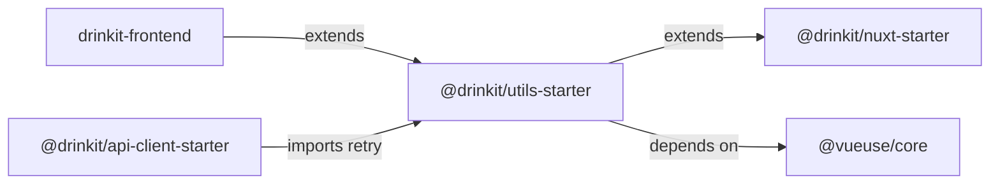

# Utils Starter

A frontend [tech starter](https://github.com/mboisnard/drinkit/blob/master/docs/content/en/1.engineering/2.architecture/6.tech-starters.md)
that answers the common needs of a Nuxt app without writing a helper: it gives the app
[VueUse](https://vueuse.org/), lists where each need is already answered, and adds the two helpers that VueUse,
Nuxt and the browser lack, `retry` and `useTextOverflow`. It is a
[Nuxt layer](https://nuxt.com/docs/guide/going-further/layers) that extends
[`nuxt-starter`](../nuxt-starter/README.md), published in the pnpm workspace as `@drinkit/utils-starter`.
[ADR 027](https://github.com/mboisnard/drinkit/blob/master/docs/content/en/2.decisions/027-take-browser-composables-from-vueuse-and-write-only-what-it-lacks.md)
records why.

## How it works



Before writing a helper, look for the need in the catalog below. A need it does not list goes to VueUse's
[function list](https://vueuse.org/functions.html) first, then to the browser's
[Baseline](https://web.dev/baseline) features, which the lint's browser check, `eslint-plugin-compat`, accepts. A
helper lands here only when none of them answers, and never wraps a function that does, which would hide its
documentation behind ours.

## Usage

```json
{
  "dependencies": {
    "@drinkit/utils-starter": "workspace:*"
  }
}
```

```ts
// nuxt.config.ts
export default defineNuxtConfig({
  extends: ['@drinkit/utils-starter'],
});
```

Auto-imports are off: a page imports VueUse from `@vueuse/core`, which comes with the starter, and a helper from
its export.

| Export | What it gives |
|---|---|
| `/retry` | `retry(run, { retries, delayMs, retryIf })`: runs `run` again after a wait, at most `retries` times, then throws its last error. `retryIf` picks the errors worth another run. `delayMs` may be a function, read before each wait, such as a `Retry-After` |
| `/use-text-overflow` | `useTextOverflow(element)`: whether the text of an element no longer fits it, cut by an ellipsis or a line clamp, measured again when the element resizes or its text changes |

```vue
<template>
  <p ref="name" class="truncate" :title="overflows ? wine.name : undefined">{{ wine.name }}</p>
</template>

<script setup lang="ts">
import { useTemplateRef } from 'vue';
import { useTextOverflow } from '@drinkit/utils-starter/use-text-overflow';

const { wine } = defineProps<{ wine: { name: string } }>();
const overflows = useTextOverflow(useTemplateRef('name'));
</script>
```

## Catalog

| Need | Answer |
|---|---|
| Breakpoints, the server render included | [`useBreakpoints(breakpointsTailwind, { ssrWidth })`](https://vueuse.org/core/useBreakpoints/) |
| An element entering the screen, to load it late | [`useElementVisibility`](https://vueuse.org/core/useElementVisibility/), [`useIntersectionObserver`](https://vueuse.org/core/useIntersectionObserver/) |
| A list that loads more on scroll | [`useInfiniteScroll`](https://vueuse.org/core/useInfiniteScroll/) |
| A click outside a menu or a popover | [`onClickOutside`](https://vueuse.org/core/onClickOutside/) |
| Copy to the clipboard | [`useClipboard`](https://vueuse.org/core/useClipboard/) |
| The hover, size or scroll of an element | [`useElementHover`](https://vueuse.org/core/useElementHover/), [`useElementSize`](https://vueuse.org/core/useElementSize/), [`useScroll`](https://vueuse.org/core/useScroll/) |
| Debounce or throttle | [`useDebounceFn`](https://vueuse.org/shared/useDebounceFn/), [`refDebounced`](https://vueuse.org/shared/refDebounced/), [`useThrottleFn`](https://vueuse.org/shared/useThrottleFn/) |
| Poll, wait | [`useTimeoutPoll`](https://vueuse.org/core/useTimeoutPoll/), [`useIntervalFn`](https://vueuse.org/shared/useIntervalFn/), [`promiseTimeout`](https://vueuse.org/shared/promiseTimeout/) |
| Browser storage | [`useLocalStorage`](https://vueuse.org/core/useLocalStorage/), [`useSessionStorage`](https://vueuse.org/core/useSessionStorage/) |
| A listener removed with its component | [`useEventListener`](https://vueuse.org/core/useEventListener/) |
| An event between components | [`useEventBus`](https://vueuse.org/core/useEventBus/) |
| Code that runs once mounted or hydrated | [`useMounted`](https://vueuse.org/core/useMounted/), [`onNuxtReady`](https://nuxt.com/docs/4.x/api/utils/on-nuxt-ready) |
| A CSS variable | [`useCssVar`](https://vueuse.org/core/useCssVar/) |
| State shared by the server render and the browser, and its reset | [`useState`](https://nuxt.com/docs/4.x/api/composables/use-state), [`clearNuxtState`](https://nuxt.com/docs/4.x/api/utils/clear-nuxt-state) |
| Code that runs once across the server render and the browser | [`callOnce`](https://nuxt.com/docs/4.x/api/utils/call-once) |
| An id that matches between the server render and the browser | [`useId`](https://vuejs.org/api/composition-api-helpers.html#useid) |
| A typed ref to an element of the template | [`useTemplateRef`](https://vuejs.org/api/composition-api-helpers.html#usetemplateref) |
| A promise resolved from outside | [`Promise.withResolvers`](https://developer.mozilla.org/en-US/docs/Web/JavaScript/Reference/Global_Objects/Promise/withResolvers) |
| Every case of a union handled | [`switch-exhaustiveness-check`](https://typescript-eslint.io/rules/switch-exhaustiveness-check/), already on in the lint |
| Group, copy, sort without mutating | [`Object.groupBy`](https://developer.mozilla.org/en-US/docs/Web/JavaScript/Reference/Global_Objects/Object/groupBy), [`structuredClone`](https://developer.mozilla.org/en-US/docs/Web/API/Window/structuredClone), [`toSorted`](https://developer.mozilla.org/en-US/docs/Web/JavaScript/Reference/Global_Objects/Array/toSorted) |
| A call that gives up after a time, or on either of two signals | [`AbortSignal.timeout`](https://developer.mozilla.org/en-US/docs/Web/API/AbortSignal/timeout_static), [`AbortSignal.any`](https://developer.mozilla.org/en-US/docs/Web/API/AbortSignal/any_static) |
| A search that cancels the call it replaces | [`useAsyncData`](https://nuxt.com/docs/4.x/api/composables/use-async-data) with `watch`, as [`api-client-starter`](../api-client-starter/README.md#a-search-that-cancels-the-call-it-replaces) shows |
| A form sent once, its refusal shown | [`useSubmission`](../api-client-starter/README.md#a-form-sent-once) of `api-client-starter` |
| A redirect kept on the site | [`safeRedirect`](../security-starter/README.md) of `security-starter` |
| A date, a number, an amount | [`i18n-starter`](../i18n-starter/README.md): the lint refuses `Intl.*Format` called directly |
| A component with an async setup, in a test | [`mountSuspended`](https://nuxt.com/docs/4.x/getting-started/testing#mountsuspended) |

## Configuration

None.

## Tests

`retry` runs in Node, on fake timers. `useTextOverflow` runs in the
[Nuxt environment](https://github.com/mboisnard/drinkit/blob/master/docs/content/en/1.engineering/5.writing-code/2.testing/5.frontend-tests.md)
on happy-dom, which lays nothing out: the test gives the element its widths and replaces the browser's `ResizeObserver`.

## Limits

- `useTextOverflow` compares the size of the text with the size of its element: it says nothing of a text cut by an
  ancestor with `overflow: hidden`.
- A function VueUse or Nuxt renames leaves a dead link in the catalog, found only when a reader follows it.
